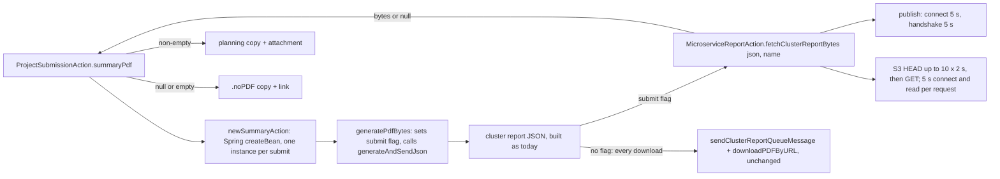

# Submit and unsubmit email defects — Design

**Spec ID:** BUG-SUBMIT-EMAIL-001
**Status:** Approved 2026-11-12. Judgment round 1: APPROVED (`judgment.md`). Adjust round 1 applied 2026-11-12 (owner: "sí, los tres, aplica los ajustes")
**Owner:** Kenji Tanaka (IBD)
**Last Updated:** 2026-11-12
**Requirements:** `requirements.md` (approved 2026-11-12)
**Base:** branch `email-layout-default` at `f9dba6a035`. Citations verified at `cc15631fe4`; the merge in between touched none of the cited files. Work stays on this branch (R1)
**Depth:** Lite (Bug Mode)

> **Answer first.** For a planning submit, `ProjectSubmissionAction` builds its **own** `ReportingSummaryAction`
> through Spring's `createBean`, the same way Struts builds every action. On that instance it calls
> `generatePdfBytes()`. That method runs today's `generateAndSendJson()` with a submit flag, so its last line hands the
> JSON to a new `MicroserviceReportAction.fetchClusterReportBytes(...)` instead of `sendClusterReportQueueMessage(...)`.
> The new method publishes with short timeouts and polls S3 into a byte array. It never touches the HTTP response.
> The download actions change by one guarded line that they never enter. The four small defects are fixed in
> `UnsubmitProjectAction` and `ProjectSubmissionAction`. No schema, no new action, no new dependency.

## 1. Architecture

## 2. Module Footprint

| File | Change | Req |
|---|---|---|
| `action/report/MicroserviceReportAction.java` | **New method only:** `fetchClusterReportBytes(String json, String reportName)`. It reads queue URL, queue name, API key and S3 URL from `APConfig` into locals and does not call `loadData()`. It returns `null` at once when `json`, `reportName`, the queue URL or the S3 URL is null or blank. It publishes with connection and handshake timeouts of 5 s. It polls `s3URL + reportName` with HEAD up to `SUBMIT_POLL_ATTEMPTS` (10) × `SUBMIT_POLL_WAIT_MS` (2 000), then GETs into a `byte[]`. Each HTTP request has a 5 s connect timeout and a 5 s read timeout. It returns `null` on a non-200, an exception or 0 bytes. On `InterruptedException` it restores the interrupt flag and returns `null`. It never calls `ServletActionContext`. Package-private seams cover publish, HEAD, GET and the wait. `sendClusterReportQueueMessage`, `downloadPDFByURL` and `loadData` are **not changed** | FN-001, FN-002, FN-003, NF-001, NF-002 |
| `action/summaries/ReportingSummaryAction.java` | New private boolean `pdfForSubmit` and private `byte[] submitPdf`, both default off and null. New public `byte[] generatePdfBytes()`: sets the flag, calls `generateAndSendJson()`, returns `submitPdf`. In `generateAndSendJson()` **one line** changes: the call at `:7869` becomes "flag on → `submitPdf = microserviceReportAction.fetchClusterReportBytes(jsonOutput, reportName)`, otherwise today's call". `execute()`, the JSON build and every other line stay as they are | FN-001, FN-003, NF-002 |
| `action/projects/ProjectSubmissionAction.java` | The constructor takes Spring's `ApplicationContext` in place of `ReportingSummaryAction`. New protected `ReportingSummaryAction newSummaryAction()` returns `applicationContext.getAutowireCapableBeanFactory().createBean(ReportingSummaryAction.class)`. The PDF block (`:362-391`) becomes a protected `byte[] summaryPdf()`: the same setters on a fresh instance, then `generatePdfBytes()`; any exception is logged and returns `null`. `pdfAttached` = bytes non-null and non-empty, and the send attaches those bytes. Title fallback at `:347`. WARN with the unit id | FN-001, FN-002, FN-006, FN-007 |
| `action/json/project/UnsubmitProjectAction.java` | One `leader = project.getLeaderPerson(phase)`. TO = the leader's email when a leader exists. `values[0]` = the leader's first name, or the unit's `email.greeting.everyone` when there is no leader or the name is blank. The two `getId() !=` conditions are removed. CC omits every address equal to the TO (trimmed, case-insensitive); the delivered recipients for a different actor and leader are unchanged, since `SendMailS.send` already strips `", " + TO` (P-8). *(Amended at execute 2026-11-12, T04 brief: "omits the actor's address" left the leader's own CC entry in place when actor = leader.)* Title fallback at `:284`. WARN with the unit id | FN-004, FN-005, FN-006, FN-007 |
| `global.properties` | New `email.greeting.everyone=all`. Custom files inherit it | FN-005, NF-003 |
| Tests | `ProjectSubmissionEmailTest` (send path; `DrivenSubmission` passes `null` for the context and overrides `newSummaryAction()` to return the existing `FakeSummary`, which now overrides `generatePdfBytes()`, so the setters stay exercised). `UnsubmitProjectEmailTest`. New `MicroserviceReportFetchTest` (fake publish, HEAD, GET and wait; recording response installed in `ServletActionContext`). New `ReportingSummarySubmitFlagTest` (the flag routes the last call; without it the download call runs) | all |

## 3–9. Data, API, frontend, persistence, validation, permissions, specificity

Not applicable. No schema, route, interceptor stack, screen, save path or `parameters` change.
`{crp}/submit` keeps its results.

## 10. Integration

- **RabbitMQ:** same queue and the same message shape, since the JSON comes from the unchanged builder.
- **S3:** the same URL pattern, `s3URL + reportName`.
- **Budget constants** in `MicroserviceReportAction`: connect and handshake 5 000 ms; polling 10 × 2 000 ms; HTTP
  connect and read 5 000 ms each.
- **Worst case:** about 5 s + 5 s + (10 × (2 s + 5 s HEAD)) + 10 s GET ≈ 90 s if every request hangs to its timeout.
  The typical slow case is about 25 s (polling sleeps plus fast HEADs). Both are bounded, unlike today's unbounded
  HEAD and GET. The constants start at 10 × 2 000 ms and are re-set from the post-deploy log in T05 (P-9).

## 11. Observability

- `fetchClusterReportBytes` logs one INFO with the report name, the outcome (bytes and their length, timeout,
  error) and the elapsed milliseconds. This is the production measurement source after release.
- The fallback WARNs name the unit id, as a null-safe argument.

## 12. Security

No new input. The report URL comes from config and the generated name, as today.

## 13. Rollback

Revert the commits. No data to undo.

## 14. Design Decisions

| ID | Decision | Rationale / rejected | Req |
|---|---|---|---|
| DD-1 | Each planning submit uses its **own** `ReportingSummaryAction` from `createBean`. It no longer uses the injected singleton | The injected bean is a Spring singleton (P-3). Once the PDF carries data, its setters (`:366-379`) let concurrent submits swap `project` or `phase` and attach another project's report (judgment S-1). Struts already builds every action this way (P-10), and today's singleton was built by the same Spring path. Rejected: a lock on the singleton (it serializes submits and relies on no other caller), and a mode flag on the shared bean | FN-001, FN-003 |
| DD-2 | The download path is untouched apart from one guarded line in `generateAndSendJson()`, which a download never enters (its instance never sets the flag). The fetch has its own publish and download code instead of extracting the existing block | NF-002. Duplicating about 25 lines is chosen over refactoring code that works today (judgment W-2). Rejected: extracting the publish block or the JSON builder | NF-002 |
| DD-3 | The fetch never calls `ServletActionContext`, uses locals copied from `APConfig`, and does not call `loadData()` | FN-003; judgment W-2. The singleton `MicroserviceReportAction` is shared with the innovation and study downloads, so the new method writes none of its fields | FN-003 |
| DD-4 | Short, fixed submit budget with timeouts on every network step, then the `.noPDF` copy. On interruption the flag is restored and the result is null. A null or blank JSON, report name or config value returns null without waiting | Owner Q5; judgment W-1, W-3, I-1. Sending in the background after the PDF is ready was rejected as out of Lite scope | NF-001, FN-002 |
| DD-5 | `pdfAttached` means non-null **and** non-empty bytes | 0 bytes is the defect's own signature (D1) | FN-002 |
| DD-6 | Unsubmit drops the leader/actor exclusion, so TO and the greeting always use the leader. CC drops every address equal to the TO | Owner Q1. The `Long !=` is removed rather than corrected, because a corrected comparison would restore the "Dear ," / empty-TO branch the owner rejected. **Correction (judgment W-4):** `SendMailS.send` does **not** strip the TO from CC when the actor is the leader. CC `"a, a"` becomes `"a"` (`SendMailS.java:360-372`). The action now leaves the TO address out of CC itself. **Reversion challenge** ("what does removing this break?"): for ids above 127 TO and greeting do not change, and the duplicate CC disappears. For ids 127 and below, the leader who unsubmits their own project now gets TO and a named greeting instead of "Dear ," and no TO, which is the decided behavior. Other CC entries are unchanged | FN-004 |
| DD-7 | The no-leader greeting comes from a new base key, `email.greeting.everyone=all`, read through the unit's `TextProvider` | FN-005. "Dear all," matches the submit copy, and a key keeps it translatable. No `email.greeting*` key exists in any file (P-11) | FN-005 |
| DD-8 | The title fallback is the unit's existing `global.untitled` ("Untitled", P-7) when the project info or its title is null or blank | FN-006. Also covers a null `projectInfo`, which would otherwise throw an NPE | FN-006 |
| DD-9 | Seams: `newSummaryAction()` and `summaryPdf()` are protected (tests subclass the action, as the existing send-path tests do). The submit tests override `newSummaryAction()` only, so the setters and `summaryPdf()` run for real. The fetch's network calls and wait are package-private seams with production defaults | KZ-…auth-flow-2: tests assert the exact bytes, attempts, timeouts and arguments the doubles receive; judgment I-3 | all |

**Reversion challenge for D1b** ("what does removing the response write from submit break?"): users who see the PDF
in the tab after a planning submit today (Q2, UNVERIFIED) no longer see it there. They get it in the email, and
from Summaries at any time. The owner chose this on 2026-11-12 (option 1).

**Known limit (judgment I-2):** the report name has minute granularity. A resubmit of the same project within the
same minute can receive the previous object. That object has the same project and phase, built seconds earlier.
Accepted.

## 15. Budget (tripwire for `/akili-execute`)

| Expected tasks | Expected LOC (prod + test + docs) | Expected review rounds |
|---|---|---|
| 5 | ~480 (Java ~170, properties 1, tests ~290, docs ~20) | 7 (one per task, plus 2 margin) |

The test estimate is set high on purpose: the previous spec's first guess ran 2.4× over on tests (pending lesson P4 of
`kaizen/changes--email-layout-default.md`). Lite holds: five small fixes around one new method and one guarded line.

## 16. Premise Ledger

Count: 11 rows. 9 verified, 2 `UNVERIFIED` (P-9 Low, P-10 High).
Blast-radius triggers fired:
- `live-path` — submit and unsubmit user actions (P-1, P-2).
- `shared-state` — singleton actions (P-3, P-10).
- `consumer` — injections of the two actions, and tests (P-4).

| # | Claim | Class | Citation (as run) | Verified at | If false | Settled by |
|---|---|---|---|---|---|---|
| P-1 | The planning submit reaches the PDF step through `ProjectSubmissionAction.execute()` → `submitProject()` → `sendNotficationEmail()` → `reportingSummaryAction.execute()` → the microservice branch (`generatePentahoReport = false`) → `generateAndSendJson()` → `sendClusterReportQueueMessage(json, name)` → `downloadPDFByURL` → `ServletActionContext.getResponse()` | live-path | `struts-projects.xml:1140`; `ProjectSubmissionAction.java:106-114, 225, 362, 380-383`; `ReportingSummaryAction.java:1210-1213, 1391-1394, 7869`; `MicroserviceReportAction.java:454, 471-474, 89-91`. Both judges confirmed | cc15631fe4 | DD-1/DD-3 aim at the wrong code (High) | — |
| P-2 | Unsubmit builds TO and `{0}` from `getLeaderPerson(getActualPhase())`, guarded by `getUser().getId() != getCurrentUser().getId()`, which compares `Long` references | live-path | `struts-json.xml:678`; `UnsubmitProjectAction.java:155, 166, 278`; live `email_logs` 18411 (archived T08). Both judges confirmed | cc15631fe4 | DD-6 misses the cause (High) | — |
| P-3 | The `ReportingSummaryAction` that `ProjectSubmissionAction` receives is the Spring singleton, shared by every submit. Downloads get their own instance (P-10). The singleton `MicroserviceReportAction` is shared by the cluster, innovation and study downloads | shared-state | `@Named`, no `@Scope` (`ReportingSummaryAction.java:135`, `MicroserviceReportAction.java:50`); `marlo-web/src/main/java/org/cgiar/ccafs/marlo/ApplicationContextConfig.java:45-48` scans `org.cgiar.ccafs.marlo.action`; `grep -rn '@Scope\|scopeResolver\|SCOPE_PROTOTYPE' marlo-web/src/main` → 0 hits; `ProjectSubmissionAction.java:88-91` `@Inject` constructor; `grep -rn 'MicroserviceReportAction microserviceReportAction' marlo-web/src/main/java` → ReportingSummaryAction, ProjectInnovationSummaryAction, StudySummaryAction, StudiesSummaryAction, BaseStudySummaryData. The only other holder of the singleton, `utils/SendEmails`, is a standalone `main` with its own context (`SendEmails.java:74-86`) | f9dba6a035 | DD-1 is unnecessary (Low); or the fetch writes shared fields (High, prevented by DD-3) | — |
| P-4 | Consumers of the changed code. `sendClusterReportQueueMessage(json, name)` is called only by `ReportingSummaryAction:7869`; the no-arg form is not a Struts route (`struts-report.xml` maps only `sendOICRsQueueMessage` and `fetchPDF`). `ReportingSummaryAction.generateAndSendJson()` is called only by its own `execute()` `:1393`. The `ReportingSummaryAction` type is injected or looked up only by `ProjectSubmissionAction` and `SendEmails`. Test consumer: `ProjectSubmissionEmailTest:150-215` (`FakeSummary` overrides `execute()` / `getBytesPDF()`; `DrivenSubmission` passes it to the constructor). No test references `sendClusterReportQueueMessage` or `downloadPDFByURL` | consumer | `grep -rn 'sendClusterReportQueueMessage\|downloadPDFByURL\|generateAndSendJson\|getBytesPDF()' marlo-web/src`; `grep -rn 'ReportingSummaryAction\b' marlo-web/src/main/java`; `grep -n 'action name' marlo-web/src/main/resources/struts-report.xml` | f9dba6a035 | A caller or the test double changes unnoticed (Low) | — |
| P-5 | The JSON build reads no field set by `execute()`'s preamble (`hasGender`, `hasW1W2Co`, `targetUnitList`, `startTime`), so `generatePdfBytes()` can skip `execute()` | other | Read sites: `hasGender` 1168-1172 and 5865-5898; `hasW1W2Co` ≤5898; `targetUnitList` 1185-1196, 5874, 7471; `startTime` 1200, 1387. None inside `:7742-7875` or the `build*` helpers from `:7878`. Both judges confirmed | cc15631fe4 | `generatePdfBytes()` must run the preamble (Low) | — |
| P-6 | On the microservice branch `bytesPDF` is always empty, because nothing writes to `os` | existence | `ReportingSummaryAction.java:1208, 1391-1394`; `generateAndSendJson()` `:7742-7875` has no `os` reference. Both judges confirmed | cc15631fe4 | D1's cause is wrong (High) | — |
| P-7 | `global.untitled` = "Untitled" in base and in alliance, aicrra, aiccra3, pabra and test; other units inherit the base | data-env | `grep -H '^global.untitled=' global.properties custom/*.properties`. Both judges confirmed | cc15631fe4 | DD-8 shows another word (Low) | — |
| P-8 | `SendMailS.send` removes `", " + TO` from CC and dedupes, but keeps a CC equal to the TO when that CC is the first entry | location | `SendMailS.java:358-372`; CC is built as `actor` then `, leader` (`UnsubmitProjectAction.java:171-181`). Corrected after judgment W-4 | f9dba6a035 | DD-6's CC handling is unnecessary (Low) | — |
| P-9 | The microservice produces a cluster report within about 20 s | data-env | UNVERIFIED — confirm at source before relying on it | — | Too many `.noPDF` fallbacks: re-set the constants (Low) | T05 post-deploy: the `fetchClusterReportBytes` INFO lines (elapsed ms) of the first aiccratest planning submits; owner at that check (T01 deferred 2026-11-12, owner had no aiccratest access) |
| P-10 | Struts builds each action with Spring's `createBean` (the action's class name is not a bean name), so `createBean(ReportingSummaryAction.class)` yields a working instance equivalent to today's singleton. `ApplicationContext` can be injected into an action constructor | shared-state | `struts.xml:9-12` (`StrutsSpringObjectFactory`, autowire by name); `javap -c` of `com/opensymphony/xwork2/spring/SpringObjectFactory` in `struts2-spring-plugin-6.8.0.jar`: `buildBean(String…)` calls `containsBean(name)`, then `buildBean(Class…)` → `AutowireCapableBeanFactory.createBean(Class, int, boolean)`. ApplicationContext injection into a constructor: **UNVERIFIED — confirm at source before relying on it** (no precedent in `marlo-web/src/main`; `ShiroSpringStartupListener` uses `ApplicationContextAware`) | f9dba6a035 (Struts path) | DD-1 needs another factory (High) | T3 first step: clean compile with the `ApplicationContext` constructor parameter. T5: boot the app locally and run one planning submit. The microservice is unreachable locally, so the email uses `.noPDF`, and the log line of `fetchClusterReportBytes` proves the fresh instance ran end to end |
| P-11 | No `email.greeting*` key exists in any properties file | existence | `grep -rn 'email.greeting' marlo-web/src/main/resources/*.properties marlo-web/src/main/resources/custom/*.properties` → 0 hits | f9dba6a035 | DD-7 collides with an existing key (Low) | — |
