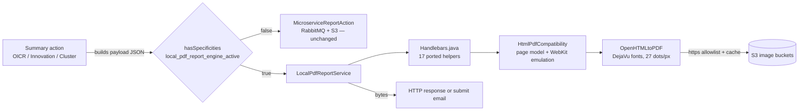

# Local PDF Report Engine — Design

**Spec ID:** CHG-LOCAL-PDF-REPORT-ENGINE-001
**Status:** Approved — Phase 2 gate `auto-approved (pre-approved mode)` 2026-11-20, after judgment-day round 1 fixes and re-judgment (see `judgment.md`)
**Last Updated:** 2026-11-23 (Pivot 2: §18 replaces the OpenHTMLtoPDF engine with PhantomJS)
**Depth:** Full · **Requirements:** `requirements.md` · **Evidence:** `spike.md`

---

## 1. Executive Summary

A stateless Spring bean, `LocalPdfReportService`, takes the **same JSON payload** the summary actions already
build for the microservice and returns PDF bytes: Handlebars.java fills the template, an html-pdf compatibility
step reshapes the HTML, and OpenHTMLtoPDF renders it on a small bounded thread pool. Each of the four call sites
checks the specificity `local_pdf_report_engine_active` and calls either the local service or the existing
microservice method. Nothing else changes: templates, data maps, Struts mappings and the microservice code stay as
they are, so switching the flag off is a complete rollback.

## 2. Architecture Overview



| Requirement | Where it is met |
|---|---|
| FN-001, FN-002 | §7.1 payload contract |
| FN-003 | §7.2 helpers |
| FN-004, NF-001, NF-002 | §7.3 compatibility step, §7.4 renderer settings |
| FN-005 – FN-007 | §7.6 call sites |
| NF-003 – NF-005 | §7.5 execution model |
| NF-006 | §4 dependencies |
| DA-001 | §5 specificity |
| DA-002 | §7.3 — compatibility lives in code and a classpath stylesheet, never in the database |
| SEC-001, SEC-002 | §11 |
| OPS-001 | §10 |

## 3. Extended Directory Structure

| Path | Change |
|---|---|
| `marlo-parent/pom.xml` | Properties `handlebars.version` 4.5.8, `openhtmltopdf.version` 1.1.108; `dependencyManagement` entries with the exclusions of §4 |
| `marlo-web/pom.xml` | Dependencies `com.github.jknack:handlebars`, `io.github.openhtmltopdf:openhtmltopdf-pdfbox` (versions from the parent); `org.jsoup:jsoup` is already a dependency (1.15.4, managed in `marlo-parent/pom.xml:66`) and is reused |
| `marlo-web/src/main/java/org/cgiar/ccafs/marlo/utils/pdf/LocalPdfReportService.java` | **New** — public API, payload parsing, execution model, logging |
| `marlo-web/src/main/java/org/cgiar/ccafs/marlo/utils/pdf/HandlebarsReportHelpers.java` | **New** — the 17 helpers |
| `marlo-web/src/main/java/org/cgiar/ccafs/marlo/utils/pdf/HtmlPdfCompatibility.java` | **New** — HTML preprocessing (§7.3) |
| `marlo-web/src/main/java/org/cgiar/ccafs/marlo/utils/pdf/PdfResourceLoader.java` | **New** — URI allowlist, timeouts, in-memory cache (§11) |
| `marlo-web/src/main/java/org/cgiar/ccafs/marlo/utils/pdf/PdfRenderException.java` | **New** — checked failure carrying a log-safe message |
| `marlo-web/src/main/java/org/cgiar/ccafs/marlo/utils/pdf/ReportTemplateSubset.java` | **New** (added by the T02 Pivot, §7.1) — port of the Handlebars.js lexer that lists template constructs outside the supported subset (FN-008) |
| `marlo-web/src/main/resources/pdf/html-pdf-compat.css` | **New** — the F7–F9 overrides from `spike.md` |
| `marlo-web/src/main/resources/pdf/fonts/DejaVuSans.ttf`, `DejaVuSans-Bold.ttf`, `LICENSE-DejaVu.txt` | **New** — DejaVu 2.37 (the version in `node:23`, spike F1), Bitstream Vera licence text |
| `marlo-web/src/main/java/org/cgiar/ccafs/marlo/action/summaries/BaseStudySummaryData.java` | Call site — OICR (reached from `StudySummaryAction` only) |
| `marlo-web/src/main/java/org/cgiar/ccafs/marlo/action/summaries/ProjectInnovationSummaryAction.java` | Call site — Innovation |
| `marlo-web/src/main/java/org/cgiar/ccafs/marlo/action/summaries/ReportingSummaryAction.java` | Call sites — Cluster download and `generatePdfBytes` |
| `marlo-data/.../config/APConstants.java`, `marlo-web/.../config/APConstants.java` | Constant `LOCAL_PDF_REPORT_ENGINE_ACTIVE` |
| `marlo-web/src/main/resources/database/migrations/V2_6_0_<YYYYMMDD>_<HHMM>__AddLocalPdfReportEngineSpecificity.sql` | **New** — §5 |
| `marlo-web/src/test/java/org/cgiar/ccafs/marlo/utils/pdf/*Test.java`, `marlo-web/src/test/resources/pdf/` | **New** — tests and fixtures (production templates, reference payloads, `helper-vectors.json`, `subset-vectors.json` from the T02 Pivot, reference images) |
| `marlo-web/src/test/java/org/cgiar/ccafs/marlo/action/summaries/LocalPdfEngineDispatchTest.java` | **New** (T06) — call-site dispatch with the flag on, off and absent |

Not touched: `MicroserviceReportAction`, `struts-report.xml`, `report_configurations`, `APConfig`, the
`microservice.*` keys, the FTL views.

## 4. Dependencies (NF-006)

| Artifact | Version | Exclusions | Why |
|---|---|---|---|
| `com.github.jknack:handlebars` | 4.5.8 (2026-10-28) | `org.slf4j:slf4j-api`, `org.openjdk.nashorn:nashorn-core` | MARLO binds SLF4J 1.7.22 to logback 1.2.13; SLF4J 2 would change the binding mechanism. Nashorn is only for JavaScript helpers, unused, and drags ASM 7.3.1 under MARLO's 9.7.1 (spike F14) |
| `io.github.openhtmltopdf:openhtmltopdf-pdfbox` | 1.1.108 (2026-11-01) | `commons-logging:commons-logging` | Keeps MARLO's 1.2; PDFBox 3 needs only the 1.x API |

Versions older than two weeks at specify time; neither replaces a library MARLO already pins. Handlebars 4.5.8 is
compiled for Java 17 (class version 61): the change requires the Java 17 build and cannot be back-ported to the
legacy Java 8 profile (`scripts/run-marlo-java8.sh`). `commons-lang3`
3.14.0 and `commons-text` 1.10.0 stay at MARLO's managed versions; Handlebars was exercised on them only through
T02/T03 tests, which therefore load every helper and all three production templates (P-9). Licences: Handlebars
Apache-2.0, OpenHTMLtoPDF LGPL-2.1+, PDFBox Apache-2.0, DejaVu Bitstream Vera — all compatible with MARLO's GPL.

## 5. Data Model (DA-001) — Specificity / Feature-Flag Strategy

- Specificity key: `local_pdf_report_engine_active`
- APConstants constant: `LOCAL_PDF_REPORT_ENGINE_ACTIVE`, in both `APConstants.java` files, value equal to the key.
- Migration `V2_6_0_<YYYYMMDD>_<HHMM>__AddLocalPdfReportEngineSpecificity.sql`, built with `marlo-migration`,
  following the repository precedent `V2_6_0_20261021_2318__CreateInnovationAllianceAlignmentSpecificity.sql`:
  - inserts one `parameters` row per `global_unit_type_id` 1, 3, 4 with `format = 1`, `default_value = 'false'`,
    `category = 2` (`AGENTS.md` → *Specificity Implementation Guide*), each guarded by `NOT EXISTS` on key + type;
  - inserts an explicit **`'false'` `custom_parameters` row for every global unit**, matched through its
    `global_unit_type_id`, guarded by `NOT EXISTS`, with `created_by`/`modified_by` resolving seed user 3 only when
    it exists. Reason: on a unit switch `ValidSessionCrpInterceptor` removes and re-puts only the keys the new unit
    has rows for (`ValidSessionCrpInterceptor.java:100-116`), so a unit without a row would keep a stale `'true'`
    from the previous unit (P-6);
  - no global unit id is assumed; on a clean database the inserts match what exists and nothing more;
  - units created later get their row from `GlobalUnitCreationManagerImpl.initializeCustomParameters`, which saves
    one custom parameter per specificity of the unit's type (`GlobalUnitCreationManagerImpl.java:646-686`). Units of
    types other than 1, 3, 4 have no parameter row for any specificity created by this guide — the same known limit
    every MARLO specificity has. A unit created **from a template unit that has the flag `'true'`** inherits `'true'`
    (boolean specificities are inheritable in `resolveCustomParameterValue`); this is accepted — the template unit
    has validated the engine — and is stated in the migration header.
- Backend gating: `hasSpecificities(APConstants.LOCAL_PDF_REPORT_ENGINE_ACTIVE)` in each call site.
- Frontend gating: not applicable.

No other schema change. `report_configurations` is read exactly as today.

## 6. API Design

No new Struts action, REST endpoint or JSON endpoint. The existing download actions keep their URLs, interceptor
stacks and `stream` results.

## 7. Backend Module Design

### 7.1 Payload contract (FN-001, FN-002)

- Input: the JSON string each call site already produces — root `{pattern, data}`, with `data.data` (template
  context), `data.options` (page options), `data.templateData` (template source), `data.fileName`.
- `pattern`, `bucketName` and `apiKey` are ignored by the local engine.
- A missing or blank `templateData`, or a `data.data` that is not an object, is a `PdfRenderException` (the
  microservice rejects the same cases, `pdf.service.ts` `generatePdf`).
- Options read: `format` (A4 only; anything else logs a warning and renders A4), `orientation`
  (`portrait` | `landscape`), `header.height`, `footer.height` (CSS lengths; absent → 0). `border`, `zoomFactor`
  and `timeout` are ignored — `border` is `"0"` in all three senders (`BaseStudySummaryData.java:1496`,
  `ProjectInnovationSummaryAction.java:1633`, `ReportingSummaryAction.java:7830`).
- Deliberate deviation: a blank `templateData` is rejected; the microservice rejects only a non-string and would
  render an empty PDF.
- Template context: the parsed `data.data` map, resolved with Handlebars' map resolver only (no JavaBean or method
  resolution). JavaScript `null` (key present) and `undefined` (key missing) stay distinguishable to the helpers;
  `null` elements of lists (payload or `parseJSON`) are JavaScript `null`. Numbers print the JavaScript way
  (`1`, not `1.0`; `NaN`, `Infinity`).
- Built-in `if` / `unless` follow Handlebars.js 4.7.8: false when JS-falsy (`null`, missing, `false`, `0`, `NaN`,
  `""`) or an empty array; `0.5` and an empty map are true. A literal `null` in a template reaches helpers as JS
  `null`.
- Scoping follows Handlebars.js (no compat mode): a plain name missing from the current item is `undefined` — no
  walk to parent contexts; parents are reached through `../` or `@root`; data variables (`@index`, `@key`,
  `@first`, `@last`) stay visible in nested scopes.
- **Supported template subset** (*Pivot 2026-11-23, owner-approved — replaces the earlier "complete list of
  residual limits"*). Parity with Handlebars.js is guaranteed for the 17 helpers and for the constructs the
  production templates use, proven by the Handlebars.js-generated vectors and by identical rendering of the three
  production templates. These constructs are **outside the subset** — they behave differently or are unverified in
  Handlebars.java and no production template uses them: `../` paths, block parameters (`as |x|`), partials
  (`{{>`, `{{#*inline`), `@odd` / `@even`, a path segment named `null` (`x.null`, or a data key named `null`), and
  `{{#if}}` / `{{#unless}}` without an argument. A **subset guard** (`ReportTemplateSubset`, a port of the
  Handlebars.js 4.7.8 lexer rules and states plus a grammar-faithful mustache reader) lists the unsupported
  constructs a template contains; its verdicts are proven equal to a classifier over the real `Handlebars.parse()`
  AST on generated vectors (`subset-vectors.json`, generator `spike/helper-vectors-generator/subset-generate.js`); a unit test runs it over the three production templates (must be
  empty), and the render service logs a WARN naming them at render time (T04), so a template edited through the
  super-admin screen cannot drift outside the subset silently. A data key named `null` cannot be seen in the
  template; the render service also checks the payload for it and names it in the same WARN (T04). *Amended
  2026-11-23 after the T02 attempt-6 review.* The two cheap divergences found in T02 attempt 5
  are fixed anyway: `../` under a `null` item, and `@odd` / `@even` (resolved as `undefined`, as in Handlebars.js).

### 7.2 Helpers (FN-003)

All **17** helpers registered in `pdf.module.ts` at `6f16514` (the unused duplicate in `handlebars-helper.ts` is not ported — no file imports it), with JavaScript semantics where Java differs:

| Helper | Semantics kept |
|---|---|
| `safeEmpty` | Block output `""` → `Not Provided`; otherwise the output unchanged |
| `ifEquals`, `ifNotEquals`, `ifCond ==`/`!=` | **JavaScript abstract equality**: `null` equals missing and nothing else; a boolean converts to a number (`true` → 1); number vs string compares numerically (`1 == "1"`, `0 == ""` true); two strings compare exactly; a list or map converts to its JavaScript string form first (`[] == ""` true) |
| `ifCond` `===`/`!==` | Same type and value; numbers compare by value regardless of Java numeric type |
| `ifCond` `< <= > >=` | JavaScript relational: two strings compare lexicographically; otherwise both convert to numbers (`NaN` → false) |
| `ifCond` `&&`/`||`, unknown operator | JS truthiness; unknown operator → inverse branch |
| `or`, `ifOr`, `ifAnd` | JS truthiness: `null`, `false`, `0`, `NaN`, `""` are false; **empty lists and maps are true** |
| `mathOperator` | `parseFloat` semantics on both sides (leading numeric prefix, else `NaN`); `+ - * /`; result printed the JavaScript way (`2`, `0.5`, `NaN`, `Infinity`); unknown operator → empty |
| `parseJSON` | Parses a string; invalid → empty list; missing argument → empty list; explicit `null` → `null`; a non-string value is coerced to its JavaScript string form first, as `JSON.parse` does (a list `[1,2]` → `"1,2"` → invalid → empty list) — *amended 2026-11-20 during T02: the earlier "passes through" contradicted FN-003; the Handlebars.js vectors settle it* |
| `stringContentCompare` | Requires exactly two string arguments (error otherwise, as in JS); equality at **base sensitivity**: case- and accent-insensitive, English collation |
| `yesNoHelper` | Reproduces the JS argument-count quirk (`pdf.module.ts:89-97`): Handlebars appends the options object, so the `arguments.length == 2` branch runs only for a **one-argument** call — there a `null` value renders the options object's string form (`[object Object]`), anything else `Yes`/`No` by truthiness. A **two-argument** call skips that branch: always `Yes`/`No` by truthiness, the fallback is never used |
| `conditionalAttribiute` | Returns a plain string, so its quotes are HTML-escaped exactly as in Handlebars.js |
| `json` | JavaScript `JSON.stringify(value, null, 2)` formatting (two-space indent) |
| `percentage`, `inList`, `safeString`, `typeof` | As in `pdf.module.ts`; `typeof` returns the JavaScript type names (`string`, `number`, `boolean`, `object`, `undefined`) |

Templates compile once per distinct template text and are cached (at most 8 entries, keyed by the SHA-256 of the
text), because the same three templates repeat.

### 7.3 html-pdf compatibility step (FN-004, NF-001, DA-002) — *superseded by §18 (Pivot 2, 2026-11-23)*

Applied to the HTML produced by Handlebars, before rendering; the database template is never modified. The HTML is
parsed with jsoup (lenient HTML5 parsing, so user rich text such as `<br>` or `&nbsp;` is accepted; no DOCTYPE or
external entity is resolved), edited as a jsoup document, and converted to a W3C DOM with jsoup's `W3CDom` for the
renderer.

| Behaviour emulated | Mechanism | Spike |
|---|---|---|
| html-pdf ignores the template's `@page` rules and `@font-face` (woff2) | Remove `@page …{}` and `@font-face …{}` blocks from every `<style>` | F1, F4 |
| Header/footer repeated, out of the flow; `-1`/`-first` variants on page 1 | Move `#pageHeader`, `#pageFooter`, `#pageHeader-1|-first`, `#pageFooter-1|-first` to the start of `<body>` as running elements, **appending** to their inline style; generate `@page` with margins `header.height 0 footer.height 0` and margin boxes spanning the page width; header boxes top-aligned, footer boxes middle-aligned; `@page :first` uses the `-1` variants when present | F4 |
| Margins collapse through inline wrappers | Stylesheet rule (compat CSS) | F5 |
| Whitespace beside `<br>` is not a line | Remove whitespace-only text nodes adjacent to `<br>` (outside `pre`/`textarea`) | F6 |
| Cover height, inline-block width, percentage images in tables | Compat CSS rules, one commented line per template selector | F7–F9 |
| `position: fixed` images inside headers/footers | Compat CSS turns them `absolute` inside the margin boxes | F4 |

The compat stylesheet is appended last in `<head>`. Each rule names the template and spike fact it serves, so
the retirement spec can fold them into the templates.

### 7.4 Renderer settings (NF-001, NF-002) — *superseded by §18 (Pivot 2, 2026-11-23)*

- Fonts: DejaVu Sans regular (400) and bold (700) from the classpath, registered under the families
  `sans-serif`, `Montserrat` and `DejaVu Sans`, subset on embed.
- Dots per pixel set to 27 on the renderer's shared context (1 px ≈ 1.0125 pt; spike F2–F3).
- Fast renderer mode; base URI `https://localhost/` (no relative resources exist in the templates).
- OpenHTMLtoPDF's own logging (`XRLog`, java.util.logging by default) is set to `WARNING` at bean
  initialisation, so per-render INFO lines do not flood `catalina.out`; the `css-parse` category is set to
  `SEVERE`, because the production templates trigger ~15 CSS-parser warnings per render (unsupported `flex-wrap`,
  `word-break`, 8-digit colours) that carry no actionable information. *Amended 2026-11-23 during T04.* The `load` and
  `exception` categories are also set to `SEVERE`: at WARNING they quote full resource URIs and `data:` payloads from
  user rich text (observed in T04 attempt 2), which §10 forbids in the log. *Amended 2026-11-23 during T04 rework.*
  **Superseded the same day (T04 attempt-2 security review):** every OpenHTMLtoPDF category is set to `SEVERE`
  (deny by default) — link handling in `general` can also quote user-entered hrefs; render failures still surface
  through the service's own ERROR line, and fetch failures through the `failedFetches` count on the INFO line (§10).

### 7.5 Execution model (NF-003 – NF-005)

- A dedicated pool of **3** daemon threads named `pdf-render-n` with a bounded queue of **6**; a full queue fails
  fast with `PdfRenderException`.
- Callers wait for the result with a deadline: **30 s** for the submission path (its own constant in
  `utils.pdf`, equal to `SUBMIT_TOTAL_DEADLINE_MS` in `MicroserviceReportAction`, which is package-private there),
  **50 s** for downloads (below the common 60 s proxy idle timeout; the real load-balancer timeout is not
  documented — `docs/infrastructure.md` does not name the balancer). On expiry the task is cancelled **and removed
  from the queue**, and the caller gets `PdfRenderException`.
- Each render is bounded from inside, because layout cannot be interrupted: all remote fetches of one render share
  a **20 s total fetch budget**; once spent, further resources resolve to nothing. The budget bounds fetch time only;
  layout took ~1 s for these templates in the spike (F13).
- A render that finishes after its caller's deadline logs a WARN with its total time. A fetch already in flight is
  checked against the budget right after the status line arrives and between body reads, and a partial body is
  discarded (T10, validation W5). The overrun is therefore at most the connect timeout plus the header wait
  (≤ 10 s) when the budget runs out during connect or header wait, or one read timeout (5 s) once the body has
  started. Timeouts are per socket operation: a slow TLS handshake or slow header bytes are bounded per read only,
  each read restarting the 5 s timeout — accepted, since the allowlist is two S3 hosts. A budget cut is a fact
  about the render, not the resource: it counts in the render's `failedFetches` but is never remembered as a
  failure nor cached for other renders. **Layout itself is not bounded**: a layout that never ends would
  hold its thread; this is an accepted risk (§17), capped by the pool size.
- Two entry points: `render(payload, deadline)` returns bytes; `renderToResponse(payload, fileName, response)`
  writes `application/pdf`, `Content-Disposition: inline; filename="<fileName>"` — the headers
  `downloadPDFByURL` sets today. A render failure calls `sendError(500)` with no reason text when the
  response is not committed (T10: no new user-facing string, Hard rule 8 / UI-001). A failure while writing (client abort, I/O error) is not turned into `sendError`: a
  client abort is logged at DEBUG, as the summary actions already do, and other I/O errors propagate to the caller.
- The pool is shut down on bean destruction.
- The bean holds no per-request state (it is a singleton shared by concurrent downloads — the same constraint
  `fetchClusterReportBytes` documents).

### 7.6 Call sites (FN-005 – FN-007)

| Site | Flag on | Flag off |
|---|---|---|
| `BaseStudySummaryData.java:1544` (OICR; reached only from `StudySummaryAction` — `{crp}/studySummary`) | `renderToResponse(jsonOutput, OICRsReportName, response)` | `sendOICRsQueueMessage(jsonOutput, OICRsReportName)` — unchanged |
| `ProjectInnovationSummaryAction.java:1673` | `renderToResponse(jsonOutput, innovationsReportName, response)` | `sendInnovationsQueueMessage(...)` — unchanged |
| `ReportingSummaryAction.java:7889` (download) | `renderToResponse(jsonOutput, reportName, response)` | `sendClusterReportQueueMessage(...)` — unchanged |
| `ReportingSummaryAction.java:7887` (`pdfForSubmit`) | `submitPdf = render(jsonOutput, 30 s)`; a failure leaves `submitPdf` null, which the email already handles | `fetchClusterReportBytes(...)` — unchanged |

- The service reaches the actions by **setter injection** (`@Inject` setter), not by constructor: the constructors
  are pinned by `StudySummaryAction`, `StudiesSummaryAction` and test subclasses (P-11). Struts actions are built by
  Spring with annotation processing (P-10), and the submission path builds its summary with `createBean` (P-8), so
  the setter is honoured on every path.
- `{crp}/caseStudySummary` (`StudiesSummaryAction`) is Pentaho-only and never reaches `generateAndSendJson`
  (`git grep -n "generateAndSendJson("` at 2f67c5d2ab lists `StudySummaryAction.java:211` as the only OICR caller);
  it is unchanged and out of scope.
- With the flag on and no service injected (a wiring failure), the call site logs an ERROR and fails — HTTP 500 for
  downloads, `submitPdf` null for the submission email — and **never** publishes to RabbitMQ. With the flag off the
  service is not needed.
- The flag follows the **session's** Global Unit, as every specificity does. `{crp}/studySummary` and
  `{crp}/projectInnovationSummary` run on public stacks (`publicStudyStack` at `struts.xml:227`, `publicSummaryStack` at `struts.xml:243`): an anonymous session carries no
  unit parameters (usually — the public stacks' `i18nFile`/`validCrp` interceptors can see a unit already held in the
  session), so anonymous downloads keep using the microservice until the retirement spec decides public access. The pool cap (§7.5) bounds what authenticated users can trigger.
- Response for downloads: obtained the same way `downloadPDFByURL` obtains it (`ServletActionContext`), and
  `bytesPDF` stays empty exactly as in today's microservice branch, so the `stream` result behaves as it does now.

## 8. Frontend / UX Component Architecture

Not applicable — no FTL, JS or CSS of the web UI changes. The PDF layout is governed by the stored templates.

## 9. Shared Contracts or Package Extensions

- New package `org.cgiar.ccafs.marlo.utils.pdf` in `marlo-web`. Its public surface is `LocalPdfReportService`
  and `PdfRenderException`; the other classes are package-private.
- The payload contract of §7.1 is the shared contract with the microservice; this spec does not change it.

## 10. Observability (OPS-001)

- One INFO line per render: file name, outcome (`ok` | `failed` | `timeout` | `rejected`), bytes, pages, elapsed
  ms, the count of blocked resource URIs, and the count of failed fetches on allowlisted hosts (`failedFetches`,
  *added 2026-11-23 to match §17's mitigation*).
- Failure: ERROR with the cause and stack trace, file name included. No payload is logged.
  *Amended 2026-11-23 (validation W4):* a `rejected` or `timeout` render logs its ERROR with the log-safe message
  only — the cause is the pool or the deadline, not a stack worth reading; and the FN-008 WARN quotes the offending
  template tags (at most 5, each cut to 60 characters) so the unsupported construct can be found. Template tags
  are developer-authored, not user content.
- Blocked resource: one DEBUG line per URI (host only), so SEC-001 rejections are visible without logging user
  content.

## 11. Security Considerations (SEC-001, SEC-002)

- **Resource allowlist — one decision point.** Every resource the renderer would load (images, `<link>`
  stylesheets, CSS `@import` and `url()`, fonts) passes through `PdfResourceLoader`, wired into all of the
  builder's loading hooks: the URI resolver (returns nothing on denial), the HTTP stream implementation, and the
  stream implementations for every other protocol (`file`, `jar`, `ftp`, …), which always refuse. The decision
  parses the URI with `java.net.URI`, compares the lowercased host exactly, and connects with that same parsed
  value. Allowed: `data:` URIs up to 2 MB, and `https` with no userinfo on the default port to hosts
  `marlo-pdf-resources-dev.s3.us-east-1.amazonaws.com` and `prms-file-storage.s3.amazonaws.com` (P-7). Everything
  else — `file:`, `jar:`, `http`, IP literals, other hosts — resolves to nothing, and the element renders empty.
  Redirects are not followed.
- **Why it matters here.** Rich-text fields reach the templates unescaped (`{{{outcomeImpactStatement}}}`), and the
  renderer runs inside MARLO's network, where the instance-metadata endpoint is reachable. Today the same fetches
  happen inside the microservice's container; moving them in-process without an allowlist would import that SSRF
  surface into MARLO.
- **Fetch limits.** Connect 5 s, read 5 s, body ≤ 3 MB, and the 20 s per-render budget of §7.5. Cache: LRU bounded
  by **32 MB total**, entries expire after 1 h; failed fetches are remembered for 60 s so a dead image does not
  stall every render. Only allowlisted responses with status 200 are cached.
- **Images from other hosts vanish.** Rich text that embeds an image from any other host rendered it under
  PhantomJS and will not under the local engine; the render log counts blocked URIs (§10) so a rollout check can
  spot it.
- **Template trust.** Templates come from `report_configurations`, editable only by super-admins through
  `ReportsManagementAction`; they are trusted as today. Handlebars escapes `{{ }}` output as Handlebars.js does.
- **Error surfaces.** The user sees a generic HTTP 500; details go to the log only.

## 12. Performance & Scalability

- Spike cold-JVM timings 0.9–3.6 s per report, dominated by image fetches (F13). The image cache removes most of
  that after the first render per instance; template compilation is cached too.
- Worst-case concurrency: 3 renders per Tomcat instance; each holds the rendered HTML, the layout tree and the PDF
  in memory (spike PDFs 50,969–772,151 B, F13). A fourth to ninth request waits; a tenth fails fast. Image cache
  ≤ 32 MB per instance.

## 13. Backwards Compatibility & Rollout

1. Deploy with the migration: flag `'false'` for every unit → behaviour identical to today.
2. Enable for one Global Unit (AICCRA, selected by acronym — its id differs per environment) by setting its
   `custom_parameters` row to `'true'` through the admin specificity screen or a one-off update, and compare its
   downloads with microservice output.
3. Enable for the others; then propose `changes/retire-reports-microservice`.
- **Rollback:** set the unit's row back to `'false'` — no deploy needed. The change reaches a logged-in user at their
  next login or unit switch, because specificities are copied into the session then (P-6); it is not instantaneous.
  A code rollback is a plain revert; the migration leaves only unused rows.

## 14. Design Decisions

### ADR-CHG-LPRE-1 — Same payload as the microservice
- Decision: the local engine consumes the JSON the call sites already build.
- Rationale: identical input to both engines makes the flag a pure engine switch and keeps each call site a two-way branch.
- Alternatives: pass the `Map` directly (avoids one JSON round-trip, but forks the data path per engine).
- Status: Accepted.

### ADR-CHG-LPRE-2 — Emulate html-pdf in code, not in the templates — *superseded by §18 (Pivot 2, 2026-11-23)*
- Decision: compatibility preprocessing plus a classpath stylesheet.
- Rationale: both engines must render the same database templates during the rollout; the innovation template has
  201 bytes of `TEXT` headroom.
- Alternatives: edit templates via migration (breaks the microservice path, needs `MEDIUMTEXT`).
- Status: Accepted.

### ADR-CHG-LPRE-3 — Parity target is Linux PhantomJS
- Decision: DejaVu Sans, 27 dots per pixel.
- Rationale: production runs on `node:23` Linux (spike F1–F3); the macOS render differs in font and scale.
- Status: Accepted.

### ADR-CHG-LPRE-4 — Bounded pool with deadlines
- Decision: 3 threads, queue 6, deadlines 30 s / 50 s, 20 s fetch budget per render.
- Rationale: OpenHTMLtoPDF rendering is not interruptible mid-layout; a pool caps concurrent CPU/memory, and a
  deadline protects the submission request (NF-005).
- Alternatives: semaphore in the request thread (no deadline possible without a second thread).
- Status: Accepted.

### ADR-CHG-LPRE-5 — Setter injection at the call sites
- Decision: `@Inject` setter on the three actions.
- Rationale: constructor changes ripple into subclasses and test doubles (P-11).
- Status: Accepted.

**Reversion challenge (Step 2.3):** no decision removes, disables or inverts delivered behaviour — with the flag off
every path runs today's code. Not triggered.

**Backend route:** decisions §7.5 and §11 led by `error-handling-patterns` (failure paths, deadlines);
`software-architect` → `references/backend-routing.md` not consulted (`UNVERIFIED` presence in this checkout; the
project Skill Map already routes Java/Struts work).

## 15. Premise Ledger

Count: 15 premises — 14 verified, 1 `UNVERIFIED` (Impact Low: 1).
Blast-radius triggers: **live-path** (the design names user download and submit actions and a branch point, the
flag), **shared-state** (`MicroserviceReportAction` is a singleton shared across requests), **consumer** (the call
sites' behaviour is pinned by tests).

| # | Claim | Class | Citation (as run) | Verified at | If false | Settled by |
|---|---|---|---|---|---|---|
| P-1 | The OICR, Innovation and Cluster payloads are sent at the lines named in §7.6 | location | `BaseStudySummaryData.java:1544`, `ProjectInnovationSummaryAction.java:1673`, `ReportingSummaryAction.java:7886-7890` | 2f67c5d2ab | §7.6 sites move — High | — |
| P-2 | Download live path: `{crp}/studySummary` → `StudySummaryAction.execute` → `generateAndSendJson` when `GENERATE_PENTAHO_OICRS_REPORT_ACTIVE` is false (`{crp}/caseStudySummary` → `StudiesSummaryAction` is Pentaho-only and never reaches it); `{crp}/projectInnovationSummary` → `execute` → `generateAndSendJson` when `GENERATE_PENTAHO_INNOVATIONS_REPORT_ACTIVE` is false; `{crp}/reportingSummary` → `execute` → else-branch → `generateAndSendJson` | live-path | `struts-projects.xml:40-41,137-138`; `struts-summaries.xml:80-81`; `StudySummaryAction.java:148-149,211`; `git grep -n "generateAndSendJson(" 2f67c5d2ab -- marlo-web/src/main/java` → callers only in `StudySummaryAction:211`, `ProjectInnovationSummaryAction:383`, `ReportingSummaryAction:1398,7747`; `ProjectInnovationSummaryAction.java:332-333,383`; `ReportingSummaryAction.java:1395-1398` | 2f67c5d2ab | the flag would sit on a path users never reach — High | — |
| P-3 | Submit live path: `ProjectSubmissionAction.summaryPdf` → `newSummaryAction` (`createBean`) → `generatePdfBytes` → `generateAndSendJson` with `pdfForSubmit = true` | live-path | `ProjectSubmissionAction.java:379-404`; `ReportingSummaryAction.java:7745-7748,7886-7887` | 2f67c5d2ab | FN-006 site wrong — High | — |
| P-4 | `hasSpecificities` reads the session and reports `false` when the key is absent | other | `BaseAction.java:6221-6229` | 2f67c5d2ab | default-off rollout fails — High | — |
| P-5 | The submit summary receives the user's session | location | `ProjectSubmissionAction.java:389` `summary.setSession(this.getSession())` | 2f67c5d2ab | flag unreadable on submit — High | — |
| P-6 | Only active `custom_parameters` values enter the session, and a unit switch removes/re-puts only the keys the new unit has rows for — so a unit without a row keeps a stale value from the previous unit | data-env | `ValidSessionCrpInterceptor.java:100-116`; `LoginAction.java:460`; `CrpAdminManagmentAction.java:1212`; precedent comment in `V2_6_0_20261021_2318__CreateInnovationAllianceAlignmentSpecificity.sql` | 2f67c5d2ab | without explicit `'false'` rows the flag leaks across units — High (now addressed in §5) | — |
| P-7 | Remote resources in the templates and data are only on the two allowlisted hosts | data-env | Run against the local database copy `partroute_local` (MySQL 8, `report_configurations` id 1; same lengths in `aiccradb2`, `aiccradb3`, `aiccradb_actsave`) — not reproducible from the repository alone; `grep -hoE "https?://[a-zA-Z0-9.-]+"` over the three dumped templates and the three summary actions → hosts `marlo-pdf-resources-dev.s3.us-east-1.amazonaws.com`, `prms-file-storage.s3.amazonaws.com`, plus link-only `www.scalingreadiness.org`, `www.gnu.org`, `www.w3.org` | 2f67c5d2ab | images go missing — Low (allowlist edit) | — |
| P-8 | `createBean` performs annotation-driven injection on the submit summary | other | `ProjectSubmissionAction.java:380` (`getAutowireCapableBeanFactory().createBean(ReportingSummaryAction.class)`); the class's `@Inject` constructor is honoured on that path today (`ReportingSummaryAction.java:222`) | 2f67c5d2ab | service null on submit → microservice fallback — Low | — |
| P-9 | Handlebars 4.5.8 works on MARLO's `commons-lang3` 3.14.0 / `commons-text` 1.10.0 | data-env | `UNVERIFIED — confirm at source before relying on it` (spike ran with 3.21.0 / 1.15.0) | — | pick another Handlebars version — Low | T01 compile + T02/T03 tests on MARLO's classpath |
| P-10 | Struts actions are created by Spring with annotation processing | other | `struts.xml:9-12` (`StrutsSpringObjectFactory`, autowire `name`); the summary actions' `@Inject` constructors work in production today | 2f67c5d2ab | setter not called — High | — |
| P-11 | Constructors of the touched actions are pinned by subclasses and tests | shared-state | `StudiesSummaryAction.java:104-107`, `StudySummaryAction.java:107-110` call `super(...)` with the full list; `FakeSummary extends ReportingSummaryAction` in `ProjectSubmissionEmailTest.java`; `ReportingSummarySubmitFlagTest.java:91` calls `new ReportingSummaryAction(...)` directly | 2f67c5d2ab | constructor injection would be fine — Low | — |
| P-12 | `MicroserviceReportAction` is one singleton shared by all downloads, so the design must not add fields to it | shared-state | `MicroserviceReportAction.java:51` `@Named`; comment in `fetchClusterReportBytes` ("this bean is a singleton shared by the downloads") | 2f67c5d2ab | — (design does not touch it) — Low | — |
| P-13 | Tests that pin the call sites or the microservice action | consumer | `grep -rlE "MicroserviceReportAction\|ReportingSummaryAction\|BaseStudySummaryData\|ProjectInnovationSummaryAction\|StudySummaryAction\|StudiesSummaryAction" marlo-web/src/test` → `ProjectSubmissionEmailTest`, `ProjectSubmissionPdfStepTest`, `MicroserviceReportFetchTest`, `ProjectInnovationSummaryActionIdTest`, `ReportingSummarySubmitFlagTest` | 2f67c5d2ab | call-site change breaks them unseen — High | — |
| P-14 | `pdf.module.ts` registers 17 helpers; `handlebars-helper.ts` is an unused duplicate | existence | `grep -c registerHelper src/domain/api/pdf/pdf.module.ts` → 17 (reports-microservice at `6f16514`); `grep -rn handlebars-helper src` outside the file itself → 0 | 6f16514 (microservice) | helper set incomplete — High | — |
| P-15 | Every sender passes `border: "0"`; the microservice rejects non-object `data` and non-string `templateData` | other | `BaseStudySummaryData.java:1496`, `ProjectInnovationSummaryAction.java:1633`, `ReportingSummaryAction.java:7830`; `pdf.service.ts:56-66` | 2f67c5d2ab / 6f16514 | border handling needed — Low | — |

Main-code readers of the same classes (same grep over `src/main/java`): `ProjectSubmissionAction`,
`LeveragesReportingSummaryAction`, `ProjectContributionLP6PDFSummaryAction`, `SendEmails` — none calls the changed
branches; they import the classes for other members.

## 16. Budget (tripwire for `/akili-execute`)

| Measure | Estimate |
|---|---|
| Tasks | 7 (6 implementation + 1 verification) |
| LOC | ~1,300 production + ~800 test |
| Review rounds | 11 |

## 17. Open Risks

- Risk: production data paginates differently from the reference payloads. Mitigation: per-unit rollout with the
  microservice as fallback (§13).
- Risk: an S3 image bucket becomes unreachable; images render empty instead of failing the PDF. Mitigation:
  blocked/failed fetch count in the render log line (§10); the retirement spec moves images into MARLO.
- Risk: OpenHTMLtoPDF 1.1.x releases weekly; a future bump may change layout. Mitigation: page-count tests on the
  three production templates (T03) guard upgrades.
- Accepted risk (T04 security review, 2026-11-23): an image within the size limits can declare huge pixel
  dimensions (decompression bomb) and make ImageIO allocate a very large raster inside the MARLO JVM; previously
  that exposure lived in the microservice container. Mitigation today: rich text is entered by authenticated MARLO
  users and the pool caps concurrent renders at 3. Follow-up: a header-only dimension check before decoding.
- Accepted risk: OpenHTMLtoPDF layout cannot be interrupted; a pathological template or payload could hold one of
  the three render threads until restart. Mitigation: the late-finish WARN, the pool cap, and templates being
  super-admin content; a watchdog is left to the retirement spec if production shows the need.
- Pending item (shared file, not editable on a spec branch): `docs/trd/trd.md` §7 lacks the reports microservice;
  after merge it should list the transitional microservice and the new embedded libraries — constitutional
  process applies.

## 18. Rendering with PhantomJS (Pivot 2, 2026-11-23) — supersedes §7.3, §7.4, the fetch parts of §11, and ADR-2

**Why.** Measured parity (NF-001 as amended) is reachable only with the production engine itself. The prototype in
`execution.md` ("Option B feasibility proof") gave PARITY on all six cases. The emulation route did not (T11,
`spike/t11-discarded-emulations.diff`).

### 18.1 Pipeline

```text
payload ──parse (§7.1, unchanged)──▶ Handlebars.java + 17 helpers ──▶ HTML (byte-identical to Handlebars.js)
   ──sanitize (SEC-003)──▶ phantomjs --local-url-access=false render-page.js   (cwd = per-render temp dir)
   ◀── stdin: {"html": "<html>", "options": payload options + filename in the temp dir} ── stdout: {"filename", "blocked", "failed"} ──▶ PDF bytes
```

| Stage | Owner | Notes |
|---|---|---|
| Payload parse, subset guard (FN-008), null-key warning | `LocalPdfReportService` (unchanged) | §7.1 |
| HTML | `HandlebarsReportHelpers` | The 17 helpers of `pdf.module.ts` (its `ifCond` is the same body `pdf-creator-node` re-registers — corrected in T12; no 18th helper). Whitespace: standalone block-tag lines are stripped as Handlebars.js does, so the HTML is byte-identical on the six cases |
| Sanitize | `PhantomJsRenderer` (new, package-private) | jsoup on the generated HTML: remove `<script>`, every `on*` attribute, and `href`/`src` values starting with `javascript:`. Production templates contain none, so parity is unaffected |
| Render | `PhantomJsRenderer` + `pdf/render-page.js` (classpath resource) | `render-page.js` is html-pdf 3.0.1's `pdf_a4_portrait.js` (MIT, attribution kept) with three additions: `page.onResourceRequested` aborts any URL outside the SEC-001 allowlist (`https` to the two S3 hosts, `data:`) and counts it; `page.settings.resourceTimeout = 5000`; `page.onResourceError` counts failed fetches. The HTML still arrives on stdin and is loaded with `page.setContent(html, null)`, exactly as html-pdf does, so the page origin matches production |
| Process | `PhantomJsRenderer` | `ProcessBuilder` with an explicit environment: `FONTCONFIG_FILE` → generated `fonts.conf` listing only the bundled DejaVu directory (NF-002), `HOME`/`TMPDIR` → the render's temp dir; stdout and stderr drained on their own threads and bounded to 64 KB each; waited with the caller's deadline; on expiry `destroyForcibly()` on the process and its descendants (SEC-004). Exit code ≠ 0 or no output file → `PdfRenderException` with a log-safe message |
| Fonts | startup | DejaVu TTFs (already bundled) copied once to a private directory, plus Debian bookworm's fontconfig rule set (`pdf/fontconfig/conf.d`, 31 files, `fontconfig-config` 2.14.1-4, excluding `50-user`/`51-local`) and a `fonts.conf` whose only `<dir>`, `<include>` and `<cachedir>` are private. No custom aliases. *Amended in T13 attempt 3: a minimal config changed glyph metrics (hinting) and broke parity; production's rule set restores it (PARITY 6/6, `execution.md`).* Child environment also sets `OPENSSL_CONF=/dev/null` (T13 attempt 2: PhantomJS's bundled OpenSSL cannot parse Ubuntu's `openssl.cnf`) |
| Binary | `APConfig.getPdfPhantomjsPath()` (`pdf.phantomjs.path`) | Empty in `marlo-test.properties`. Startup check runs `phantomjs --version` once (5 s timeout): logs INFO with the version, or WARN when missing or not 2.1.1. A render without a usable binary fails fast (NF-007) |

### 18.2 What stays and what goes

- **Stays:** public API (`render`, `renderToResponse`, `PdfRenderException`), the pool of 3 / queue of 6, the deadlines
  (30 s submit / 50 s download), the INFO/ERROR log lines (`blockedUris` now comes from the page script;
  `failedFetches` from failed resource responses it reports), the bare 500, the specificity and the four call sites.
- **Goes:** `HtmlPdfCompatibility`, `html-pdf-compat.css`, `PdfResourceLoader` (Java fetching and its image cache —
  PhantomJS fetches per render, as production does today), OpenHTMLtoPDF and PDFBox on the production classpath
  (PDFBox may stay test-scoped). The accepted risk "layout cannot be interrupted" (§17) disappears: the process is
  killed at the deadline.

### 18.3 Security

- SEC-001 moves into the page script; the HTML is set as page content (no file URL), and `--local-url-access=false`
  blocks local URLs. No redirect is followed outside the allowlist: each redirect target passes through
  `onResourceRequested` again.
- SEC-003 sanitation runs on the generated HTML, so it also covers rich text that arrives through triple-stash
  fields.
- **Measured in T13 (2026-11-23):** JavaScript cannot be disabled for `setContent` in PhantomJS 2.1.1, and QtWebKit
  WebSockets bypass `onResourceRequested` (a spy server received a WebSocket even with the page-script allowlist).
  The Java sanitizer (SEC-003: scripts, `on*`, `javascript:`, embedded documents, `noscript`, foreign content, `base`,
  `meta[http-equiv]`, `data:` narrowed to non-SVG images and fonts) is therefore the barrier against script; with it,
  11 hostile payloads produced no request and no content change. **Recommended second layer (OQ-4):** restrict network
  egress of the PhantomJS process to the two S3 hosts (firewall / dedicated user / container network policy).
- **Accepted risk (Pivot 2):** PhantomJS 2.1.1 (QtWebKit, 2016–2018) is unmaintained and has known engine
  vulnerabilities. Today the same engine renders the same HTML inside the microservice container; with option B it
  runs inside MARLO's hosts. Mitigations: sanitized HTML (no scripts), the resource allowlist, a per-render temp
  directory, the process kill at the deadline, and no network beyond the two S3 hosts. The retirement spec should
  revisit sandboxing (separate user, seccomp/container) once the infrastructure route is known (OQ-4).

### 18.4 Platform notes

- Parity is defined against **Linux x86_64** PhantomJS with the bundled DejaVu fonts. The macOS PhantomJS build
  uses CoreText and substitutes fonts (spike), so a developer Mac renders correctly wired but not pixel-equal PDFs;
  parity acceptance runs in a Linux container (`spike/parity/`).
- No official PhantomJS build exists for ARM64 (Graviton); OQ-4 asks infrastructure for the architecture.

### ADR-CHG-LPRE-6 — Render with PhantomJS as a local process (supersedes ADR-2 and the engine choice of §1)

- **Decision:** MARLO renders the HTML with PhantomJS 2.1.1 and html-pdf's page script, as a local process, instead
  of emulating them in OpenHTMLtoPDF.
- **Alternatives:** (A) keep emulating WebKit in OpenHTMLtoPDF — fixtures reached parity, real data did not and got
  worse for the cluster (T11); (D) accept visual equivalence without identical page breaks — rejected by the owner
  ("los reportes deben verse igual que en produccion"); headless Chromium — not the production engine, so not equal
  either.
- **Consequences:** identical output by construction; an external, unmaintained binary on MARLO's hosts (accepted
  risk §18.3); infrastructure work (OQ-4); the specificity cannot be enabled where the binary is absent.
