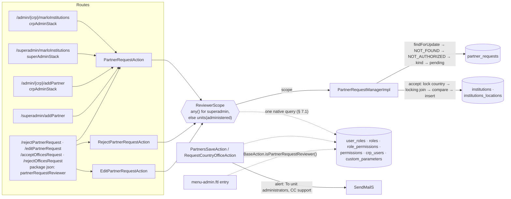

# Partner request approval per Global Unit — Design

**Spec ID:** CHG-PARTUNIT-001
**Status:** Approved 2026-11-27 by the owner at the Phase 2 gate — `JUDGMENT: APPROVED ✅` after two rounds (`judgment.md`)
**Owner:** Kenji Tanaka (IBD)
**Last Updated:** 2026-11-27
**Depth:** Full
**Requirements:** `requirements.md` (approved 2026-11-27; amended at judgment round 1, see its Decision Log)
**Verified at:** `e365e6a950` (branch `revive-local-partner-request-approval`, equal to `origin/staging` `a54160ab47` plus the proposal commit)

> **Answer first.** One definition decides who **administers** a unit, and every surface uses it: the menu entry,
> the admin list, each decision, and the alert recipients. A user administers unit U when they are an active member
> of U, U's admin area is switched on, and they hold in U the `CRP-Admin` role or a role granted `crp:{0}:admin:*`.
> It is read from the database, not from Shiro or the session. Superadmins may do everything. Decisions are checked
> twice: in the action, and in the manager after the row is locked. The listing scope is a `ReviewerScope` derived
> from the Struts namespace (`/admin` = the session unit, `/superadmin` = every unit), never from input, and the DAO
> refuses a missing scope. Accept locks the country row, then reads, with a locking join, the active institutions
> headquartered there, and refuses when one has the same normalized name. One review template serves both routes.

---

## 1. Architecture Summary

| Layer | Change |
|---|---|
| Authorization data | The units a user administers, and the administrators of a unit: one definition, two native queries (§ 7.1) |
| Manager | Decision methods take a `ReviewerScope` and refuse another unit's request after the lock; accept gains the duplicate guard; listing by scope |
| Actions | Build the scope once per request; listing scope from the namespace; refuse an admin listing before any read; two new outcome strings; one log line per refusal |
| Routes | Admin listing and a new admin accept route; the four JSON routes swap `superAdminValidation` for `partnerRequestReviewer`, declared in the `json` package |
| Views | One shared review body; two shells; unit chips and a unit filter; escaped notes |
| Emails | Alert recipients and links, including the two per-unit text overrides |

## 2. Module Footprint

### marlo-data

| File | Change |
|---|---|
| `data/dao/RoleDAO.java`, `data/dao/mysql/RoleMySQLDAO.java` | Two native SELECTs: `findAdministeredUnitIds(userId)`, `findUnitAdministrators(unitId)` (§ 7.1), following the DAO's existing native SELECT at `RoleMySQLDAO.java:72` (P-8) |
| `data/manager/RoleManager.java`, `…/impl/RoleManagerImpl.java` | Pass-throughs, read-only |
| `data/dao/PartnerRequestDAO.java`, `…/mysql/PartnerRequestMySQLDAO.java` | `findPendingForReview(ReviewerScope scope)`; a null scope throws (J-16) |
| `data/dao/InstitutionDAO.java`, `…/mysql/InstitutionMySQLDAO.java` | `findActiveHeadquarteredIn(long locElementId)`: one HQL block joining `InstitutionLocation` to `Institution`, `PESSIMISTIC_READ` (§ 7.3) |
| `data/dao/LocElementDAO.java`, `…/mysql/LocElementMySQLDAO.java` | `lockForUpdate(long id)` (`session.get` + `refresh(PESSIMISTIC_WRITE)`, as `PartnerRequestDAO.findForUpdate`) |
| `data/manager/PartnerRequestManager.java`, `…/impl/PartnerRequestManagerImpl.java` | `ReviewerScope` on the five decision methods; unit refusal; duplicate guard; `findPendingForReview` |
| `data/model/PartnerRequestOutcome.java` | `Status.NOT_AUTHORIZED`, `Status.DUPLICATE` (neither notifiable); an unpublished `requestUnitId` field set only on `NOT_AUTHORIZED` (J-12) |
| `data/model/ReviewerScope.java` (new) | Immutable: `any()` or `units(Set<Long>)`; `permits(GlobalUnit)` (null unit → only `any`); `isEmpty()` |
| `data/model/InstitutionNames.java` (new, or a static method beside the guard) | The one normalization function (§ 7.3) |

### marlo-web

| File | Change |
|---|---|
| `action/BaseAction.java` | `isPartnerRequestReviewer()`: superadmin, or the session unit (from the session, never `getCrpID()`) ∈ administered units. Uses the already-autowired `roleManager` (`BaseAction.java:570`); the result is memoized in a field for the request, since the menu renders it on every admin page. Used by the admin menu |
| `action/superadmin/PartnerRequestAction.java` | Constructor gains `RoleManager`; scope; listing by namespace through an overridable seam; admin listing refused before any read; `addPartner` / office decisions pass the scope; `statusName` +2; one log line per refusal; duplicate message |
| `action/json/superadmin/RejectPartnerRequestAction.java`, `EditPartnerRequestAction.java` | Constructor gains `RoleManager`; pass the scope; `statusName` +2; one log line per refusal |
| `interceptor/admin/PartnerRequestReviewerInterceptor.java` (new) | Coarse gate for the JSON routes: superadmin, or a non-empty administered set; else `BaseAction.NOT_AUTHORIZED` (403). It runs before `defaultStack`, so it first calls `baseAction.setSession(invocation.getInvocationContext().getSession())`, as `AccessibleAdminInterceptor` does, because `getCurrentUser()` reads `this.session` (P-36) |
| `struts-json.xml` | Declare `partnerRequestReviewer` **inside the `json` package's `<interceptors>`** (the package extends `json-default`, not `marlo-default`, P-26); swap it into the four routes in place of `superAdminValidation` |
| `struts-admin.xml` | `{crp}/marloInstitutions` without `superAdminValidation`, `input` renders the admin shell, a refusal returns `BaseAction.NOT_AUTHORIZED` (`"403"`, the inherited global result, P-37); new `{crp}/addPartner` with `success` redirect (`edit=true`, `phaseID`) and an `input` result rendering the admin shell (J-21) |
| `action/projects/PartnersSaveAction.java` | Constructor gains `RoleManager`; alert To = administrators, CC = support; link to the admin route |
| `action/json/project/RequestCountryOfficeAction.java` | Constructor gains `RoleManager`; same recipients; review link |
| `utils/PartnerRequestEmails.java` | `newOffice` takes a review URL |
| `webapp/WEB-INF/global/views/partnerRequests/reviewBody.ftl` (new) | Today's `#prqPage` body, moved; notes keep `${message}` — already HTML-escaped by Struts' auto-escaping (P-35); `?html` is forbidden there |
| `webapp/WEB-INF/global/views/superadmin/marloInstitutions.ftl` | Shell: superadmin menu + `reviewBody`, unit filter on |
| `webapp/WEB-INF/crp/views/admin/marloInstitutions.ftl` | Replaced by a shell: main menu + admin menu + `reviewBody` (RM-001) |
| `webapp/WEB-INF/crp/views/admin/menu-admin.ftl` | Re-enable the entry in the reachable branch (P-29), condition in § 5 |
| `webapp/WEB-INF/global/macros/institutionRequestMacro.ftl` | Accept form posts to the page's base; unit chip on partner cards and office groups; `data-prq-unit` on cards and office rows |
| `webapp/global/js/superadmin/marloInstitutions.js` | Unit filter; office batches post only visible checked rows |
| `webapp/global/css/superadmin/marloInstitutions.css` | Unit chip and filter select (J-9) |
| `global.properties` | `…ui.outcome.duplicate`, filter label, chip label; `…mail.newOffice` gains the link |
| `custom/aicrra.properties:2232`, `custom/aiccra3.properties:2233` | Their `…mail.newOffice` overrides gain the same link placeholder (J-2, P-27) |
| Both FTL shells | Cache-busting param on the JS and CSS includes bumped to `?20261127` (or the day of the change) |

### Tests touched (J-5; the full list is P-14)

`PartnerRequestManagerGuardTest`, `PartnerRequestReviewGuardTest`, `PartnerRequestEmailsTest`,
`PartnersSaveActionRequestTest`, `PartnersSaveActionClarisaModeTest`, `RequestCountryOfficeActionAlertTest`,
`CrpUsersActionDirectoryTest` (its `NoOpRoleManager implements RoleManager` gains the two methods), plus new suites.

### Docs

`docs/specs/domain/admin/agent-context.md` § *Partner Requests*; `reports/ai-context/role-assignment-email-catalog.md`
§17; `reports/ai-context/struts-critical-routing-catalog.md`.

## 3. Data Model Changes

**None.** No migration. Requests carry `global_unit_id` (P-1, P-2); the guard reads existing columns. A unique index
cannot express the key (two tables, `TEXT` name) and would fail on the 42 existing same-name same-country groups
(P-15) — DD-6.

## 4. API / Action Surface

| Route | Namespace / package | Interceptors (in order) | Method | Change |
|---|---|---|---|---|
| `{crp}/marloInstitutions` | `/admin` | `i18nFile`, `requireUser`, `crpAdminStack` | `execute` | Drop `superAdminValidation`; `input` renders the admin shell; refusal → `BaseAction.NOT_AUTHORIZED` = `"403"` (global result, P-37) |
| `{crp}/addPartner` | `/admin` | `i18nFile`, `requireUser`, `crpAdminStack` | `addPartner` | **New.** `success` → redirect `${crpSession}/marloInstitutions` with `edit=true`, `phaseID`; `input` → admin shell |
| `marloInstitutions`, `addPartner` | `/superadmin` | `superAdminStack` | — | Unchanged |
| four JSON routes | `/`, package `json` | `logErrorStatus`, `requireUser`, `validPhase`, **`partnerRequestReviewer`**, `defaultStack`, `SecurityControl` | — | Guard swap; results unchanged |

`crpAdminStack` contains `validSessionCrp` (switches the session to the URL's `{crp}` for a member, P-28) and
`accessibleStage` (refuses every `/admin` route unless the unit's `crp_admin_active` is `true`, P-30). Both run before
the action. The administered-units definition includes `crp_admin_active` (§ 7.1), so a unit whose admin area is off
has no administrators anywhere: no menu, no list, no decisions, alerts to support only.

**Outcome strings:** existing `done`, `alreadyHandled`, `notFound`, `wrongKind`, `skippedExisting`, `notAllowed`,
`failed`, plus:

| Status | String | Text key | Where |
|---|---|---|---|
| `NOT_AUTHORIZED` | `notAuthorized` | existing `…ui.outcome.notAuthorized` (P-23) | every decision |
| `DUPLICATE` | `duplicate` | new `…ui.outcome.duplicate`, `{0}` name, `{1}` id passed as a `String` (no grouping separator, J-8) | `addPartner` only |

All three `statusName` copies gain both values (P-13); their `default → failed` stays for anything unknown.

## 5. Frontend Composition

- **One body, two shells (RM-001, UI-002).** `reviewBody.ftl` holds today's `#prqPage` block. Each shell sets `prqReviewBase` (`superadmin` or `admin/${crpSession}`) and `prqUnitFilter` (superadmin only) before including it.
- **Accept form** posts to `${prqReviewBase}/addPartner`. JSON decisions keep `baseURL + '/<route>.do'` (P-11).
- **Unit chips (UI-003).** A partner card header shows its unit acronym. An office group (keyed by institution, may hold rows of several units) shows one chip per distinct unit of its rows; each office row also carries its unit in its details (P-22) and `data-prq-unit`.
- **Unit filter (UI-003, superadmin only).** A select built by the JS from the distinct `data-prq-unit` values present, so it offers only units with pending requests. Choosing a unit hides partner cards and office **rows** of other units; an office group with no visible row is hidden; the group's batch actions send only the ids of visible, checked rows. Combines with the existing search and kind filter.
- **Admin menu (UI-001).** `menu-admin.ftl` re-enables the entry in the branch that renders (P-29) with `visible` = the superadmin entry's own condition — `institutions` specificity clause and `!hasSpecificities('partner_requests_to_clarisa')` (P-31) — **and** `action.isPartnerRequestReviewer()` (J-4, J-19).
- **Escaping (J-8, corrected at round 2).** Struts 6.8 enables FreeMarker auto-escaping with the HTML output format for every template (P-35), so `${message}` in the notes list is already escaped, including the catalog name inside the duplicate text. Nothing is added; `?html` MUST NOT be used (a parse error under that policy). The round-1 XSS concern was a false premise.
- **Cache-busting:** both shells bump `marloInstitutions.js` and `.css`.

## 6. Persistence & Phase Replication Plan

Not applicable: none of the tables is phased. Every write stays inside the existing `@Transactional` manager methods.
The scope queries run outside the manager transaction, in the action (J-20, § 7.2).

## 7. Backend Module Design

### 7.1 Who administers a unit (SEC-001, SEC-003, UI-001, FN-009)

User X **administers** unit U when all hold, read in one native SELECT:

1. X is active (`users.is_active = 1`) and has an active membership of U (`crp_users` with `global_unit_id = U`, `is_active = 1`) — **stricter by design** than `validSessionCrp`, whose `existCrpUser` ignores `is_active` (P-28): an inactive membership is treated as no membership;
2. U's admin area is on: an active `custom_parameters` row of U for `crp_admin_active` whose value is `true` (what `accessibleStage` reads, P-30);
3. X holds, through `user_roles`, a role `r` of U (`r.global_unit_id = U`) with `r.acronym = 'CRP-Admin'`, or `r` granted the permission whose text equals `Permission.CRP_ADMIN_EDIT_PRIVILEGES` (`crp:{0}:admin:*`) through `role_permissions` → `permissions`.

- `findAdministeredUnitIds(userId)` → the set of U (distinct).
- `findUnitAdministrators(unitId)` → users X of U, with a non-blank email, distinct by user.

Read from the database because Shiro holds only the session unit's permissions (P-5), and because `accessibleAdmin`
is wider (it also admits `crp:{0}:admin:canAcess` and a substring role match, P-10) — that width is why the admin
list and menu re-check with this definition (J-4). `SuperAdmin` roles holding `*` are not matched by rule 3; a
superadmin passes through `canAccessSuperAdmin()` instead.

### 7.2 Scope and the decision methods

- **Build once per request, in the action** (in `prepare()`, before `params` binds input; P-28): superadmin → `ReviewerScope.any()`; else `units(findAdministeredUnitIds(currentUser))`. The JSON coarse gate runs the same query independently; the two reads are cheap and the action's scope is the one passed to the manager (J-20). A failure of the query → empty scope → refusals, logged (fail closed).
- **Manager.** The five decision methods take `ReviewerScope scope`. Order after `findForUpdate`: `NOT_FOUND` → **`NOT_AUTHORIZED`** (`!scope.permits(request.getCrp())`) → `WRONG_KIND` → `ALREADY_HANDLED` (DD-3). A `NOT_AUTHORIZED` outcome carries no request and no institution, only the unpublished `requestUnitId` for the log.
- **Office batches** keep their ascending per-id loop; each id is checked alone, so a mixed batch applies the permitted ids (FN-008).
- **Logging (OPS-001, J-3).** For `NOT_AUTHORIZED`, the action writes exactly one WARN — action, user id, request id, `requestUnitId` — **instead of** its existing generic non-DONE WARN (`PartnerRequestAction.java:193`, `:404`; `EditPartnerRequestAction.java:89`; `RejectPartnerRequestAction.java:121`, P-32). Other statuses keep the generic line.
- **Accepted trade-offs (J-12):** the foreign row is X-locked by `findForUpdate` before the scope check (bounded to the short transaction, no data returned); `notFound` vs `notAuthorized` reveals whether an id exists (ids are sequential, existence alone is not sensitive; DD-3).

### 7.3 Duplicate guard (FN-006, FN-007, D5)

In `acceptPartnerRequest`, after the refusals and the "type or country missing" check, before the insert:

1. `LocElementDAO.lockForUpdate(country.id)`. Concurrent accepts for the same country queue here.
2. `InstitutionDAO.findActiveHeadquarteredIn(country.id)`: **one HQL block** selecting from `InstitutionLocation l join l.institution i` where `l.locElement.id = :country`, `l.headquater = true`, `i.active = true`, with `PESSIMISTIC_READ`. The active dialect appends `for share` to the whole statement (P-18), so both tables are read at their latest committed state. No subquery (a lock clause does not reach into one, J-15), no `DISTINCT` (duplicates removed in Java).
3. Normalize the request's name and each candidate's name with the one function: Unicode lower case (`Locale.ROOT`); every run of characters matching `[\s\p{Z}]` (whitespace including non-breaking and other Unicode spaces) replaced by one space; trimmed. **Accent-sensitive** (FN-006 names case and spaces only; J-24).
4. A match → `DUPLICATE` with the matched institution; nothing written; the copy stays pending. The action writes one INFO (request id, matched id) **instead of** its generic non-DONE WARN (OPS-002, J-3).

A multi-headquarters institution matches on any of its rows (P-16).

**Locks taken (J-18).** The country row (X) for the transaction; S locks on every `institutions_locations` row read
for that country (headquarters filter applied after the index lookup on `loc_element_id`) and on the matched
institutions. Effects: other writers of those rows, and an office accept inserting a location of the same country
(its FK takes S on the country row), wait until the partner accept commits. Accepts for different countries do not
wait on each other. Accepted: accepts are rare, short and human-paced; the largest country holds 904 headquarters
institutions (US).

### 7.4 Listing (FN-001, FN-004, SEC-003, SEC-004)

`prepare()` resolves the listing scope from the invoked namespace, read through a protected seam
`invokedNamespace()` (default: `ServletActionContext.getActionMapping().getNamespace()`, as `AccessibleStageInterceptor:56`
does; tests override it, P-33):

| Namespace | Listing scope |
|---|---|
| `/superadmin` | `ReviewerScope.any()` — every unit, null-unit rows included |
| `/admin` | if the user is a superadmin or the session unit ∈ administered units: `units({session unit})`; **otherwise** the action reads no partner request, lists nothing and `execute()` returns `BaseAction.NOT_AUTHORIZED` (`"403"`, P-37) (SEC-003). The country and institution-type catalogs `prepare()` loads are reference data, not requests |
| anything else (JSON routes on `/`) | `units({})` — nothing is listed |

The session unit is read from the session (`getCurrentGlobalUnit()`), **never** `getCrpID()`, which a request
parameter can set (`BaseAction.setCrpID` is public, P-28). `findPendingForReview(scope)` keeps today's row filters
and throws on a null scope (J-16).

### 7.5 Alerts (FN-009, FN-010)

`sendNewPartnerAlert` / `sendNewOfficeAlert`, after the save, behind `PartnerRequestEmails.isEnabled(unit)`:

| `findUnitAdministrators(unit)` | To | CC | BCC |
|---|---|---|---|
| non-empty | the administrators, comma-separated | support mailbox | — |
| empty (including a unit whose admin area is off) | support mailbox | — | — |

Link: `<baseUrl>/admin/<unit acronym>/marloInstitutions.do` for both alerts. `newOffice` gains the URL, and its text
gains the link in `global.properties` **and** in both per-unit overrides (P-27). One INFO line when the fallback is
used (unit id). CC is the single support address, so `SendMailS`'s `ccEmail.replaceAll(", " + toEmail, "")` (`:360`)
sees no match (P-20).

**Known effect (J-17).** `SendMailS` applies the notification and support-only switches of the **sender's session
unit** (`getRequestCrpID`, `:149-166`), not of the request's unit. For an admin of 47 deciding from a session in 45,
the requester's email follows 45's switches. `PartnerRequestEmails.isEnabled(requestUnit)` in the actions still
applies the request unit's switch first. Changing `SendMailS` is out of scope; recorded as R-5.

## 8. Validation & Save Pipeline

No section save pipeline changes. Decisions are guarded by POST-only (unchanged, SEC-005), the scope, and the manager
refusals.

## 9. Permissions & Edit Gates

| Gate | Where | Rule | Requirement |
|---|---|---|---|
| Admin area | `crpAdminStack` (`validSessionCrp`, `accessibleStage`, `accessibleAdmin`) | membership, `crp_admin_active`, wide admin check (existing) | — |
| Admin listing | `PartnerRequestAction.prepare` | superadmin, or session unit ∈ administered (§ 7.1), before any read | SEC-003 |
| Admin menu entry | `BaseAction.isPartnerRequestReviewer()` | same | UI-001 |
| Superadmin listing | `superAdminStack` | superadmin | FN-004 |
| JSON decisions, coarse | `partnerRequestReviewer` (package `json`) | superadmin, or administered set non-empty; else 403 | SEC-001 |
| Every decision, fine | `ReviewerScope` in the manager | request's unit ∈ administered, or superadmin | SEC-001, SEC-002, SEC-004, FN-008 |
| POST-only | each decision action | unchanged | SEC-005 |

## 10. Specificity / Feature-Flag Strategy

No new specificity. Reads three existing ones: `partner_requests_to_clarisa` and `institutions` (menu condition),
`crp_admin_active` (the definition). No `isAiccra()`, unit acronym or unit id literal (NF-001); `'CRP-Admin'` is a
role acronym already used system-wide (P-21).

## 11. Integration Points

None external. `SendMailS` is the only outbound path.

## 12. Observability

| Event | Level | Fields | Replaces | Requirement |
|---|---|---|---|---|
| Decision refused for another unit | WARN | action, user id, request id, request unit id | the generic non-DONE WARN | OPS-001 |
| Accept refused as duplicate | INFO | request id, matched institution id | the generic non-DONE WARN | OPS-002 |
| Alert fell back to support | INFO | unit id | — | FN-009 |

SLF4J; no email addresses or request content; arguments null-safe.

## 13. Security Considerations

- **IDOR (D1):** the authority is the manager check after the row lock.
- **Scope widening:** listing scope bound to the namespace; session unit from the session; null scope throws.
- **Leak (SEC-002, D9):** `NOT_AUTHORIZED` outcomes carry no request; JSON `includeProperties` unchanged; the admin list reads no partner request for non-administrators.
- **XSS (J-8):** already covered by auto-escaping (P-35); no `?html`.
- **Fail closed:** query failure → empty scope.
- **Accepted:** foreign-row lock before the check; id-existence oracle (§ 7.2).

## 14. Performance & Scalability

Two extra native SELECTs per JSON decision (gate and action), one per page. Listing: `partner_requests` holds 5,079
rows locally with an index on `global_unit_id` only (P-34); the admin query uses it and filters the pending flags on
that unit's rows; the superadmin query scans as today's `findAll()` does, but returns only pending rows. Lock effects
in § 7.3.

## 15. Backwards Compatibility & Rollout

- No data change; pending requests appear in their unit's list on deploy (FN-011).
- Superadmins keep their screen and powers.
- Rollback: revert the commits.
- Release note: unit administrators gain a duty (only where `crp_admin_active` is on); alerts change recipient; duplicate accepts are refused.

## 16. Decision Records

### DD-1 — "Administers" is one database definition

Shiro holds only the session unit's permissions (P-5), and `accessibleAdmin` is wider than the approved rule (P-10).
One definition, read from the database, used by menu, list, decisions and alerts, so whoever sees or is alerted can
act, and whoever can act can see. `crp_admin_active` is part of it because without it the admin screen cannot open
(P-30); active membership is part of it by choice, stricter than the screen's own membership check (P-28). Alternative rejected: switching the session unit before checking.

### DD-2 — Listing scope from the namespace, session unit from the session

A settable property could be overwritten through `params`; `crpID` already is bindable (P-28).

### DD-3 — Unit refusal right after the existence check

`NOT_AUTHORIZED` before `WRONG_KIND` / `ALREADY_HANDLED`: a foreign row yields nothing beyond "not yours". The
existence oracle this leaves is accepted (§ 7.2).

### DD-4 — One action class, two entry points

Only the listing depends on the route. An admin copy of the action would duplicate logic (see the three `statusName`
copies).

### DD-5 — The JSON routes swap `superAdminValidation` for `partnerRequestReviewer` (reversion)

Reverts `CHG-PARTREQ-001` SEC-001 on four routes. Declared in the `json` package (P-26). **Reversion challenge:**
*what does removing `superAdminValidation` break?* — (a) the two static tests pinning it (P-14) — rewritten to pin
`partnerRequestReviewer` in the same position; (b) the chain the stack coverage tests read (`logErrorStatus`,
`validPhase`) — kept; (c) the protection — replaced by the coarse gate plus the per-request check. No unaddressed
breakage.

### DD-6 — Serialize accepts per country instead of a unique index

A unique index cannot express the key and would fail on 42 existing groups (P-15). Residual: institutions created
outside accept bypass the lock and the guard (R-3).

### DD-7 — Alerts use the administrators definition (reversion of the To recipient)

Whoever is alerted can act. **Reversion challenge:** *what does moving support from To to CC break?* — the alert
tests pinning `to = NOTIFY`, `bcc = NOTIFY` and the office body (P-14) — rewritten; support still receives every
alert. No unaddressed breakage.

### DD-8 — The old admin view becomes a shell (reversion of `CHG-PARTREQ-001` SEC-003)

**Reversion challenge:** *what does reopening the admin route break?* — the static test pinning
`superAdminValidation` on `{crp}/marloInstitutions` (rewritten); the `input → redirect` result (replaced). No
unaddressed breakage.

### DD-9 — Replace, not add, the generic refusal log line (J-3)

OPS-001 / OPS-002 say "exactly one". The generic non-DONE WARN stays for every other status.

### Budget (tripwire for `/akili-execute`)

| Measure | Estimate |
|---|---|
| Tasks | 8 |
| LOC | ~1,450: ≈ 560 main Java, ≈ 150 FTL / JS / CSS / properties (≈ 125 of it moved, not new), ≈ 640 tests and probes, ≈ 100 docs |
| Review rounds | 13: 2 each for the two security tasks (scope / manager, actions / routes), 1.5 each for the other six |

## 17. Premise Ledger

**Count:** 36 verified, 1 `UNVERIFIED` (1 High, 0 Low). P-18 is settled at the dialect level; its runtime half stays open.
**Blast-radius triggers:** `live-path` fired (admin menu → admin route; accept form → admin accept route);
`shared-state` fired (`PartnerRequestOutcome.Status`, the JSON interceptor chain, the generic refusal log lines, the
alert envelope and its per-unit texts); `consumer` fired (manager, DAO and `RoleManager` signatures, action
constructors, `newOffice`, struts routes, alert recipients).

| # | Claim | Class | Citation (as run) | Verified at | If false | Settled by |
|---|---|---|---|---|---|---|
| P-1 | Partner and office requests are stamped with the session unit | location | `PartnersSaveAction.java:445-446`; `RequestCountryOfficeAction.java:122` | `e365e6a950` | High — listing by unit would need a backfill | — |
| P-2 | No stored request lacks a unit locally; 17 units have rows | data-env | `partroute_local`: `select count(*) from partner_requests where global_unit_id is null` → `0`; nullable (`IS_NULLABLE = YES`); distinct units → 17 | `e365e6a950` | Low — SEC-004 handles them | — |
| P-3 | The review list loads every unit's rows | location | `PartnerRequestAction.java:251-255` | `e365e6a950` | High — FN-001 already met | — |
| P-4 | Decision refusals check existence, kind and pending state only | location | `PartnerRequestManagerImpl.java:251` `refusePartner`, `:266` `refuseOffice`; all five decision methods lock then refuse | `e365e6a950` | High — the unit check may exist | — |
| P-5 | Shiro loads the session unit's permissions only | location | `APCustomRealm.java:223-232` | `e365e6a950` | High — DD-1 unnecessary | — |
| P-6 | In active units only `CRP-Admin` roles hold `crp:{0}:admin:*`; the other holders belong to inactive unit 26 | data-env | `partroute_local`: `role_permissions` ⋈ `roles` where `permission_id = 421` → `CRP-Admin` ×19, plus 17 other roles of unit 26 (`is_active = 0`); 45 and 47 → `CRP-Admin` only | `e365e6a950` | Low — who is alerted changes | — |
| P-7 | `Role` maps `crp` and `acronym`; `UserRole` links users | location | `xmls/Roles.hbm.xml:12-21`; `BaseAction.getRoles()` `:5610-5622` | `e365e6a950` | Low | — |
| P-8 | `role_permissions` is not an entity; `RoleMySQLDAO` reaches it with native SQL (INSERT … SELECT, `:121-137`) and already runs a native SELECT on `permissions` (`:72-73`, `createSQLQuery`) — the precedent the two new queries follow | location | `grep -rln "role_permissions" marlo-data/src/main` → `RoleDAO.java`, `RoleMySQLDAO.java`, `RoleManager.java`; `RoleMySQLDAO.java:72-73` (`SELECT COUNT(DISTINCT permission) FROM permissions …`), `:121-137` | `e365e6a950` | Low — HQL path instead | — |
| P-9 | Namespaces: admin `/admin`, superadmin `/superadmin`, json `/` | location | `struts-admin.xml:7`, `struts-superadmin.xml:7`, `struts-json.xml:6` | `e365e6a950` | High — DD-2 keyed wrong | — |
| P-10 | `accessibleAdmin` admits superadmin, `crp:{0}:admin:canAcess` of the session unit, or a substring match of `CRP-Admin` in the session unit's roles — wider than § 7.1 | location | `AccessibleAdminInterceptor.intercept` (`canAccessSuperAdmin() \|\| canAcessCrpAdmin() \|\| isRole("CRP-Admin")`); `BaseAction.java:731-735` (`CRP_ADMIN_VISIBLE_PRIVILEGES`), `:8095-8100` (`contains`); `partroute_local`: role `DM` holds 422, not 421, in 45 and 47 | `e365e6a950` | High — the listing / menu re-check (J-4) would be unnecessary | — |
| P-11 | The review JS posts JSON decisions to namespace `/`; the accept form posts to `superadmin/addPartner` | live-path | `marloInstitutions.js:523, 599, 740, 781`; `institutionRequestMacro.ftl:211`. Chain: admin menu (P-29) → `/admin/{crp}/marloInstitutions` (`struts-admin.xml:146`) → `crpAdminStack` (P-28, P-30) → `PartnerRequestAction.prepare` → `reviewBody` → form / JS | `e365e6a950` | High — the admin page would post to superadmin routes | — |
| P-12 | The superadmin page body has no superadmin-only dependency besides the menu include | location | `global/views/superadmin/marloInstitutions.ftl:22-146`, `menu-superadmin.ftl` include at `:39` | `e365e6a950` | Low | — |
| P-13 | `PartnerRequestOutcome.Status` consumers: the manager and three `statusName` copies, each `default → failed` | shared-state | `PartnerRequestAction.java:422`, `EditPartnerRequestAction.java:175`, `RejectPartnerRequestAction.java:234` (read); `PartnerRequestManagerImpl` refusals; `isNotifiable` in `PartnerRequestOutcome` | `e365e6a950` | High — a missed copy publishes `failed` | — |
| P-14 | Tests and test doubles the change breaks or must extend | consumer | (1) `grep -rln "new RoleManager()\|new RoleDAO()\|new InstitutionDAO()\|new LocElementDAO()\|new PartnerRequestManager()\|new PartnerRequestDAO()\|implements RoleManager\|implements RoleDAO\|implements InstitutionDAO\|implements LocElementDAO\|implements PartnerRequestManager\|implements PartnerRequestDAO\|(RoleManager.class\|(RoleDAO.class\|(InstitutionDAO.class\|(LocElementDAO.class\|(PartnerRequestManager.class\|(PartnerRequestDAO.class" marlo-web/src/test marlo-data/src/test` → `CrpUsersActionWelcomeMailTest` (`forbidden(RoleManager.class)` proxy, unaffected), `CrpUsersActionDirectoryTest` (`:540` `NoOpRoleManager implements RoleManager` → must add two methods), `PartnersSaveActionRequestTest`, `PartnerRequestReviewGuardTest`, `PartnersSaveActionClarisaModeTest`, `PartnerRequestManagerGuardTest` (`:80-89` `answering` proxy throws on unanswered methods, `:214-216` builds the manager → accept tests must answer `lockForUpdate` / `findActiveHeadquarteredIn`). (2) `grep -rln "new PartnersSaveAction(\|new RequestCountryOfficeAction(\|new PartnerRequestAction(\|new RejectPartnerRequestAction(\|new EditPartnerRequestAction(\|extends PartnersSaveAction\|extends RequestCountryOfficeAction\|extends PartnerRequestAction\|extends RejectPartnerRequestAction\|extends EditPartnerRequestAction" marlo-web/src/test` → `PartnersSaveActionRequestTest`, `PartnersSaveActionClarisaModeTest`, `PartnerRequestReviewGuardTest`, `RequestCountryOfficeActionAlertTest` (constructors gain `RoleManager`). (3) Pins: `PartnerRequestReviewGuardTest.java:927` and `:956` (`superAdminValidation`), `PartnersSaveActionRequestTest.java:271-276` (alert to / bcc / link), `RequestCountryOfficeActionAlertTest.java:127` (custom office body), `PartnerRequestEmailsTest` (`newOffice` signature); `ValidPhaseStackCoverageTest` / `ErrorStatusLogStackCoverageTest` read every `struts-json.xml` route (keep `validPhase`, `logErrorStatus`). Main implementers of the changed interfaces: only the MySQL DAOs and the two `…ManagerImpl` | `e365e6a950` | High — an unlisted suite breaks | — |
| P-15 | Under the guard's own semantics (accent-sensitive, whitespace-normalized), `institutions` holds 57 same-name groups, 42 of which share a headquarters country and 15 do not; active institutions only: 55 / 40 / 15. The earlier 61 / 45 / 16 came from the column's accent-insensitive collation | data-env | `partroute_local`: key `convert(lower(trim(regexp_replace(name,'[[:space:]]+',' '))) using utf8mb4) collate utf8mb4_bin`; groups with `count(*) > 1` → 57 (all rows), 55 (`is_active = 1`); groups where two distinct ids share an HQ `loc_element_id` → 42 / 40 | `e365e6a950` | Low — Q-6 and DD-6 stand on either count | — |
| P-16 | An institution can have more than one headquarters row | data-env | `partroute_local`: institution 4623 → HQ in LB and LR | `e365e6a950` | Low | — |
| P-17 | The local MySQL runs REPEATABLE-READ, 8.0.43 | data-env | `select @@global.transaction_isolation, @@version` → `REPEATABLE-READ`, `8.0.43` | `e365e6a950` | High — the locking read in § 7.3 | — |
| P-18 | The guard query is a locking read that sees rows committed after the transaction's snapshot, and the country lock serializes two accepts so the second finds the first's institution | data-env | **Dialect half verified (judges A and B):** Hibernate 5.6.15.Final (`marlo-parent/pom.xml:15`); `MySQL8Dialect` (`MarloDatabaseConfiguration.java:105`, applied after `hibernate.cfg.xml:7`); `getReadLockString` → `" for share"`; snapshot already open at `PartnerRequestMySQLDAO.java:75`. **Runtime half:** `UNVERIFIED — confirm at source before relying on it` | — | High — D5 not closed; R-1 | T03, first step: two-session probe on a throwaway DB copy running the exact join of § 7.3: red without the country lock, green with it; records the isolation the app's connection reports |
| P-19 | `Institution.active` maps `is_active` | location | `Institutions.hbm.xml:28-29` | `e365e6a950` | Low | — |
| P-20 | `SendMailS.send(to, cc, bcc, …)`: To parsed by `InternetAddress.parse`; CC first stripped of `", " + toEmail` by `replaceAll`, then split on `", "` | location | `SendMailS.java:345`, `:360-361`, `:454` | `e365e6a950` | Low | — |
| P-21 | `CRP-Admin` is a literal role acronym in existing code; each unit's `crp_admin_rol` names its admin role | other | literal: `BaseAction.java:1309`, `CrpUsersAction.java:1004`; parameter: `SendEmails.java:296` reads `APConstants.CRP_ADMIN_ROLE`, `partroute_local`: 45 → 417, 47 → 479 | `e365e6a950` | Low | — |
| P-22 | Each card shows its unit in its details | location | `institutionRequestMacro.ftl:48`; `global.properties:2604` | `e365e6a950` | Low | — |
| P-23 | `notAuthorized` is an existing outcome text and JS path | existence | `global.properties:2588`; `data-outcome-notauthorized`; `marloInstitutions.js` `statusOfError` | `e365e6a950` | Low | — |
| P-24 | The office alert carries no review link today | location | `PartnerRequestEmails.newOffice` (8 parameters, no URL); `RequestCountryOfficeAction.java:203-204` | `e365e6a950` | Low | — |
| P-25 | The only code building a review URL is the partner alert | consumer | `grep -rn "superadmin/marloInstitutions\|superadmin/addPartner" marlo-web/src/main marlo-web/src/test` → URL builders: `PartnersSaveAction.java:669`, `institutionRequestMacro.ftl:211` (form), test `PartnersSaveActionRequestTest.java:276`; other hits are view paths (`struts-superadmin.xml:139,151`) and asset paths (`global/js/superadmin/marloInstitutions.js`, `.css` in both FTLs, `partnersSave.css:6`) | `e365e6a950` | Low | — |
| P-26 | The `json` package extends `json-default`, not `marlo-default`, and declares its own interceptors; a new interceptor for its routes must be declared there | location | `struts-json.xml:6` (`extends="json-default"`); its `<interceptors>` block holds `logErrorStatus`, `SecurityControl`, `requireUser`, `superAdminValidation`, `validPhase`, `jsonStack`, `jsonStackWithAudit` (`struts-json.xml:8-44`) | `e365e6a950` | High — the app fails to start (J-1) | — |
| P-27 | Units 45 and 47 override the new-office alert text; the partner alert text is not overridden | location | `custom/aicrra.properties:2232`, `custom/aiccra3.properties:2233` (`…mail.newOffice`, `{0}`–`{4}`); `grep -n "mail.newPartner=" marlo-web/src/main/resources/custom/*.properties \| wc -l` → `0`; `partroute_local` active `crp_custom_file`: 45 → `aicrra`, 47 → `aiccra3`; `PartnerRequestEmails.unitTexts(unit)`; `PartnerRequestEmailsTest.java:208, 212` builds `newOffice` with the 8-parameter signature | `e365e6a950` | High — the office link misses the live units (J-2) | — |
| P-28 | `validSessionCrp` switches the session to the URL's `{crp}` for a member (`crpUserManager.existCrpUser`, which ignores `is_active`, and is skipped when the URL unit is the session unit); `getCurrentGlobalUnit()` reads the session; `getCrpID()` returns the field first and `setCrpID` is public | location | `ValidSessionCrpInterceptor.java:80-110` (`existCrpUser`, `session.replace(SESSION_CRP, crp)`); `CrpUserMySQLDAO.existCrpUser` `:67-74` (no `is_active` filter, judges A and B; re-read at round 2); `BaseAction.java:3030-3041`, `:2869-2873`, `:8803` | `e365e6a950` | High — DD-2 / § 7.4 would read a bindable value | — |
| P-29 | `menu-admin.ftl`'s non-AICCRA branch never renders; the commented entry sits in the rendered branch | location | `menu-admin.ftl:2` `[#if !action.isAiccra()]`, entry at `:29`; `GlobalUnit.isAiccra()` returns `true` (`GlobalUnit.java:333-336`) | `e365e6a950` | Low — the entry would also be needed in the other branch | — |
| P-30 | `accessibleStage` (in `crpAdminStack`) refuses every `/admin` route unless the unit's `crp_admin_active` is `true` | location | `AccessibleStageInterceptor.java:55-63` (`getNamespace()`, `startsWith("/admin")`, `sectionActive(APConstants.CRP_ADMIN_ACTIVE)`); `struts.xml:251-264`; `partroute_local`: true for 45 and 47 | `e365e6a950` | High — the definition would admit admins who cannot open the screen (J-7) | — |
| P-31 | The superadmin entry's visibility = `institutions` specificity clause ∧ not CLARISA mode | location | `menu-superadmin.ftl:21, 34` | `e365e6a950` | Low | — |
| P-32 | Each decision action already logs a generic WARN for any non-DONE outcome | shared-state | `PartnerRequestAction.java:193` (`addPartner`), `:404` (`recordOutcomes`, per office id), `EditPartnerRequestAction.java:89`, `RejectPartnerRequestAction.java:121` (judges A and B) | `e365e6a950` | High — "exactly one" fails (J-3) | — |
| P-33 | The namespace is readable inside an action through the action mapping or the proxy | location | `AccessibleStageInterceptor.java:56` (`ServletActionContext.getActionMapping().getNamespace()`); `SendMailS.java:221-223` (proxy) | `e365e6a950` | Low — the seam reads the other one | — |
| P-34 | `partner_requests` holds 5,079 rows locally and indexes `global_unit_id`, not `is_active` / `acepted` | data-env | `partroute_local`: `show index from partner_requests` → PK, FKs (`institution_type_id`, `loc_element_id`, `created_by`, `modified_by`, `rejected_by`, `institution_id`, `partner_request_id`, `global_unit_id`, `id_phase`); `select count(*) from partner_requests` → 5,079 | `e365e6a950` | Low — § 14 | — |
| P-35 | Struts 6.8.0 turns on FreeMarker auto-escaping with the HTML output format for every template, so `${…}` is escaped and `?html` is a parse error | location | `struts2-core-6.8.0-sources.jar` `org/apache/struts2/views/freemarker/FreemarkerManager.java:370-371` (`setAutoEscapingPolicy(ENABLE_IF_DEFAULT_AUTO_ESCAPING_POLICY)`, `setOutputFormat(HTMLOutputFormat.INSTANCE)`); `marlo-parent/pom.xml:25` `struts2.version` = `6.8.0`; corroborated by `crp/views/home/dashboard.ftl:212-214` | `e365e6a950` | High — the shared body would fail to parse on both routes with `?html` | — |
| P-36 | An interceptor that runs before `defaultStack` must hand the session to the action: `getCurrentUser()` reads `this.session`, and the admin interceptors call `setSession` first | location | `BaseAction.java:3083-3093` (`getCurrentUser` reads `this.session`); `AccessibleAdminInterceptor.intercept` (`baseAction.setSession(session)` before the check) | `e365e6a950` | High — the coarse gate would refuse every non-superadmin (RB-3) | — |
| P-37 | `BaseAction.NOT_AUTHORIZED` is the string `"403"`, mapped by an inherited global result; no result is named `notAuthorized` | location | `BaseAction.java:179`; `struts.xml:595-` `<global-results>` (`401`, `403`, `404`) | `e365e6a950` | Low — a literal `notAuthorized` would hit no result mapping (RA-3 / RB-1) | — |

## 18. Gate map (requirements § 7 → test)

| Defect | Gate | Task |
|---|---|---|
| D1 cross-unit write | Manager tests per decision method; action tests per entry point (recording doubles, arguments asserted) | T02, T04 |
| D2 session instead of request unit | Test pair (admin of 47 in session 45 allowed; admin of 45 in session 47 refused); falsifier: scope built from `getCrpID()` or the session | T04 |
| D3 listing leak | DAO test (throwaway DB) for each scope; action test: `/admin` with a non-administrator reads nothing; null scope throws | T02, T04 |
| D4 duplicate false ± | Normalization table (case, inner / outer spaces, NBSP, tab; accents stay distinct); same name other country; inactive; multi-HQ | T03 |
| D5 concurrent accepts | Two-session probe on a throwaway DB copy, exact § 7.3 query | T03 |
| D6 alert recipients / link | Mail double asserts to / cc / bcc / link, with and without administrators, for the global text and both custom files | T06 |
| D7 route config | Static tests pin the interceptor refs of the six routes and the declaration of `partnerRequestReviewer` inside the `json` package | T05 |
| D8 FTL | HITL on the local stack, screenshots: admin and superadmin, both routing modes, chips, filter, duplicate message | T07, T08 |
| D9 refused data leaked | Assert a `NOT_AUTHORIZED` outcome and the published properties hold no request data; log line count = 1 | T04 |
| D10 regressions | Existing suites with `-am` | every task |
| D11 compile, D12 i18n | `marlo-verify` | every task |

## 19. Open Risks

| # | Risk | Mitigation |
|---|---|---|
| R-1 | P-18 runtime half false | T03 probe red → Pivot to a native `SELECT … FOR SHARE`, or accept D5 with owner approval |
| R-2 | A unit whose roles all hold `crp:{0}:admin:*` (inactive unit 26 today) would alert every member | Only unit 26 (P-6), and its `crp_admin_active` decides whether it has administrators at all |
| R-3 | Institutions created outside accept bypass the lock and the guard | Out of scope (DD-6) |
| R-4 | Administrators without an email | Not recipients; fallback when none remain |
| R-5 | Decision emails follow the sender's session-unit switches inside `SendMailS` (§ 7.5) | Rare (stale tab, multi-unit admin); `isEnabled(requestUnit)` still applies first |
| R-6 | Lock waits for writers of the same country during an accept (§ 7.3) | Accepted; transactions are short |
