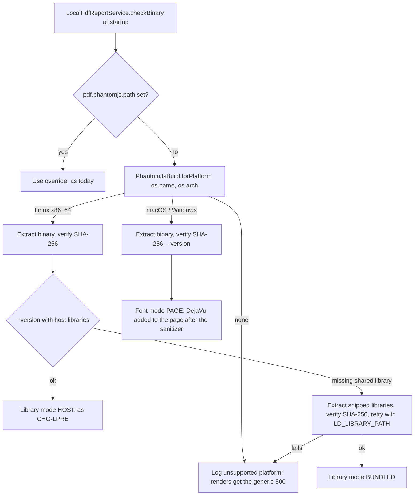

# Portable PDF Engine — Design

**Spec ID:** CHG-PORTABLE-PDF-ENGINE-001
**Status:** Approved — owner, 2026-11-24 (Phase 1, 2 and 3 gates)
**Owner:** Kenji Tanaka (IBD)
**Last Updated:** 2026-11-24
**Implements requirements:** CHG-PPE-FN-001 … FN-007, NF-001 … NF-006, SEC-001 … SEC-003, OPS-001, OPS-002
**Touches modules:** marlo-web (`utils/pdf`, `resources/pdf/phantomjs`, tests)

> **Answer first:** one platform table decides which shipped build runs (Linux x86_64, macOS, Windows). On Linux the
> build first starts with the host's libraries, as today; only if that fails does MARLO use the seven libraries it
> ships. On macOS and Windows, MARLO adds DejaVu to the page after the sanitizer, because fontconfig does not exist
> there. Linux keeps fontconfig, so production output does not change by a single byte.

---

## Spike (2026-11-24, before this design)

All runs at commit `e452378187`. The harness and outputs are in the session scratchpad and are not committed; the
commands are quoted so they can be re-run.

| # | Question | Run | Result |
|---|---|---|---|
| S-1 | Which fonts do the templates ask for? | `SELECT <x>_template_data FROM lpre_live_tmp.report_configurations` + `grep font-family`; same on `marlo-web/src/test/resources/pdf/templates/*.html` | `'Montserrat', sans-serif` (OICR, Innovation) and `"Montserrat", "Arial", sans-serif` (Cluster). Montserrat is embedded as a **woff2** data URI, which PhantomJS 2.1.1 cannot use, so every OS falls back to its default sans: DejaVu Sans on Linux (fontconfig), Helvetica/Arial on macOS. No `serif` or `monospace` family is used |
| S-2 | Do shipped Linux libraries let the shipped build run on a minimal Linux? | Debian 12 `libfontconfig1 2.14.1-4`, `libfreetype6 2.12.1+dfsg-5+deb12u4` and their deps (`libexpat1`, `libpng16-16`, `libbrotli1`, `zlib1g`) copied out; `objdump -T` per library; fixtures rendered in `debian:bookworm-slim --network none` through a wrapper setting `LD_LIBRARY_PATH` | 7 libraries, 1.8 MB (0.9 MB gzipped). Highest symbol needed: `GLIBC_2.36` (`libexpat.so.1`; fontconfig and freetype need 2.33). Fixtures: PARITY, **0 pages with pixel differences**, same byte size as the Tomcat image. `amazonlinux:2023` (glibc 2.34): ``version `GLIBC_2.36' not found (required by /libs/libexpat.so.1)`` |
| S-3 | Can fonts placed in the page replace fontconfig? | `@font-face` DejaVuSans/Bold as `data:font/truetype` + `*{font-family:… !important}` injected before `</head>` | **macOS:** only DejaVuSans/DejaVuSans-Bold, page counts 5/6/7 as Linux, text extractable; layout not identical (comparator: lines about 4 pt higher, some words on the next page). **Linux:** text drawn as paths: `pdffonts` empty, `pdftotext` 0 words, PDF 2.3× larger. So: page fonts on macOS/Windows only |
| S-4 | Windows build | `phantomjs-2.1.1-windows.zip` from the same release as Linux, SHA-256 `d9fb0562…c7dcc8` | `PE32 executable (console) Intel 80386 … UPX compressed`, 18.6 MB raw, 18.1 MB gzipped. Not run: no Windows host |
| S-5 | macOS build | `phantomjs-2.1.1-macosx.zip`, SHA-256 `538cf488…150f8c1` | `Mach-O 64-bit executable x86_64`, 45.0 MB raw, 17.1 MB gzipped; ran on this Apple Silicon Mac under Rosetta (live renders 2026-11-24) |

## 1. Architecture Summary

Renders keep the CHG-LPRE path: sanitize → inline bundled images → **(macOS/Windows: add DejaVu)** → run PhantomJS in
its per-render directory with a minimal environment → read the PDF.

## 2. Module Footprint

### marlo-web

| File | Change |
|---|---|
| `utils/pdf/PhantomJsBuild.java` (new) | The platform table: one entry per shipped build (resource, checksum resource, executable file name, font mode, environment style), and `forPlatform(osName, osArch)` |
| `utils/pdf/EmbeddedPhantomJs.java` | Built from a `PhantomJsBuild` instead of the Linux constants; POSIX permissions only where the file system supports them; library extraction with per-file SHA-256 |
| `utils/pdf/PhantomJsRenderer.java` | Environment per build; Linux library-mode probe; page fonts for PAGE builds; `FONTCONFIG_FILE` on Linux only; completeness covers the library directory in BUNDLED mode; owner name compared without the Windows domain prefix |
| `utils/pdf/LocalPdfReportService.java` | Startup log names the build and the library mode; unsupported-platform line unchanged in meaning |
| `resources/pdf/phantomjs/` | Adds `phantomjs-2.1.1-macosx.gz`, `phantomjs-2.1.1-windows.exe.gz`, their `.sha256`, `PROVENANCE-*.txt`; `linux-libs/` with 7 gzipped libraries, `SHA256SUMS`, `PROVENANCE.txt` and the Debian copyright files |
| `resources/pdf/fonts/` | Unchanged (DejaVuSans and DejaVuSans-Bold are read for the page fonts) |
| tests under `utils/pdf/` | New `PhantomJsBuildTest`; `EmbeddedPhantomJsTest`, `PhantomJsRendererTest`, `PhantomJsRenderingTest` extended (see tasks) |

### marlo-data / marlo-utils

Not applicable. `APConfig` keeps `pdf.phantomjs.path` unchanged; only its Javadoc changes, to "optional override".

## 3. Data Model Changes

Not applicable — no entity, column or migration.

## 4. API / Action Surface

Not applicable — the three summary actions and their dispatch (CHG-LPRE T05) are unchanged.

## 5. Frontend Composition

Not applicable — no screen changes.

## 6. Persistence & Phase Replication Plan

Not applicable — nothing is saved.

## 7. Validation & Save Pipeline

Not applicable.

## 8. Permissions & Edit Gates

Not applicable — the actions keep their interceptor stacks.

## 9. Specificity / Feature-Flag Strategy

Unchanged: `local_pdf_report_engine_active` (CHG-LPRE DA-001), off by default, read from the session at login.

## 10. Integration Points

None added. Nothing is downloaded at runtime (NF-003): every byte comes from the WAR.

## 11. Observability

The startup line (OPS-002) gains the platform, the build and the library mode, for example
`PhantomJS available for local PDF renders, version=2.1.1, platform=Linux/amd64, build=linux-x86_64, libraries=bundled, path=…`. The
per-render INFO line is unchanged. Two new WARN lines:
- `PhantomJS does not start with the host libraries; using the libraries shipped with MARLO` (INFO, once)
- `PhantomJS does not start with the host libraries nor the shipped ones (glibc older than 2.36?): local PDF
  renders will fail` (WARN, once)

## 12. Performance & Scalability

- On Linux with host libraries, nothing changes. The BUNDLED probe adds one extra `--version` run at startup only.
- On macOS/Windows each render's HTML grows by about 2 MB of base64 font data. In the S-3 runs the fixtures took
  1.7–2.0 s with page fonts; the runs without them are not a fair comparison (the first included a cold start), so
  the cost is bounded by the NF-006 deadlines rather than measured. The CSS string is built once per JVM.
- Extraction: one build per platform (NF-003), about 45 MB on disk for macOS, 18.6 MB for Windows; the CHG-LPRE
  support directory lifecycle is kept.

## 13. Security Considerations

- **SEC-001:** every library gets an entry in `SHA256SUMS` and is verified while it is written, exactly like the
  binary. The fingerprint re-check of CHG-LPRE extends to the library directory in BUNDLED mode. A resource that does
  not match its checksum is never written.
- **FN-003:** `LD_LIBRARY_PATH` is set only in the child process environment, which is built from scratch
  (`builder.environment().clear()`, `PhantomJsRenderer.java:990`). The JVM never loads these files.
- **SEC-002:** sanitizer, allowlist, `--local-url-access=false`, render directory and deadline kill are shared code
  paths; no platform branch touches them.
- **SEC-003:** the page fonts are inserted by string replacement after `sanitize()`, beside the image inlining
  (`PhantomJsRenderer.java:586-588`). Their `data:font/truetype` URIs already pass `render-page.js:74`, so the
  allowlist is not widened.
- PhantomJS stays unmaintained (CHG-LPRE design §18.3); this change adds two more copies of the same accepted risk.

## 14. Backwards Compatibility & Rollout

- Linux with host libraries (the current Tomcat image): same binary, same environment keys, same fontconfig — the
  output is byte-identical (verified by the Linux gated test and a byte comparison against the pre-change PDFs).
- The override keeps priority (FN-006).
- Rollout rides on the CHG-LPRE flag; the same branch reaches `staging` once.
- Rollback: revert the commits; no data or configuration to undo.

## 15. Decision Records

| # | Decision | Requirements | Rejected alternatives |
|---|---|---|---|
| DD-1 | **One platform table** (`PhantomJsBuild`) keyed by OS and architecture together. Entries: Linux x86_64 (`amd64`/`x86_64`), macOS (`x86_64` and `aarch64`, Rosetta), Windows (`amd64`/`x86_64`/`x86`; the 32-bit build runs under WOW64). Anything else → no build | FN-001, FN-007 | One `if` per OS spread across classes: the Linux-only assumption is in 3 files today (P-1, P-9, P-14); a table keeps it in one place (KZ-…-directory-abstraction-1) |
| DD-2 | **Library mode decided at startup**: try `--version` with the host's libraries; only on a "cannot open shared object file" failure, extract the shipped libraries and retry with `LD_LIBRARY_PATH`. The mode is kept for all renders | FN-002, FN-003, FN-007 | Always use the shipped libraries: breaks hosts with glibc < 2.36 that work today (S-2, `amazonlinux:2023`). Static re-linking: needs a custom PhantomJS build, out of scope |
| DD-3 | **Linux keeps fontconfig; macOS/Windows get page fonts** (DejaVuSans and DejaVuSans-Bold as `@font-face` data URIs plus a universal `font-family` rule, added after the sanitizer) | FN-005, NF-001, NF-002, SEC-003 | Page fonts everywhere: on Linux text becomes paths (S-3). Shipping fontconfig for macOS: Qt on macOS uses CoreText, not fontconfig |
| DD-4 | **Environment per build style**: POSIX style (PATH `/usr/bin:/bin`, `OPENSSL_CONF=/dev/null`, `HOME`, `TMPDIR`, `LANG`) for Linux and macOS; Windows style (`SystemRoot`, `PATH=%SystemRoot%\System32`, `TEMP`, `TMP`, `USERPROFILE`, `OPENSSL_CONF=NUL`). `FONTCONFIG_FILE` only on Linux | FN-004, SEC-002 | The POSIX environment on Windows: a process started without `SystemRoot` commonly fails to initialise (P-16) |
| DD-5 | **Executable name and permissions from the build**: `phantomjs` / `phantomjs.exe`; `rwx------` applied only when the file store supports the POSIX view | FN-004 | Try and catch `UnsupportedOperationException`: works, but hides the platform decision in an exception path |
| DD-6 | **Stale-directory sweep compares the owner without a `DOMAIN\` prefix** on Windows | FN-004 | Skip the sweep on Windows: support directories would pile up in `%TEMP%` |
| DD-7 | **Binaries stored gzip-compressed, one per platform**, from the same GitHub release as the Linux one, with upstream and stored SHA-256 in `PROVENANCE-*.txt`; licences (`LICENSE.BSD`, `third-party.txt`) shared | OPS-001, NF-004 | A single archive with all builds: forces reading the whole archive on every platform |

**Reversion challenge (Step 2.3).** DD-2 and DD-4 change delivered behavior only for platforms where the engine did
not run before, and DD-3 leaves Linux untouched. The one reversion is DD-4 moving `FONTCONFIG_FILE` out of the
macOS environment. *What does removing it break?* Nothing: Qt on macOS does not read fontconfig (S-3 without page
fonts shows CoreText's Helvetica even with `FONTCONFIG_FILE` set). The test that pins the key set
(`PhantomJsRendererTest.java:136-137`) changes with it (P-14).

## 16. Premise Ledger

Verified 15 · UNVERIFIED 3 (High 1, Low 2).
Blast-radius triggers: `live-path` (the design names the summary download), `shared-state` (the support directory
is shared by the version check and every render), `consumer` (`EmbeddedPhantomJs.FILE_NAME` and the environment key
set are pinned by tests).

| # | Claim | Class | Citation (as run) | Verified at | If false | Settled by |
|---|---|---|---|---|---|---|
| P-1 | The shipped build is chosen only on Linux `amd64`/`x86_64` | location | `EmbeddedPhantomJs.java:153-158` | e452378187 | DD-1 unnecessary — High | — |
| P-2 | `Files.setPosixFilePermissions` is called unconditionally at extraction; on a file store without the POSIX view it throws `UnsupportedOperationException` | existence | `EmbeddedPhantomJs.java:195`; the JDK contract of `Files.setPosixFilePermissions` | e452378187 | DD-5 unnecessary — Low | — |
| P-3 | The shipped libraries need glibc ≥ 2.36 | data-env | S-2: `objdump -T <lib> \| grep -oE "GLIBC_[0-9.]+" \| sort -uV \| tail -1` per library in `debian:bookworm-slim` → `libexpat.so.1 GLIBC_2.36` | e452378187 | DD-2 fallback order would not be needed — High | — |
| P-4 | With the shipped libraries, a minimal Debian 12 renders the fixtures pixel-identically to the Tomcat image | data-env | S-2: fixtures in `debian:bookworm-slim --network none`; `compare.py` → PARITY ×3; per-page `pdftoppm -r 72 \| shasum` → 0 differing pages | e452378187 | FN-002 would need a different mechanism — High | — |
| P-5 | On glibc 2.34 the shipped libraries do not load | data-env | S-2: `amazonlinux:2023`, `LD_LIBRARY_PATH=/libs phantomjs --version` → ``version `GLIBC_2.36' not found`` | e452378187 | DD-2 could always use shipped libraries — Low | — |
| P-6 | On macOS, page fonts give only DejaVu, the Linux page counts and extractable text, but not the same layout | data-env | S-3: `pdffonts`, `pdfinfo`, `compare.py out/<n>-linux.pdf out/<n>-macfont.pdf` (PhantomJS 2.1.1 macOS, Apple Silicon + Rosetta) | e452378187 | NF-002 wording; DD-3 — High | — |
| P-7 | On Linux, page fonts turn text into paths | data-env | S-3: `pdffonts out/oicr-linuxfont.pdf` → no fonts; `pdftotext -f 2 -l 2` → empty | e452378187 | DD-3 could use page fonts everywhere — High | — |
| P-8 | The production templates ask only for Montserrat (woff2 data URI) with a sans-serif fallback, never serif or monospace | data-env | S-1 on `lpre_live_tmp.report_configurations` (latest row) and `marlo-web/src/test/resources/pdf/templates/*.html`: `grep -oiE 'monospace\|[^-]serif'` → 0 hits | e452378187 | DD-3's universal rule would change serif/monospace text — High | — |
| P-9 | The child environment is built with fixed POSIX values | location | `PhantomJsRenderer.java:857-866` (`PATH=/usr/bin:/bin`, `OPENSSL_CONF=/dev/null`, `HOME`, `TMPDIR`, `LANG`) | e452378187 | DD-4 unnecessary — Low | — |
| P-10 | Trusted transforms happen after the sanitizer | location | `PhantomJsRenderer.java:586-588` (`images.inline(sanitize(html))`) | e452378187 | SEC-003 needs another insertion point — Low | — |
| P-11 | The page script allows `data:font/*` URIs up to 2 MB | location | `render-page.js:64, 74` | e452378187 | DD-3 would need an allowlist change (SEC-003) — High | — |
| P-12 | Live path: a summary download reaches the renderer through the service | live-path | `ReportingSummaryAction` / `ProjectInnovationSummaryAction` / `BaseStudySummaryData` → `LocalPdfReportService.render` (`LocalPdfReportService.java:431`) → `renderer.render` (`:516`) → `PhantomJsRenderer.render` (`PhantomJsRenderer.java:576`); branch point: the flag (CHG-LPRE T05) taken = on; startup branch `checkBinary` (`LocalPdfReportService.java:380-415`) | e452378187 | Changes made in the renderer would not reach users — High | — |
| P-13 | Shared state: the support directory is read by every reader below, all of which must see the library directory in BUNDLED mode | shared-state | `supportDirectory()` `:872`, `isComplete()` `:947`, `isExecutableIntact()` `:927`, `render()` `:576` (executable and `FONTCONFIG_FILE` from one directory, `:581`), `queryVersion()` `:535`, `sweepIfStale()` `:672` (deletes it), `discardSupport()` `:713` | e452378187 | A temp cleaner removing the libraries would not trigger a rebuild — Low | — |
| P-14 | Consumers: tests pin the executable name, its permissions and the environment key set | consumer | `grep -rnE 'Posix\|/dev/null\|"phantomjs"\|TMPDIR\|"HOME"\|FONTCONFIG' marlo-web/src/test/java/org/cgiar/ccafs/marlo/utils/pdf` → `EmbeddedPhantomJsTest.java:132-134, 177, 192, 228-229, 309, 525`; `PhantomJsRendererTest.java:136-142, 545-547`; `FakePhantomJs.java:39`; no main-code reader outside `utils/pdf` (`grep -rl LocalPdfReportService marlo-web/src/main/java` → the 3 actions only) | e452378187 | Those tests break unannounced — Low | — |
| P-15 | The macOS build is x86_64 and runs on Apple Silicon | data-env | S-5: `file` → `Mach-O 64-bit executable x86_64`; renders on this arm64 Mac (`uname -m` → `arm64`) | e452378187 | DD-1 mapping for `aarch64` — Low | — |
| P-16 | A Windows process started with an environment missing `SystemRoot` fails to initialise | data-env | `UNVERIFIED — confirm at source before relying on it` | — | DD-4 Windows style could be minimal — **High** for Windows | T06 (Windows run, OQ-2); if no host, stays open as an accepted gap |
| P-17 | On Windows, `Files.getOwner(dir).getName()` returns `DOMAIN\user` while `user.name` is `user` | data-env | `UNVERIFIED — confirm at source before relying on it` | — | DD-6 unnecessary — Low | T06 (Windows run) |
| P-18 | The Windows build keeps page fonts as text (macOS behavior), not paths (Linux behavior) | data-env | `UNVERIFIED — confirm at source before relying on it` | — | FN-005 on Windows — Low (Windows is not a production platform) | T06 (Windows run) |

## 17. Open Risks

| Risk | Mitigation |
|---|---|
| Windows cannot be run here (OQ-2) | Unit tests over the platform table and the Windows environment; P-16…P-18 recorded as UNVERIFIED with the Windows run as their settling check |
| The UPX-compressed `phantomjs.exe` may be flagged by antivirus software | Recorded in provenance; the override remains for a machine that blocks it |
| A Linux host with glibc < 2.36 and no font libraries | FN-007 outcome, clear startup line; the current Tomcat image is unaffected (OQ-6) |
| Shipped libraries carry their own CVEs over time | Provenance names the Debian package versions, so they can be refreshed; they are loaded only into PhantomJS |
| macOS/Windows output close, not identical | Accepted in NF-002; Linux stays the parity reference |

## 18. Budget (Step 2.4)

| Measure | Estimate |
|---|---|
| Tasks | 6 |
| LOC (Java, main + tests; binaries excluded) | about 650 (main about 250, tests about 400) |
| Review rounds | 9 (about 1.5 per task: the environment and probe tasks are likely to need a second round) |
| WAR growth | about 36 MB (macOS 17.1 + Windows 18.1 + libraries 0.9), under the 60 MB cap of NF-004 |

Depth check: Standard matches — six tasks, one module, no data or API change.
