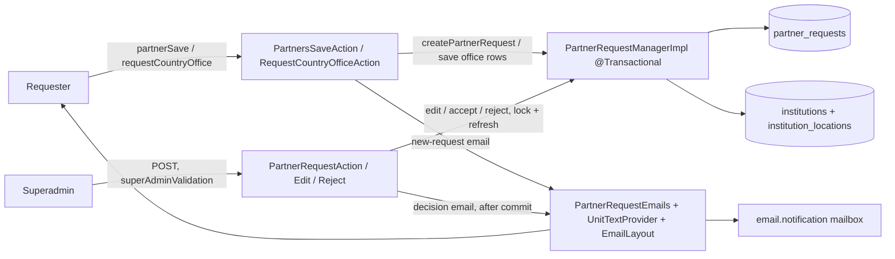

# Revive in-MARLO approval of partner requests — Design

**Spec ID:** CHG-PARTREQ-001
**Status:** Approved 2026-11-19 (owner; `judgment.md` APPROVED round 2)
**Owner:** Kenji Tanaka (IBD)
**Last Updated:** 2026-11-19
**Depth:** Standard
**Requirements:** `requirements.md` (Phase 1 approved 2026-11-19)
**Verified at:** `staging` `3e4d08bd7e`

> **Answer first.** One local path for every unit. Every write to a partner request — create, edit, accept,
> reject, accept offices, reject offices — goes through one of six `@Transactional` methods of
> `PartnerRequestManager`. The five review writes lock the row **and reload it from the database**, then refuse a
> request that is no longer pending, so a double accept or an edit racing an accept cannot corrupt the data. A
> `PartnerRequestEmails` builder assembles all six emails from the request's own unit texts and wraps them with
> `EmailLayout`. The five review actions get `superAdminValidation` ahead of their stack plus `isHttpPost()`, and the
> CRP-admin route redirects to the superadmin screen. Both pages are rebuilt in the Partners / Innovations redesign
> language, in a new `.prq` scope on the shared `--marlo-*` tokens.

---

## 1. Architecture Summary

No new layer: the flow is the 2017–2021 one, with every write's transaction boundary moved from the action into
the manager and the email assembly moved out of four actions into one builder.

## 2. Module Footprint

### marlo-data
| File | Change |
|---|---|
| `data/manager/PartnerRequestManager.java` | + `createPartnerRequest`, `editPartnerRequest`, `acceptPartnerRequest`, `rejectPartnerRequest`, `acceptOfficeRequests`, `rejectOfficeRequests` |
| `data/manager/impl/PartnerRequestManagerImpl.java` | Implements the six, each `@Transactional`; injects `InstitutionDAO`, `InstitutionLocationDAO`, `InstitutionTypeDAO`, `LocElementDAO` |
| `data/dao/PartnerRequestDAO.java` + `mysql/PartnerRequestMySQLDAO.java` | + `findForUpdate(long id)`: loads the row, then `session.refresh(entity, LockMode.PESSIMISTIC_WRITE)` so the state is re-read under the lock (P-21) |
| `data/model/PartnerRequestOutcome.java` (new, GPL header) | Result of one request: status `DONE`, `ALREADY_HANDLED`, `NOT_FOUND`, `WRONG_KIND`, `SKIPPED_EXISTING`, plus the request and, for an accept, the institution. Office methods return a list of them. **Server-side only** — never serialised (§4) |

### marlo-web
| File | Change |
|---|---|
| `utils/PartnerRequestEmails.java` (new, GPL header) | Builds subject + shell-wrapped body for the six emails from a `TextProvider`; `isEnabled(GlobalUnit)` reads the unit's email-notification switch; escapes body arguments |
| `action/projects/PartnersSaveAction.java` | Remove `sendPartnerRequest`, the `isAiccra()` branch and its imports (`ExternalPostUtils`, Apache HTTP, `JSONObject`); call `createPartnerRequest`; send the new-partner alert |
| `action/json/project/RequestCountryOfficeAction.java` | Subject + body through the builder (session unit texts); log failures |
| `action/superadmin/PartnerRequestAction.java` | `addPartner`, `addCountryOffices`, `rejectCountryOffices` call the manager; `isHttpPost()`; emails through the builder; office JSON results expose `outcome` and the `outcomes` map (§4 JSON contract); null-check order |
| `action/json/superadmin/EditPartnerRequestAction.java` | `isHttpPost()`; calls `editPartnerRequest`; `outcome` status string in the result (§4 JSON contract); log failures |
| `action/json/superadmin/RejectPartnerRequestAction.java` | `isHttpPost()`; calls `rejectPartnerRequest`; `outcome` status string in the result; email through the builder; log failures |
| `resources/struts-json.xml` | `rejectPartnerRequest`, `editPartnerRequest`, `acceptOfficesRequest`, `rejectOfficesRequest`: interceptor list as the `globalUnitLogoUpload` precedent (guard before the stack); `includeProperties` per the §4 JSON contract — edit / reject gain `success,outcome`, office results become `success,outcome,outcomes.*` |
| `resources/struts-admin.xml` | `{crp}/marloInstitutions`: `i18nFile`, `requireUser`, `superAdminValidation`, then `crpAdminStack` (no explicit `logErrorStatus`: `crpAdminStack` already runs it and `ErrorStatusLogStackCoverageTest` requires it exactly once — amended at execute 2026-11-19, T07) (an anonymous user still gets the login flow; a non-superadmin never reaches `prepare()`), and its result becomes a `redirectAction` with `namespace=/superadmin`, `actionName=marloInstitutions` (precedent: `struts-home.xml:158`) |
| `resources/global.properties` | New `marloRequestInstitution.mail.*` body keys, `marloRequestInstitution.ui.*` page / JS keys, `marloRequestCreation.saveFailed`, request-page success keys (§5.5) |
| `webapp/WEB-INF/global/views/superadmin/marloInstitutions.ftl` | Redesigned page: `.prq` scope, header + counts, outcome notes, two lists; drop the diff libs from `pageLibs`; new cache-busters |
| `webapp/WEB-INF/global/macros/institutionRequestMacro.ftl` | Rewritten markup: request card, original-vs-edited rows, inline edit form, office card, empty states; accept as POST form |
| `webapp/WEB-INF/global/macros/rejectInstitutionPopup.ftl` | Replaced by the redesign confirm / reject dialog markup |
| `webapp/WEB-INF/global/macros/allInstitutionsPopup.ftl` | Restyled into the same dialog shell (table kept) |
| `webapp/global/css/superadmin/marloInstitutions.css` | Rewritten on `--marlo-*` tokens, scoped `.prq` |
| `webapp/global/js/superadmin/marloInstitutions.js` | `type: 'POST'`; `prqDialog` helper (§5.4); inline outcome notes; strings from i18n data attributes |
| `webapp/WEB-INF/global/pages/partnersSave.ftl` | Redesigned request page: one form card, notes, i18n success copy; binding contract kept (§5.3) |
| `webapp/global/css/partnersSave.css`, `global/js/partnersSave.js` | Rewritten on `--marlo-*` tokens, scoped `.prq`; cache-busters added |
| `webapp/WEB-INF/global/views/superadmin/menu-superadmin.ftl` | Restore *Institutions* in the AICCRA branch (line 34) |
| `webapp/WEB-INF/crp/views/admin/menu-admin.ftl` | Remove *Institutions* from the non-AICCRA branch (line 14) |
| `webapp/WEB-INF/crp/views/admin/marloInstitutions.ftl` | **Not edited and no longer rendered** — the admin route redirects (DD-9). Kept on disk: cleanup scope stays literal; listed as a follow-up |
| Tests (new) | `PartnerRequestManagerGuardTest` (refusal rules on DAO doubles), `PartnerRequestEmailsTest` (subjects, bodies, escaping, switch, captured send arguments), `PartnerRequestReviewGuardTest` (POST and guard order) |

### Docs
`docs/specs/domain/admin/agent-context.md` gains a `marloInstitutions` section.

## 3. Data Model Changes

None (DA-002). `partner_requests`, `institutions`, `institution_locations` are used as they are. No migration.

## 4. API / Action Surface

| Route | Interceptors after the change | Method | Behavior |
|---|---|---|---|
| `{crp}/partnerSave` | `projectsStack` (unchanged) | POST (`name="save"`) | `createPartnerRequest`, then alert |
| `requestCountryOffice.do` | `jsonStack` (unchanged) | as today | Saves office rows, then alert |
| `superadmin/marloInstitutions` | `superAdminStack` (unchanged) | GET | Review screen |
| `superadmin/addPartner` | `superAdminStack` (unchanged) | **POST only** | Accept partner; redirect with an action message |
| `editPartnerRequest.do` | `logErrorStatus`, `requireUser`, `validPhase`, **`superAdminValidation`**, `defaultStack`, `SecurityControl` | **POST only** | Edit copy |
| `rejectPartnerRequest.do` | same | **POST only** | Reject partner |
| `acceptOfficesRequest.do` | same | **POST only** | Accept offices; JSON `success` + `outcome` |
| `rejectOfficesRequest.do` | same | **POST only** | Reject offices; JSON `success` + `outcome` |
| `admin/{crp}/marloInstitutions` | `i18nFile`, `requireUser`, `superAdminValidation`, then `crpAdminStack` (which runs `logErrorStatus`; amended 2026-11-19) | GET | Redirects to `/superadmin/marloInstitutions` |

The guard sits before `defaultStack`, so a refused call never reaches `prepare()` (the precedent order,
`struts-json.xml:704-711`). The JSON package maps `"403"` to HTTP 403 (`struts-json.xml:56-59`; `BaseAction.java:179`).

**JSON contract (plain strings only, no entity is ever serialised):**

| Action | Result `includeProperties` | Fields |
|---|---|---|
| `editPartnerRequest`, `rejectPartnerRequest` | `success,outcome` (added — today they have none) | `success` boolean; `outcome` one status string |
| `acceptOfficesRequest`, `rejectOfficesRequest` | `success,outcome,outcomes.*` | `outcome` overall status; `outcomes` map request id → status string |

Status strings: `done`, `alreadyHandled`, `notFound`, `wrongKind`, `skippedExisting`, `notAllowed` (non-POST),
`failed` (exception). A guard refusal is an HTTP 403 (the `httpheader` result may carry a container error page): the AJAX `error`
handler keys on the status, maps 403 to `.outcome.notAuthorized` and 401 (expired session) to the same note. `addPartner` turns the same statuses into an action message / error on redirect.

## 5. Frontend Composition

### 5.1 Design routing (impeccable-bridge)

| Field | Value |
|---|---|
| Skill source | `vendored (4.8.0)` — `~/.claude/skills/impeccable/` with `UPSTREAM.md`; hash verification not run at specify (no launcher call needed here) |
| Engine state | not probed — specify makes no launcher call; execute probes per phase |
| Design authority | `docs/ux-ui/design.md` — **stale**: §7 says MARLO has no token system and names Helvetica/Arial, while the shipped code uses `--marlo-*` + Figtree. Recorded as *Visual/Design Token Mismatch* drift; this spec builds against the shipped tokens and does **not** edit the authority (DD-13) |

| Screen | Page mode | Environment class | Evidence |
|---|---|---|---|
| Superadmin → *Institutions* (review) | Operate | ENV-2 | Coherent token layer in `marlo-redesign.css:13-112` (`--marlo-*`), loaded on every page (`header.ftl:51`); applied by Partners (`.ptn`), Innovations (`.dlf/.inf`), admin Phases (`crpPhases.css`, 120 `var(--marlo-*)` uses) |
| Partner request page (`partnersSave.ftl`) | Operate | ENV-2 | Same; the page includes `header.ftl` (`partnersSave.ftl:11`) |

**Direction (ENV-2, `shape` → `new-work` *Extend an existing surface*):** no new visual world. Both pages are
composed from the incumbent redesign, anchored on the Partners section for cards, fields, buttons, tags, notes and
empty states, and on the admin Phases screen for the admin list layout. A new scope class `.prq` consumes `--marlo-*`
directly, like `crpPhases.css`. No mockup was generated — the incumbent is the reference; the visual check happens on
screenshots at the HITL pause (requirements §7).

### 5.2 Component mapping

Rules are re-written inside `.prq`; values come from `--marlo-*` through the token mapping below. "New" means the
incumbent has no such variant and `.prq` defines it.

| Need | Incumbent pattern (source) | In `.prq` |
|---|---|---|
| Page container + header with summary and counts | `.container:not(.loginPage)` (`marlo-redesign.css:122`); `.phaseCycles__head` (`crpPhases.css:63-91`), `.ptn-head` (`projectPartners.css:193-198`) | `.prq-head`, `__title`, `__summary` |
| Status badge (`Pending`, `Edited`) and count badges | `.phaseBadge--upcoming` / `--open` (`marlo-redesign.css:1057-1107`); `.ptn-tag` shape (`projectPartners.css:159-171`) | `.prq-badge--pending` (warning tokens), `--edited` (brand tint) |
| Request card (head / body / foot) | `.ptn-card` (`projectPartners.css:294-304`), `.phaseCycles__card` (`crpPhases.css:95`) | `.prq-card` |
| Requested data, requester, source, date | `.dlf .inf-ro`, `__row` (`innovationForm.css:1931-1932`, scoped under `.dlf`) | `.prq-ro`, `__row` (stacks below 600 px) |
| Original vs edited (UI-003) | `.inf-ro` rows | `.prq-diff__row`: label · original (muted, struck) · edited (ink on brand tint). Only changed fields |
| Similar institutions | `.ptn-note` (`projectPartners.css:199-224`, no variants) | `.prq-note--info` (new) |
| Outcome / validation messages | none with variants | `.prq-note--success`, `--warning`, `--danger` (new) on the status tokens |
| Actions | `.ptn-btn--primary`, `--ghost`, `--danger` (`projectPartners.css:73-127`) | `.prq-btn--primary`, `--ghost`, `--danger` |
| Inline edit form, request form fields | `.ptn-field`, `.ptn-label`, `.ptn-req`, `.ptn-help`, `.ptn-error`, `.ptn-input` (`projectPartners.css:59-69,128-145,436`) | `.prq-field` family; `customForm` markup restyled inside `.prq` as `.dlf-card` does |
| Dialogs (confirm, reject, all institutions) | `.dlf-typesGuide` shell (`deliverableForm.css:410-475`); also `.ui-dialog.deliverableTypesDialog` (`deliverableForm.css:401-404`) | `.prq-dialog`, `__panel`, `__head`, `__body`, `__foot` |
| Office card (existing locations, requested countries) | `.ptn-chips` (`projectPartners.css:447-458`) | `.prq-chips`, checkbox list |
| Empty state per list | `.ptn-empty` (`projectPartners.css:797-809`), `.cycEmpty` (`crpPhases.css:651-672`) | `.prq-empty` |
| Legacy bare-`button` styling | reset in `crpPhases.css:23` | reset inside `.prq` |

**Token mapping** (the incumbents use page-local copies; `.prq` uses the shared names). Every name below was
read from `marlo-redesign.css:13-112` (`:root`) and the scoped blocks `.ptn` (`projectPartners.css:10-39`) and `.dlf`
(`deliverableForm.css:19-48`) at `3e4d08bd7e`:

| Role | Incumbent token | `.prq` uses |
|---|---|---|
| Brand / brand dark | `--ptn-primary`, `--ptn-primary-dark` / `--dlf-brand`, `--dlf-brand-dark` | `--marlo-brand`, `--marlo-brand-dark` |
| Brand tint (edited value, info note) | `--ptn-info-bg`, `--ptn-info-border` / `--dlf-info-bg`, `--dlf-info-border` | `--marlo-brand-tint`, `--marlo-brand-tint-border` |
| Headings | `--ptn-ink` / `--dlf-ink` | `--marlo-ink` |
| Body text | `--ptn-ink-soft` / `--dlf-ink-soft` | `--marlo-text` |
| Muted / subtle text | `--ptn-muted` / `--dlf-muted`, `--dlf-subtle` | `--marlo-text-muted`, `--marlo-text-subtle` |
| Borders | `--ptn-border-strong`, `--ptn-border`, `--ptn-border-soft` / `--dlf-line-strong`, `--dlf-line`, `--dlf-line-soft` | `--marlo-border-strong`, `--marlo-border`, `--marlo-border-soft` |
| Surfaces | `--ptn-surface`, `--ptn-surface-alt` / `--dlf-surface`, `--dlf-surface-alt` | `--marlo-surface`, `--marlo-surface-alt` |
| Required marker (`#c7401c`) | `--ptn-required` / `--dlf-required` | `--marlo-danger-solid` (`#c7401c`, same value) |
| Success / warning / danger notes | `--ptn-ok*`, `--ptn-warn*`, `--ptn-danger*` | `--marlo-success-bg/-border/-text`, `--marlo-warning-bg/-border/-text`, `--marlo-danger-bg/-border/-text` |
| Info note | `--ptn-info-bg`, `--ptn-info-border` | `--marlo-brand-tint`, `--marlo-brand-tint-border` (same values as the incumbent), text `--marlo-info-text` |
| Radius / shadow / focus ring | `--ptn-radius` (12px), `--ptn-radius-sm` (8px), `--ptn-shadow`, `--ptn-focus-ring` | `--marlo-radius-xl`, `--marlo-radius-md`, `--marlo-shadow-card`; focus ring as the literal `0 0 0 3px rgba(2,119,162,.12)` (no shared token exists) |
| Font | inherited | `--marlo-font-sans` |

The exact `--marlo-*` names are taken from `marlo-redesign.css:13-112` at execute; a name missing there is a spec
gap (Pivot), never invented.

### 5.3 Behavior and binding

- **Accept partner** is a POST form inside the card; `prqDialog` confirms before submit. `addPartner` redirects back
  with an action message (`superAdminStack` keeps redirect messages); the page renders action messages / errors as
  `.prq-note` above the lists.
- **AJAX** (edit, reject, accept offices, reject offices) uses `type: 'POST'`; the result's `success` / `outcome`
  selects the inline note; on success the card leaves the list.
- No `confirm()` / `alert()` / `noty` remain in `marloInstitutions.js` (UI-004).
- **Request page binding contract — kept exactly:** `activityPartner.partner.name`, `.acronym`,
  `.institutionType.id`, `.websiteLink`, `locationId`, the id hiddens (`projectID`, `fundingSourceID`, `expectedID`,
  `capdevID`, `powbSynthesisID`, `synthesisID`), `context`, `phaseID`, and the submit `name="save"` —
  `BaseAction.execute()` calls `save()` only when that parameter arrives (`BaseAction.java:1949-1952`).
- **Menus:** superadmin AICCRA branch shows *Institutions* (the `institutions` specificity has no `parameters` row,
  so the entry is visible by default — P-24); CRP-admin menu shows it in no branch.
- **Cache-busting:** new `?YYYYMMDD` on every CSS/JS file touched.

### 5.4 Dialog accessibility (`prqDialog`, in `marloInstitutions.js`)

One helper owns every dialog on the review page: sets `role="dialog"`, `aria-modal="true"`, `aria-labelledby` (dialog
title) on open; remembers the opener; moves focus to the first field (or the primary button); traps Tab / Shift+Tab
inside the panel; closes on Escape and on the cancel button; returns focus to the opener. The reject dialog's
justification is a labelled, required textarea; submitting it empty shows `.prq-error` under it and sends nothing.

### 5.5 Text catalogue (UI-001, NF-002)

| Group | Keys (all new, `global.properties`) |
|---|---|
| Review page | `marloRequestInstitution.ui.title`, `.summary` (`{0}` requests, `{1}` institutions), `.badge.pending`, `.badge.edited`, `.original`, `.edited`, `.requester`, `.source`, `.date`, `.similar`, `.empty.partners`, `.empty.offices`, `.action.accept`, `.action.edit`, `.action.reject`, `.dialog.accept.title`, `.dialog.accept.text`, `.dialog.reject.title`, `.dialog.reject.justification`, `.dialog.reject.notify`, `.dialog.cancel`, `.outcome.done`, `.outcome.alreadyHandled`, `.outcome.notFound`, `.outcome.wrongKind`, `.outcome.skippedExisting`, `.outcome.notAllowed`, `.outcome.notAuthorized`, `.outcome.failed` |
| Request page | `marloRequestCreation.saveFailed`, `marloRequestCreation.success.title`, `.success.text`, `.success.again`, `.success.close` |
| Emails | `marloRequestInstitution.mail.newPartner`, `.newOffice`, `.accepted`, `.rejected`, `.officeAccepted`, `.officeRejected`, `.supportName` (§10) |

JS reads its strings from `data-` attributes rendered by the FTL with `[@s.text]`. Apostrophes are doubled (`''`).

### 5.6 States per screen

| Screen | Loading | Empty | Error | Success |
|---|---|---|---|---|
| Review | Card-level spinner during AJAX (buttons disabled) | One empty state per list | Inline danger / warning note (failed, not authorized, already handled) | Inline success note; the card leaves the list |
| Request page | Submit disabled after click | — | Field errors + warning note; `saveFailed` danger note | Success card |

## 6. Persistence & Phase Replication Plan

Not phased data.

**Transaction model (P-5).** `.do` requests do not pass `MARLOCustomPersistFilter`: it is registered in
`WebAppInitializer`, while the `struts2` filter mapped on `/*` in `web.xml` ends the chain. The manager's
`@Transactional` is therefore the only transaction and commits when the method returns. The OpenSessionInView filter
keeps one Hibernate session for the whole request, which is why entities loaded in `prepare()` are stale inside the
manager unless refreshed (DD-3). Both facts are confirmed live by T04 before PR 1 merges and before the UI tasks build on them (P-5, P-21).

| Manager method | Inside the transaction | Refuses (no write) when |
|---|---|---|
| `createPartnerRequest(original, copy)` | save original → link copy → save copy | — (any failure rolls both back) |
| `editPartnerRequest(id, fields, justification)` | `findForUpdate(id)` → apply fields to the copy → `modified=true` | not a copy (`WRONG_KIND`), missing (`NOT_FOUND`), not pending (`ALREADY_HANDLED`) |
| `acceptPartnerRequest(id)` | `findForUpdate(id)` → institution from the copy → HQ location → copy accepted/date/institution/inactive → original inactive | same three |
| `rejectPartnerRequest(id, justification, user)` | `findForUpdate(id)` → copy rejected fields + inactive → original inactive | same three |
| `acceptOfficeRequests(ids, institutionId)` | per id: `findForUpdate` → add non-HQ location unless `findByLocation` hits (then `SKIPPED_EXISTING`: `acepted=false` + justification, as today) → close | per id: not an office row of `institutionId` (`WRONG_KIND`), missing, not pending — that id is reported, the rest proceed |
| `rejectOfficeRequests(ids, institutionId, justification, user)` | per id: `findForUpdate` → rejected fields + inactive | same per-id rules |

"Copy" = a row with a parent (`partner_request_id` not null) and `is_office = 0`. "Pending" = `is_active = 1` and
`acepted` null. The action sends emails only **after** the method returns, so a rolled-back write never sends an
email. Recipients: `DONE` outcomes, plus `SKIPPED_EXISTING` for an office accept — that requester's country is in
the institution already, so they get the office-accepted email as today (`PartnerRequestAction.java:136`, user added
before the existence check; AC FN-008). Office methods lock their ids in ascending id order, so two overlapping
batches cannot deadlock. Two different pending requests for the same institution and country are two rows: the
second accept finds the location through `findByLocation` and records `SKIPPED_EXISTING`, so no duplicate location
is created within one batch or across sequential batches; two concurrent batches for the same pair could both pass
`findByLocation` — accepted (R-9).

## 7. Validation & Save Pipeline

- `PartnersSaveAction.validate()` is unchanged and calls no `@Transactional` method.
- `save()` calls `createPartnerRequest`; on an exception it logs, sets `requestFailed` and returns `INPUT`; the page
  shows `marloRequestCreation.saveFailed` ("could not be saved"). The alert is sent only after the method returns.
- Review actions: guard order is superadmin (interceptor, before `prepare()`) → `isHttpPost()` → manager refusal rules.

## 8. Permissions & Edit Gates

- `superAdminValidation` → `BaseAction.canAccessSuperAdmin()` = `FULL_PRIVILEGES` (`BaseAction.java:707-709`).
- POST: the existing `BaseAction.isHttpPost()` (`BaseAction.java:7529`). A non-POST answers `success=false` with
  `outcome="notAllowed"` (JSON) or an action error + redirect (`addPartner`) and writes nothing.
- The requester actions (`partnerSave`, `requestCountryOffice`) keep their current stacks — they are not review
  actions (SEC-001 scope).

## 9. Specificity / Feature-Flag Strategy

None (NF-001). The `isAiccra()` branch is deleted, not replaced.

## 10. Integration Points

- **CLARISA:** the partner-request POST is removed. Its config getters (`APConfig` `getClarisaAPIHost/Username/
  Password`) and `ExternalPostUtils` then have no caller (P-7) — left in place and listed as a follow-up (cleanup
  scope stays literal). The CLARISA REST endpoints (`Institutions` → `InstitutionItem`) still accept / reject
  requests without the new guards — out of scope, accepted risk R-7.
- **Mail:** `SendMailS.send` hands the message to a mail thread (`SendMailS.java:506-507`), which logs SMTP failures
  itself; the action only sees build / dispatch failures.

### Email catalogue

Body = `email.role.dear` + body key + `email.role.bye`, wrapped by `EmailLayout.wrap(texts, assetsUrl, body)`. Texts
come from `UnitTextProvider.forCustomFile(<unit custom file>)`, as `UnsubmitProjectAction.unitTexts` does
(`UnsubmitProjectAction.java:349-356`), because `jsonStack` has no `i18nFile` interceptor (P-23).

| Email | Unit (texts + switch) | To / cc / bcc | Subject key → arguments | Body key → arguments (escaped) |
|---|---|---|---|---|
| New partner | session unit | `email.notification` / — / `email.notification` | `marloRequestInstitution.email.subject` → unit acronym, partner name | `marloRequestInstitution.mail.newPartner` → requester name, requester email, name, acronym, type, country, website, source, review URL |
| New office | session unit | same | `marloRequestInstitution.office.email.subject` → unit acronym, countries ISO, institution | `marloRequestInstitution.mail.newOffice` → requester name, requester email, institution, countries, source project |
| Partner accepted | request's unit | requester (or external mail) / approver (+ creator when external) / `email.notification` | `marloRequestInstitution.accept.email.subject` → partner name | `marloRequestInstitution.mail.accepted` → institution composed name |
| Partner rejected | request's unit | same | `marloRequestInstitution.reject.email.subject` → partner name | `marloRequestInstitution.mail.rejected` → partner name, justification |
| Office accepted | request's unit | each requester / approver / `email.notification` | `marloRequestInstitution.office.accept.email.subject` → institution | `marloRequestInstitution.mail.officeAccepted` → institution, countries |
| Office rejected | request's unit | same | `marloRequestInstitution.office.reject.email.subject` → institution | `marloRequestInstitution.mail.officeRejected` → institution, countries, justification |

- The two alerts greet the support team: `email.role.dear` with the name from a new key
  `marloRequestInstitution.mail.supportName`.
- **Switch (FN-010):** `PartnerRequestEmails.isEnabled(unit)` — same rule as today's
  `PartnerRequestAction.validateEmailNotification` (`PartnerRequestAction.java:500`) — gates every one of the six;
  the action calls it with the unit in the table. `SendMailS` itself never suppresses mail addressed to
  `email.notification` (`SendMailS.java:299-306`), so the gate must be in the action.
- **Escaping:** body arguments are HTML-escaped by the builder; subject arguments are not (plain text header).
- Old body keys stay: `InstitutionItem` still reads `marloRequestInstitution.accept.email` / `.reject.email` (P-6).

## 11. Observability

One SLF4J line per failure of a request, review write, or email build / dispatch, with the action and request id,
never an email address: `LOG.error("Could not accept partner request {}", requestId, e)`. `ALREADY_HANDLED`,
`WRONG_KIND` and `SKIPPED_EXISTING` log at WARN. SMTP delivery failures stay with the mail thread's own logging.

## 12. Performance & Scalability

Low volume (historic peak ≈ 2,000 requests/year across 18 units). `PartnerRequestAction.prepare()` still calls
`findAll()` twice — accepted (R-4).

## 13. Security Considerations

- Superadmin on all five review actions, checked before `prepare()` (SEC-001), closing C8.
- POST-only writes (SEC-002). No CSRF token — MARLO has no token pattern on these routes (R-3).
- HTML-escaping of user-supplied values in email bodies (§10).
- The CLARISA REST writer is not covered (R-7).

## 14. Backwards Compatibility & Rollout

- **Precondition (OPS-002):** production query shows no `institutions` row added by the CLARISA job after the
  cut-over date. If rows keep arriving, do not deploy.
- Rollback: revert the merge; no data migration to undo.
- Non-AICCRA units: behavior already local; they gain the alert, shell emails and the security fixes.

## 15. Decision Records

| DD | Decision | Why | Rejected |
|---|---|---|---|
| DD-1 | Delete the CLARISA branch for every unit | Option A is instance-wide (requirements Decision Log) | Specificity flag; config switch (proposal §10) |
| DD-2 | Transaction boundary in six `PartnerRequestManagerImpl` methods, create and edit included | The manager's `@Transactional` is the only transaction on `.do` (P-5); create was two transactions (orphan original) and edit could overwrite an accept (judgment JS-1) | Keep separate manager calls in the actions (C7) |
| DD-3 | `findForUpdate` = lock **and refresh** (`PESSIMISTIC_WRITE`), then the pending check | OpenSessionInView keeps entities loaded in `prepare()`; a lock without refresh reads stale state (judgment JD-1). Native `SELECT … FOR UPDATE` (as `OtpRateLimitMySQLDAO.java:77-78`) is the fallback if the refresh is not issued as `FOR UPDATE` | Pending check only; lock without refresh; unique index |
| DD-4 | Emails after the transaction returns, for `DONE` (and office `SKIPPED_EXISTING`) outcomes | A rolled-back write must not mail; an already-present office still answers its requester (AC FN-008) | Send inside the transaction |
| DD-5 | One `PartnerRequestEmails` builder, unit texts via `UnitTextProvider`, new body keys, old keys kept | Six emails share one shape; JSON actions have no `i18nFile`; `InstitutionItem` reads the old keys | Rewrite old keys; `getText` on the shared provider |
| DD-6 | `superAdminValidation` per action, placed before `defaultStack` | Precedent `globalUnitLogoUpload`; a refused call never runs `prepare()` | New stack; guard after `jsonStack` |
| DD-7 | Reuse `BaseAction.isHttpPost()` | Existing helper with 8+ callers | Struts `@AllowedHttpMethod` (new pattern) |
| DD-8 | Keep `requestFailed`; new copy key `marloRequestCreation.saveFailed` | The failure is now a save failure (UI-005) | Reuse "could not be sent" |
| DD-9 | Close the CRP-admin screen: menu removal + `superAdminValidation` + redirect to the superadmin screen; keep files | Owner decision Q2; the admin view shares the rewritten macro / CSS / JS (judgment JD-3) | Delete view and route; maintain two views |
| DD-10 | Both pages extend the incumbent redesign in a `.prq` scope on `--marlo-*` | Owner request (UI-001); ENV-2; same approach as `crpPhases.css` | Copy `.ptn-*` wholesale; shared library |
| DD-11 | Field-level "original vs edited" rows replace the character diff | A reviewer needs to know which field changed | Restyle `jquery-pretty-text-diff` |
| DD-12 | `prqDialog` and inline notes replace `confirm()`, jQuery-UI popups and `noty` on the review page | UI-004, UI-006 | Keep browser dialogs |
| DD-13 | `docs/ux-ui/design.md` §7 is not edited here | Constitutional document; drift recorded for an epic | Update it in this spec |

### Reversion challenges (Step 2.3)

| DD | Reverts | "What does removing this break?" | Outcome |
|---|---|---|---|
| DD-1 | CLARISA POST for AICCRA | (a) CLARISA stops learning about AICCRA's new institutions — intended. (b) If the sync still runs, ids collide — OPS-002. (c) The "request failed" UI state — kept by DD-8. (d) No test pins `sendPartnerRequest` (P-8). (e) `getClarisaAPI*` / `ExternalPostUtils` become dead — follow-up | No design change |
| DD-9 | CRP-admin *Institutions* entry and view | CRP admins lose a read-only view of every unit's requests; they could never act on it | Accepted by owner (Q2) |
| — | Office emails ignoring the switch (C5) | Units with notifications off stop getting office decision emails — that is the switch's purpose | No change |
| DD-11 | Character-level diff | A one-letter fix in a long name is less visible | Full original and edited values side by side; accepted |
| DD-12 | `confirm()` before accept | Without a confirm, a double accept is one click away | `prqDialog` keeps the confirmation; DD-3 makes a repeat a no-op |

### Budget (tripwire for `/akili-execute`)

| Measure | Estimate |
|---|---|
| Tasks | 12 (9 backend / email / config + 3 UI: review markup + CSS, review JS + dialogs, request page) |
| LOC | ~1,650 (Java prod ~420, tests ~380, i18n ~70, FTL ~300, CSS ~350, JS ~130) |
| Review rounds | ~20 |
| **Amended 2026-11-19 (execute, T03 gate — owner approval)** | Tripwire exceeded at 2,269 LOC after 3 / 12 tasks (Java prod 957, tests 1,304, i18n 8). New ceiling **~5,000 LOC** and **~30 review rounds**; cause: falsifier-backed tests with argument-asserting doubles and OPS-001 log tests were not in the estimate. Later test tasks reuse the existing doubles. Crossing the new ceiling stops the run again. |

> Over ~400 LOC: Phase 3 will recommend two PRs (backend + emails first, UI second).

## 16. Premise Ledger

Verified 22 · UNVERIFIED 2 (High 2, Low 0) — 24 rows
Blast-radius triggers: `live-path` (names user actions: request, edit, accept, reject), `shared-state` (the review actions and the REST items share `partner_requests` rows), `consumer` (changes i18n keys, the macro / CSS / JS shared with the admin view, the office JSON results, and removes `sendPartnerRequest`).

| # | Claim | Class | Citation (as run) | Verified at | If false | Settled by |
|---|---|---|---|---|---|---|
| P-1 | A partner request reaches `PartnersSaveAction.save()` via `{crp}/partnerSave`, and AICCRA takes the `isAiccra()` branch that skips the local save | live-path | `struts-projects.xml:718-729` → `PartnersSaveAction.save()` → `:519 if (this.isAiccra())` → `:531 sendPartnerRequest`; else `:533-538` | `3e4d08bd7e` | DD-1 targets the wrong code (High) | — |
| P-2 | Accept partner is reached from the review screen through `superadmin/addPartner` on `superAdminStack` | live-path | `institutionRequestMacro.ftl:58` → `struts-superadmin.xml:148-158` → `PartnerRequestAction.addPartner()` | `3e4d08bd7e` | Guard / POST change misses the path (High) | — |
| P-3 | Edit, reject, accept offices, reject offices are reached by AJAX on `jsonStack`, which checks only a session user | live-path | `marloInstitutions.js:31,80,154,198` → `struts-json.xml:917-931,1327-1344` → `SecurityJsonInterceptor.intercept()` (`user != null`) | `3e4d08bd7e` | SEC-001 already met (Low) | — |
| P-4 | Readers / writers of `partner_requests`: `PartnersSaveAction`, `PartnerRequestAction` (`prepare()` filters `:263-268`), `EditPartnerRequestAction`, `RejectPartnerRequestAction`, `RequestCountryOfficeAction`, `SearchInstitutionsNameAction`, `InstitutionItem` and `CountryOfficeRequestItem` (REST, via `Institutions.java:89,99,139`), `InstitutionMapper`, `CountryOfficePOJO`; FTL: both `marloInstitutions.ftl` views and `institutionRequestMacro.ftl` | shared-state | `grep -rln "partnerRequestManager\|PartnerRequestManager" marlo-web/src/main/java` → 8 files; `grep -rlnw "PartnerRequest" marlo-web/src/main/java marlo-data/src/main/java` → those 8 + `InstitutionMapper`, `CountryOfficePOJO`, DAO / manager / model; `grep -rln "partnerRequest\|countryOfficesList\|institutionRequestMacro" marlo-web/src/main/webapp/WEB-INF` → 3 FTL | `3e4d08bd7e` | A sibling reads a field set differently (Low); REST writer bypasses guards (R-7) | — |
| P-5 | On `.do` requests the manager's `@Transactional` is the only transaction and commits at method return; DAO saves use `getCurrentSession()` and join it | other | `MARLOCustomPersistFilter` registered at `WebAppInitializer.java:76`; `web.xml:41-47` maps `struts2` on `/*`; probe `docs/specs/changes/center-email-otp-login/probes/README.md:184-185` (filter does not run on `.do`; writes visible to a second connection when the call returns); saves `AbstractMarloDAO.java:407-413` (`session.save`), `:519-533` (`merge`); `UNVERIFIED — confirm at source before relying on it` for `addPartner.do` specifically | — | DD-2 atomicity / DD-4 ordering wrong (High) | T04 (owner Kenji Tanaka): forced exception after the institution save leaves no row; commit visible to a second connection before the mail call |
| P-6 | `marloRequestInstitution.accept.email` and `.reject.email` are also read by `InstitutionItem` | consumer | `grep -rn '"marloRequestInstitution.accept.email"' marlo-web/src/main` → `PartnerRequestAction.java:383`, `InstitutionItem.java:360`; `.reject.email` → `RejectPartnerRequestAction.java:149`, `InstitutionItem.java:465` | `3e4d08bd7e` | Old keys could be rewritten (Low) | — |
| P-7 | `getClarisaAPI*` and `ExternalPostUtils` have no caller outside `PartnersSaveAction` | consumer | `grep -rn "getClarisaAPI" marlo-web marlo-utils marlo-data` → `APConfig.java:321,329,337` (definitions) + `PartnersSaveAction.java:593,594,612`; `ExternalPostUtils` imported only at `PartnersSaveAction.java:49` (both judges) | `3e4d08bd7e` | They are still used (Low) | — |
| P-8 | Only `PartnersSaveActionRequestIdTest` references the touched classes; it pins `readRequestId` | consumer | `grep -rln "PartnersSaveAction\|PartnerRequestAction\|RejectPartnerRequestAction\|EditPartnerRequestAction\|RequestCountryOfficeAction\|PartnerRequestManager\|marloRequestInstitution\|sendPartnerRequest\|requestFailed" marlo-web/src/test` → 1 file; `marlo-data/src/test` does not exist | `3e4d08bd7e` | A suite breaks unseen (Low) | — |
| P-9 | No MARLO stack uses Struts `httpMethod`; `BaseAction.isHttpPost()` exists | existence | `grep -rn "httpMethod\|AllowedHttpMethod" marlo-web/src/main/resources marlo-web/src/main/java/org/cgiar/ccafs/marlo/action marlo-web/src/main/java/org/cgiar/ccafs/marlo/interceptor` → 0 (the wider `src/main` returns 10 REST hits — 5 `String httpMethod` declarations and their 5 uses, unrelated); `BaseAction.java:7529` | `3e4d08bd7e` | DD-7 could use the interceptor (Low) | — |
| P-10 | `superAdminValidation` is declared in the JSON package and used per action before `defaultStack` | existence | `struts-json.xml:21-22`; `:704-711` (`globalUnitLogoUpload`) | `3e4d08bd7e` | DD-6 needs a declaration (Low) | — |
| P-11 | `created_by` is filled by the audit listener, so the requester is known | data-env | `AuditColumnHibernateListener.java:97`; `PartnerRequest.java:24` (`extends MarloAuditableEntity`); historic rows have `created_by` (`aiccradb2`) | `3e4d08bd7e` | Decision emails have no recipient (High) | — |
| P-12 | `EmailLayout.wrap(TextProvider, assetsUrl, body)` applies a unit's shell; `email.role.dear` / `.bye` are the shell greeting / sign-off (overridden in `aicrra`, `aiccra3`, `reap`) | other | `EmailLayout.java:45-65`; `CrpUsersAction.java:584-593`; `global.properties:3809,3895` | `3e4d08bd7e` | Emails not in the new format (High) | — |
| P-13 | Office accepted / rejected emails skip the notification switch today | other | `PartnerRequestAction.java:436,471` call `sendMail.send` with no check | `3e4d08bd7e` | FN-010 already met for offices (Low) | — |
| P-14 | Office rows are saved with an institution and no parent; the review lists them by `isOffice && institution != null` | shared-state | `RequestCountryOfficeAction.java:113-121`; `PartnerRequestAction.java:266-267` | `3e4d08bd7e` | Office methods read the wrong rows (High) | — |
| P-15 | The review URL works as `{baseUrl}/superadmin/marloInstitutions.do` without `phaseID` | data-env | `ValidPhaseInterceptor` invokes through when no `phaseID` parameter is present (both judges) | `3e4d08bd7e` | Link answers 404 (Low) | — |
| P-16 | `institutions.id` is the CLARISA code; the next auto-increment (11898) would be the next CLARISA code | data-env | `aiccradb2`: `MAX(id)` 11897, `AUTO_INCREMENT` 11898; 46 rows added 2026-10-19 → 2026-11-10 at fixed hours, ids 10504–11897 (35 of them 11863–11897) | `3e4d08bd7e` (DB copy, not prod) | No collision risk (Low) | Owner — OPS-002 production query |
| P-17 | `marlo-redesign.css` (`--marlo-*`) and Figtree load on every page, superadmin and `partnersSave.ftl` included | other | `header.ftl:41,51`; `marlo-redesign.css:15,19-20`; `partnersSave.ftl:11` includes `header.ftl` | `3e4d08bd7e` | `.prq` has no tokens (High) | — |
| P-18 | An admin screen already builds on `--marlo-*` | other | `grep -c "var(--marlo-" crp/css/admin/crpPhases.css` → 120 | `3e4d08bd7e` | DD-10 has no precedent (Low) | — |
| P-19 | Redesign-styled dialogs exist only in the deliverable form (`.dlf-typesGuide`, `.ui-dialog.deliverableTypesDialog`) | existence | `deliverableForm.css:401-404, 410, 420` | `3e4d08bd7e` | A shared dialog could be reused (Low) | — |
| P-20 | The diff libs are loaded by the review page only for its (commented-out) character diff; `historyDiff` uses them elsewhere, unaffected | consumer | `marloInstitutions.ftl:4`; `marloInstitutions.js:241-242` (commented call) | `3e4d08bd7e` | Removing them breaks the page (Low) | — |
| P-21 | `session.refresh(entity, LockMode.PESSIMISTIC_WRITE)` issues `SELECT … FOR UPDATE` on MySQL and overwrites the entity's stale state | other | `UNVERIFIED — confirm at source before relying on it` — no `LockMode` use exists in `marlo-data` (`grep -rn "LockMode\|LockOptions\|PESSIMISTIC" marlo-data/src/main/java` → 0, judge B) | — | DD-3 does not prevent the duplicate (High) — fall back to the native `SELECT … FOR UPDATE` state read | T04: two concurrent accepts on a throwaway DB copy → one institution, one `ALREADY_HANDLED`; SQL log shows `for update` |
| P-22 | The kept CRP-admin view imports the macros and assets this spec rewrites | consumer | `crp/views/admin/marloInstitutions.ftl:4-11` (assets), `:24, :54, :57` (macro / popups) | `3e4d08bd7e` | DD-9 redirect unnecessary (Low) | — |
| P-23 | `jsonStack` has no `i18nFile`; `UnsubmitProjectAction` reads unit texts with `UnitTextProvider` for that reason | other | `struts-json.xml:28-34`; `UnsubmitProjectAction.java:345-356` | `3e4d08bd7e` | `getText` would suffice (Low) | — |
| P-24 | No `parameters` row has key `institutions`, so `specificityValue('institutions')` is empty and the menu entry is visible | data-env | `aiccradb2`: `SELECT COUNT(*) FROM parameters WHERE key='institutions'` → 0; `menu-superadmin.ftl:34` | `3e4d08bd7e` (DB copy) | Entry hidden in AICCRA (Low) | Live check in the UI task |

## 17. Open Risks

| # | Risk | Mitigation |
|---|---|---|
| R-1 | CLARISA sync still running in some environment (P-16) | OPS-002 production query before release |
| R-2 | Email render in real clients | Live send on a throwaway DB copy, owner review |
| R-3 | No CSRF token on the POST actions | Accepted: same level as the rest of MARLO's JSON actions |
| R-4 | `prepare()` loads all requests twice | Accepted (low volume) |
| R-5 | `docs/ux-ui/design.md` §7 contradicts the shipped tokens (DD-13) | Validate against `--marlo-*`; propose an epic |
| R-6 | Visual fidelity has no automated gate | Screenshots at 1280 / 390 px at the HITL pause; Impeccable critique + audit in `/akili-validate` |
| R-7 | The CLARISA REST endpoints (`Institutions` → `InstitutionItem`) accept / reject without the pending guard or lock | Out of scope; record in `agent-context.md`; follow-up ticket |
| R-8 | DA-001 / DD-3 cannot be proven by unit tests on doubles | Live rollback and concurrency checks on a throwaway DB copy (P-5, P-21) |
| R-9 | Two concurrent office batches for the same institution and country could both add the location | Accepted: superadmin-only, rare; the existing `findByLocation` check covers sequential batches |
