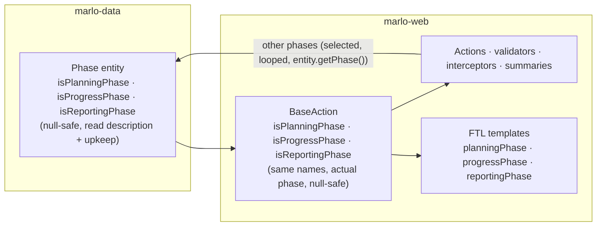

# Phase Type Unification and Cycle Names — Design

**Spec ID:** ENH-PHASE-TYPE-UNIFICATION-001
**Status:** Draft
**Owner:** IBD Team — Kenji Tanaka
**Last Updated:** 2026-10-28
**Depth:** Full
**Verified at:** commit `9e2a9ed838` unless a row says otherwise
**Requirements:** `requirements.md` · **Call-site inventory:** `call-sites.md` (generated evidence for the Premise Ledger)

---

## 1. Architecture Summary

The rule that classifies a phase moves into the `Phase` entity, and every caller asks it. The design changes no
replication, no persistence path and no endpoint. Only the place where the classification is computed moves,
and later the stored phase names change.

Two layers with the **same three names**:

| Layer | Answers about | Why it exists |
|---|---|---|
| `Phase` | the phase object it is called on | managers, interceptors, summaries and loops evaluate phases other than the actual one, and `marlo-data` cannot reach `BaseAction` (P-3) |
| `BaseAction` | the actual phase, returning `false` when there is none | `getActualPhase()` **can return `null`** (P-1). Every old type method guards against that, so a caller rewritten as `getActualPhase().isReportingPhase()` would throw where today it reads `false`. The `BaseAction` methods keep that guard in one place |

This corrects an earlier conversational claim that the `BaseAction` layer could be dropped. It cannot be dropped
without breaking FN-004 (§15, DD-2).

## 2. Module Footprint

### marlo-data
- `data/model/Phase.java` — adds the three type methods. `isReporting()` delegates to `isReportingPhase()`.
- `data/manager/impl/GlobalUnitCreationManagerImpl.java` — `createPhases` names phases by type (FN-007).
- `config/APConstants.java` — `PROJECT_INDICATOR_PHASE_PREVIOUS_NAME` is removed once its 6 `BaseAction` uses
  are migrated. `POWB_ACRONYM` **stays**: `ProgressReportProcessPOISummaryAction:1498` uses it to build the
  report file name "AWPB Year Report_", which is not a type decision (P-9).

### marlo-web
- `action/BaseAction.java`:
  - adds the three actual-phase methods;
  - makes the six old methods delegate to them, then removes them (FN-005);
  - removes the write-only fields and setters;
  - migrates the 6 `PROJECT_INDICATOR_PHASE_PREVIOUS_NAME` sites.
- `action/superadmin/GlobalUnitCreateAction.java`: the text path `parsePhaseLine` (FN-007).
- Every caller in `call-sites.md` §A1, §A2 and §B, outside `rest/`. §A1 holds 421 lines in 117 files: 44 Java
  (2 of them tests) and 73 FTL. §B adds 5 edited files not in §A1: `OutcomesMilestonesAction`,
  `ExpectedDeliverablesSummaryAction`, `FundingSourcesSummaryAction`, `ProjectsFundingSourcesSummaryAction` and
  marlo-web `APConstants`. `javascript-constants.ftl:30-31` is in §A1. The estimate is about 135 files in all,
  counting the new files (§17).
- `config/APConstants.java`: as in marlo-data.
- `src/test/java`: the new characterization, equivalence and creation tests, plus the 2 rewritten doubles
  (P-10).
- Migrations: 2 new files under `src/main/resources/database/migrations/`.

### Repository root
- `configuration/marlo-checkstyle.xml` — one rule that rejects the removed method names in Java (NF-003; P-11).

### Not touched
- `rest/`, every `ManagerImpl` replication method, `PhaseDAO.findCycle`, `getCrpPhase`, `getPhasesByCycles`,
  and `crpPhases.ftl:227`.

## 3. Data Model Changes

No schema change. Two DML migrations, named by the `marlo-migration` script from the real clock:

| Id | Purpose | Shape | Order |
|---|---|---|---|
| M1 | DA-001 | Correct `description = 'Planing'` to `Planning` by text match | First; prerequisite of the strict definitions (DD-3) |
| M2 | DA-002 | Change `name` of the plan / progress / reporting phases of units after AICCRA, from either family: `POWB` / `UpKeep` / `AR`, or `AWPB` / `Progress` / `AR` for units copied from the AICCRA template (JD-9). The cutoff is the lowest id with `acronym = 'AICCRA'`, every unit with that acronym is excluded, and a row changes only if its `description` + `upkeep` match its name's type | Last; after the code tasks (OPS-001) |

**Backfill:** none. **Entity changes:** behavior methods only; no mapped field changes.

**Safety:** the 8-scenario dry run, the idempotence check and the no-id check are in `requirements.md` §6 (AC for
DA-001, MIG-001, MIG-002). Expected counts are computed by a SELECT before each run, never fixed (JD-2). The SQL
drafts re-validated after JD-9 on 2026-10-28 are the starting point: expected equalled actual in all 8 scenarios,
and the throwaway schema was dropped.

## 4. API / Action Surface

- **Struts actions:** no new action and no routing change.
- **Spring MVC REST:** none. `rest/` is out of scope (requirements §4).
- **JSON endpoints:** none changed. The Struts JSON plugin serializes only the action class's own properties by
  default (`ignoreHierarchy = true`), so `BaseAction`'s old or new getters never appear in a JSON payload (P-12,
  JD-4).

## 5. Frontend Composition

**FTL replacement table.** Whole-word, closed list. Each form keeps its surrounding `!default`, `?exists` and
parentheses exactly as they are.

| Today | After |
|---|---|
| `reportingActive`, `action.isReportingActive()` | `reportingPhase`, `action.isReportingPhase()` |
| `upKeepActive`, `UpKeepActive`, `action.isUpKeepActive()`, `action.isProgressActive()` | `progressPhase` / `action.isProgressPhase()` |
| `action.isPOWB()`, `action.isAWPBActive()`, and the property `POWB` (`guide-button.ftl:91, 225`: `POWB?exists && POWB`) | `action.isPlanningPhase()` / `planningPhase` |
| `planningActive`, `action.isPlanningActive()` | `(planningPhase \|\| progressPhase)` |
| `isPlanningCycle && !isUpkeepCycle` (`projectContributionCrp.ftl:561`) | `planningPhase` |
| `actualPhase.name != 'Progress'` (`deliverableMacros.ftl:367, 411`) | `!progressPhase` (INT-2) |

- **FTL locals, assigns and macro parameters** that share an old name (`call-sites.md` §A2) are **not** handled
  by the property rule. Each is renamed together with its definition and every caller in the same batch:
  - `isProgressActive` locals in `innovationTemplates.ftl:136` and `projectInnovation.ftl:113` become
    `isProgressPhase`;
  - the `isReportingActive` parameter of the 7 list macros in `deliverableListTemplate.ftl` and
    `homeDashboard.ftl`, and its callers (`deliverableList.ftl:188, 191, 226`, …), becomes `isReportingPhase`.

  A blind whole-word rewrite would turn a local into a property read (JD-3).
- **Excluded identifiers** (`call-sites.md` §A3), never rewritten:
  - the action name `isProgressActive` (`struts-json.xml:74`) and its URL (`global.js:39, 210`);
  - the JS globals' names;
  - the comment in an applied migration;
  - `ProgressActiveValidationAction`;
  - `reportingActiveMenu` (`main-menu.ftl:4`; only its right-hand side changes).
- **JS:** no JS file changes. The globals in `javascript-constants.ftl:30-31` keep their JS names `reportingActive`
  / `upKeepActive`; only the FTL expression on the right-hand side changes.
- **Unchanged FTL:** `crpPhases.ftl:227`, and every display of `phase.name` / `composedName`.

**Resolution mechanism.** Top-level names such as `reportingPhase` resolve through the Struts value stack to the
action's `isReportingPhase()`, the same mechanism that resolves `reportingActive` today (P-5). The new
`BaseAction` methods return primitive `boolean`, as the old ones do.

## 6. Persistence & Phase Replication Plan

**Unchanged.** No `ManagerImpl`, no save chain and no delete chain is edited. The replication triggers in
`marlo-data` keep reading `description`, and DA-001 corrects the only data that misreads it (P-6).

## 7. Validation & Save Pipeline

Unchanged in order and content. The validators that call the old type methods are:
- `DeliverableValidator:173, 494, 806`;
- `ProjectExpectedStudiesValidator:755`;
- `ProjectOutcomeValidator:193, 304, 416`;
- `ValidateProjectSectionAction:222, 298, 406, 551`.

They call the new methods with identical results (FN-002, NF-005).

**Guarded and negated sites (DD-11, JD-1).** `ProjectOutcomeValidator:191-194` reads
`getActualPhase() != null && getName() != null && !POWB && !AWPB`. It is false on a null or empty phase, so the
achieved-value check is skipped there. A bare `!isPlanningPhase()` would be true and would run the check. The
replacement is the positive complement among the three types: actual phase is a progress or a reporting phase.
That is false on the empty and the null phase, and equal on every real phase.

`OutcomesMilestonesAction:426-428` (`current.getName() != null && !POWB && !AWPB && …`) is rewritten the same way.
Its loop stops on a name-less phase today and on an untyped phase after the change.

## 8. Permissions & Edit Gates

Interceptors that call the type methods are migrated with identical results:
- `EditDeliverableInterceptor:350, 370`;
- `EditProjectOutcomeInterceptor:353`;
- `CanEditPowbSynthesisInterceptor:112, 165`.

`165` stays the redundant check it is today, now spelled as the cycle expression. No interceptor stack, no
permission string and no `generatePermission` input changes.

## 9. Specificity / Feature-Flag Strategy

Not applicable. INT-2 applies to every progress phase by design, and the shared-cluster block itself stays behind
`deliverable_shared_clusters_trainees_active` as today.

## 10. Integration Points

- **REST v2:** untouched (requirements §4).
- **QA `qa_innovations` view:** coordinated, not changed (OQ3).
- **BI / CLARISA readers of `phases.name`:** unknown to the repo (OQ2, accepted risk D-row in requirements).

## 11. Observability

No new logs. INT-3 replaces the known exception paths (requirements §3) with `false`. `isUpKeepActive()` has no
try/catch, and a few callers wrap such calls in a try/catch that logs and skips. How each FTL form behaves today on
a null phase was not rendered, so the NF-002 page without a global unit is the check (JD-12).

## 12. Performance & Scalability

Neutral. The new methods compare two fields in memory, where the old ones compared strings. No query is added.

## 13. Security Considerations

- The public setters `setPlanningActive` / `setReportingActive` let any request bind those fields. Nothing reads
  them (P-8), and their removal removes that bindable surface.
- No authorization outcome changes (§8).

## 14. Backwards Compatibility & Rollout

| Stage | Contents | Revertible by | Behavior change |
|---|---|---|---|
| S0 | Production read-only check of the `description` / `upkeep` combinations (OPS-003) | — | None; a non-standard combination stops the rollout |
| S1 | M1 | Data repair; not reverted. The changed ids are captured by the pre-run SELECT and recorded in the release notes, in case a targeted reversal is ever needed | INT-4: every `Planing` row (12 in `aiccradb_actsave`, 6 in `aiccradb1`–`4`, production counted at S0) |
| S2 | Characterization tests, then the `Phase` methods, then delegation | `git revert` | None (FN-002) |
| S3 | Migration batches, then removal of the old methods and the Checkstyle rule | `git revert` per batch | None, except INT-2 at its batch |
| S4 | Creation by type | `git revert` | New units only |
| S5 | M2 + draft check | By the `(id, name)` list captured by a SELECT just before M2 runs and recorded in the release notes. A reversal "by type" cannot restore which family a row came from (`POWB` or `AWPB`, `UpKeep` or `Progress`) (RJ-5) | INT-1 |

**Rollback after S5:** reversing M2 restores each row from the `(id, name)` list captured by the SELECT run just
before M2 and recorded in the release notes (S5, requirements OPS-004). A reversal keyed on cutoff and type cannot
tell `POWB` from `AWPB` or `UpKeep` from `Progress` (FJ-1). The code from S2–S4 works with either set of names,
because no non-REST logic reads `name` after S3.

## 15. Decision Records

- **DD-1 — The classification lives on `Phase`.** Alternatives: `BaseAction` only, rejected by P-3; a static
  utility, rejected because the entity already carries `isReporting()` and FTL already calls it
  (`timeline-phases.ftl:148`). Requirements FN-001.
- **DD-2 — `BaseAction` keeps three same-named, null-safe methods for the actual phase.** Alternative: callers
  use `getActualPhase().isXxxPhase()` directly. Rejected by P-1: `getActualPhase()` returns `null` at
  `BaseAction:2090` (phase id not found) and `:2146` (session phase not reloadable), and every old method guards
  against it. Requirements FN-004, NF-001.
- **DD-3 — Strict definitions.**
  - Reporting phase = `description` equals `Reporting`.
  - Plan phase = `description` equals `Planning` and `upkeep` is false.
  - Progress phase = `upkeep` is true.
  - Planning cycle = plan phase or progress phase.

  Alternative: cycle = "not reporting". Rejected because it is true for the empty phase (FN-003). Typo
  tolerance is replaced by M1. Requirements FN-002, FN-003; P-2, P-6.
- **DD-4 — No fourth "planning cycle" method.** The cycle is written as plan-or-progress at each of its ~40 call
  sites. Alternative: a cycle method. Rejected by the owner, because a second "planning" name would be confused
  with the plan phase (requirements §9).
- **DD-5 — Migration by compatible stages.** The old methods delegate first and are removed last. Each batch is
  closed by the rendered-HTML diff. Alternative: one bulk replacement. Rejected because FTL misresolution is
  silent (D3). Requirements NF-001, NF-002.
- **DD-6 — The shared-cluster exemption is keyed to the progress phase (INT-2).** This is a reversion of the
  lock for non-AICCRA progress phases; the §15a challenge applies.
- **DD-7 — `crpPhases.ftl:227` is kept.** Requirements §9.
- **DD-8 — Creation names by type in the manager.** It covers both the admin path and the text path. An
  unknown-type input phase keeps its copied name. Requirements FN-007; P-7.
- **DD-9 — Old names are blocked by a Checkstyle regexp rule, written in this spec.** The console-printing
  precedent `0a17b19671` is not on this branch: it is only on `logging-json-appender`, and
  `configuration/marlo-checkstyle.xml` has no Regexp rule at `9e2a9ed838` (JD-5). Requirements NF-003; P-11.
- **DD-10 — M2 runs last.** Requirements OPS-001.
- **DD-11 — Two kinds of negation, two rules (JD-1, RJ-1).**
  1. **Negation of an old null-safe `BaseAction` method** stays a bare negation of its replacement:
     - `!isPOWB()` and `!isAWPBActive()` become `!isPlanningPhase()`;
     - `!isReportingActive()` becomes `!isReportingPhase()`;
     - `!isProgressActive()` becomes `!isProgressPhase()`;
     - `!isPlanningActive()` becomes `!(isPlanningPhase() || isProgressPhase())`.

     The old and new methods both return `false` on the empty and the null phase, so the negations are equal on
     all five inputs. The exception is `isUpKeepActive()`, which throws there today: `!upKeepActive` /
     `!isUpKeepActive()` falls under INT-3 (FJ-2). Rewriting these as a complement would flip about 30 sites to `false` on the empty phase,
     among them `DeliverableValidator:494, 806`, `ProjectExpectedStudiesValidator:755`,
     `projectContributionCrp.ftl:200` and `studiesTemplates.ftl`.
  2. **An inline test on a raw `Phase` field** (`getName()`, `name`) that is guarded (`x != null && …`) or negated
     becomes the positive complement among the three types. This keeps the guard's `false` on the empty and the
     null phase. Known sites: `ProjectOutcomeValidator:191-194`, `OutcomesMilestonesAction:426-428`; the positive
     tests of `ExpectedDeliverablesSummaryAction:352-356` become `isProgressPhase()`. **Not under this rule:**
     `deliverableMacros.ftl:367, 411` (`actualPhase.name != 'Progress'`) is unguarded and throws today on a missing
     name. It becomes the bare `!progressPhase`, which is INT-2 on UpKeep phases and INT-3 on a missing phase
     (FJ-3).

  Each site's mapping is proven by its five-input truth table (NF-005). Requirements NF-005; P-15.

### 15a. Reversion challenge (Step 2.3)

Reversions in this design:
- DD-6, the lock removed for non-AICCRA progress phases;
- the removal of the six old methods, the two write-only fields and setters, and two constants.

Challenge question: "what does removing this break?" Its outcome is recorded here before `tasks.md`.

Run on 2026-10-28 by an independent read-only reviewer (opus). It used grep and file reads at `9e2a9ed838`,
with no build.

| Item | Verdict | What it found | Design response |
|---|---|---|---|
| R1 — INT-2 lock removed in non-AICCRA progress phases | **Safe**, a behavior change | No server-side check depends on the lock. `DeliverableAction:3414-3430` saves the cluster participants in reporting and progress without calling `isSubmit()`; `:3906-3947` only null-guards. The save writes the current phase and copies forward to `getNext()` only, so the submitted plan-phase row is never touched. The server delete guards already use `!isProgressActive()` (`BaseAction:1268`, `CanDeleteDeliverableWithSharedTrainees:62`), so the view now agrees with them. In JS, only `global.js:411-420` reads `p[issubmit]`. | None needed; INT-2 stands |
| R2 — removing the 6 old methods | **Breaks unless the views migrate too** | FTL resolves the bean property names: `reportingActive`, `upKeepActive`, `planningActive`, and **`POWB`** at `guide-button.ftl:91, 225` (`POWB?exists && POWB`), which the first inventory missed. The `javascript-constants.ftl:30-31` globals feed 7 JS reads (`safeguards.js:116`, `projectDescription.js:287`, `deliverableInfo.js:618, 784, 814`, `projectStudy.js:607`, `outcomes.js:169`). JSON results do not expose these properties: ten set `root`, two only `includeProperties=success`, none sets `ignoreHierarchy`. No reflection, string-keyed access or XML/OGNL use was found. The two test doubles fail to compile. | `POWB` added to §5 and to `call-sites.md` §A. Removal stays last (DD-5), after every FTL form is migrated and the HTML diff passes. P-12 is now verified |
| R3 — fields and setters | **Safe** | No reader, no caller, no posted parameter of that name. `javascript-constants.ftl:30` is a JS variable, not a posted value | Removed in the last code batch, together with the methods |
| R4 — the two constants | **Safe once callers migrate**, with one exception | `PROJECT_INDICATOR_PHASE_PREVIOUS_NAME` is used only at `BaseAction:3966, 3982, 4230, 4243, 4584, 4597`. `POWB_ACRONYM` also builds a report file name at `ProgressReportProcessPOISummaryAction:1498`. Nothing in `rest/`, tests, FTL or i18n uses either | `POWB_ACRONYM` is kept (§2, P-9) |

## 16. Open Risks

| # | Risk | Owner |
|---|---|---|
| OR-1 | FTL misresolution in a batch (D3) | rendered-HTML diff per batch; the batch does not close without it |
| OR-2 | Running the local app for the diff kills other sessions' servers: `run-marlo-java17.sh` stops `cargo:run` and rewrites `marlo-dev.properties` | the Leader schedules HTML captures only when no other session is building (root `CLAUDE.md`, *Concurrency*) |
| OR-3 | External `phases.name` readers | OQ2, before M2 |
| OR-4 | QA view | OQ3, before M2 |

## 17. Budget (Step 2.4 tripwire)

| Measure | Expected |
|---|---|
| Tasks | 16 (`tasks.md` T00–T15; T00 and T07 were split out at decomposition: the production check and the HTML harness) |
| Files | ~135 in total (RJ-3): - 117 in `call-sites.md` §A1 - 5 more from §B - 4 not in either list: `Phase.java`, `GlobalUnitCreationManagerImpl.java`, `GlobalUnitCreateAction.java`, marlo-data `APConstants.java` - ~9 new or support files: Checkstyle config, 2 migrations, ~4 tests, ~2 docs |
| LOC changed | ~1,270 shipped, the per-task sum in `tasks.md` §9. Tests are a large part (~460 across T02, T03, T05, T12). The design-time figure of ~1,015 undercounted the tests |
| Review rounds | ~24 (1.5 per task; the FTL batches T08–T10 may need 2 each for the HTML diff) |

The declared depth, Full, matches. The large LOC count is volume, not complexity: most of it is the closed
replacement table.

## 18. Premise Ledger

**Count:** 15 premises; 14 verified, 1 `UNVERIFIED` (0 High, 1 Low). P-2 is verified locally and settled for
production by OPS-003. Revised in Judgment Day round 1: P-2, P-5, P-6, P-11, P-12 and P-13; P-15 added.
**Blast-radius triggers fired:**
- `live-path`: the design names user actions (the participants section; unit creation).
- `shared-state`: it changes base-class methods used across the app.
- `consumer`: it removes exported symbols and changes a stored field.

| # | Claim | Class | Citation (as run) | Verified at | If false | Settled by |
|---|---|---|---|---|---|---|
| P-1 | `BaseAction.getActualPhase()` can return `null` as well as the empty phase | existence | `BaseAction.java:2090` returns `phaseManager.getPhaseById(phaseID)` unchecked; `:2146` returns `getPhaseById` / `getPhaseFromCurrentPhaseParam()` unchecked; empty phase at `:2054, 2065, 2134, 2156, 2163` | 9e2a9ed838 | DD-2 changes: callers could ask the phase directly (High) | — |
| P-2 | Name, description and upkeep agree on every local phase except the `Planing` rows. Production is not covered | data-env | SQL row-by-row comparison of old vs strict rules over `phases` on `aiccradb_actsave`, `aiccradb1`–`4`: the only differences are `Planing` rows, 0 after simulating M1 (MySQL 8.0.43 local). Both judges reproduced the grouping. The copies are not independent of each other (JD-7) | 9e2a9ed838 | DD-3 changes: definitions must tolerate other combinations (High) | Production: OPS-003 check before the first code task (owner: release HITL) |
| P-3 | `marlo-data` cannot depend on `BaseAction` | location | `marlo-data/pom.xml` depends on `marlo-utils` only; `marlo-web/pom.xml` on `marlo-data` + `marlo-utils` (`grep artifactId>marlo` in both poms) | 9e2a9ed838 | DD-1 changes (Low) | — |
| P-4 | Every Struts action extends `BaseAction`, so the actual-phase methods are reachable from every template | location | `grep -rlE "extends ActionSupport\|implements Action\b" marlo-web/src/main/java` → only `action/BaseAction.java` | 9e2a9ed838 | FTL replacement needs another source for some pages (High) | — |
| P-5 | A top-level FTL name resolves to the action's `is…()` getter (`reportingActive` → `isReportingActive()`), so `reportingPhase` → `isReportingPhase()` resolves the same way | data-env | 205 FTL occurrences of `reportingActive`, on 201 lines in 71 files, render today (`call-sites.md` §A1). FTL **locals and macro parameters** that share old names do exist (§A2, JD-3) and are renamed separately; no FTL assigns or macro parameter defines `reportingActive`, `upKeepActive`, `planningActive`, `planningPhase`, `progressPhase` or `reportingPhase` (`grep -rnE "\[#(assign\|local\|global) +(reportingActive\|…)"` and `grep -rnwE "planningPhase\|progressPhase\|reportingPhase"` over `marlo-web/src` → only local variables in `ActivityManagerImplReplicationTest`) | 9e2a9ed838 | The FTL replacement form changes to `action.isXxxPhase()` (Low) | — |
| P-6 | `description = 'Planing'` sits on AICCRA's 2028–2030 plan / progress phases **and spreads to every unit created from the AICCRA template**. Nothing in code or migrations reads `Planing` | data-env | `SELECT COUNT(*) FROM phases WHERE description='Planing'` → `aiccradb1`–`4`: 6 (435, 436, 438, 439, 441, 442); `aiccradb_actsave`: 12, adding 507, 508, 510, 511, 513, 514 on unit 50 (QATEST, created 2026-10-28 17:26 from AICCRA). `grep -rn "Planing" marlo-web/src/main marlo-data/src/main` → none. M1 matches by text, so the count does not matter | 9e2a9ed838 | — (corrected after JD-2) | Production count recorded at S0 / S1 |
| P-7 | Unit creation reaches `GlobalUnitCreationManagerImpl.createPhases` on both paths | live-path | Admin: `GlobalUnitCreateAction:756` `createManagementGlobalUnit` → `:793` `createGlobalUnit` → manager `:163` `createPhases` (`:519`). Text path: `save()` `:231` `parsePhasesDefinition` → `:253` `createGlobalUnit` → `:163`. The template's phase fields are copied at `GlobalUnitCreateAction:831-841` | 9e2a9ed838 | DD-8 moves to the action layer (Low) | — |
| P-8 | `planningActive` / `reportingActive` fields are written by their setters only and never read; no caller of the setters | existence | `grep -rnE "\.set(Planning\|Reporting)Active\(" marlo-web/src` → none; `grep -nE "this\.(planningActive\|reportingActive)\b" BaseAction.java` → only in the setters `:8925, 8929` | 9e2a9ed838 | Removal could break a binding (Low) | Reversion challenge §15a |
| P-9 | `PROJECT_INDICATOR_PHASE_PREVIOUS_NAME` has no use left once its 6 `BaseAction` sites are migrated. `POWB_ACRONYM` keeps one non-type use | consumer | `grep -rn "POWB_ACRONYM\|PROJECT_INDICATOR_PHASE_PREVIOUS_NAME" marlo-web/src marlo-data/src marlo-utils/src` (reversion challenge, as run) → declarations `marlo-web APConstants:379, 701`, `marlo-data APConstants:345`; uses `BaseAction:3966, 3982, 4230, 4243, 4584, 4597, 6350, 7742`, `OutcomesMilestonesAction:428`, `ProjectOutcomeValidator:194`, `ProgressReportProcessPOISummaryAction:1498` (file name); none in `rest/`, tests, FTL or i18n | 9e2a9ed838 | A constant removal breaks a file name (Low) | — |
| P-10 | Two tests override old type methods | consumer | `grep -rlnE "is(POWB\|AWPBActive\|PlanningActive\|ProgressActive\|UpKeepActive\|ReportingActive)\(" marlo-web/src/test` → `action/BaseActionGlobalUnitRulesTest.java` (`:104` isUpKeepActive), `validation/projects/ProjectActivitiesValidatorCancelledTest.java` (`:46` isReportingActive) | 9e2a9ed838 | More doubles to rewrite (Low) | — |
| P-11 | Checkstyle 8.18 (the version run directly in this repo) can reject a method call by name with a `RegexpSinglelineJava` rule in `configuration/marlo-checkstyle.xml` | other | `UNVERIFIED — confirm at source before relying on it`. The precedent `0a17b19671` is **not** an ancestor of HEAD (`git merge-base --is-ancestor 0a17b19671 HEAD` → no; only `logging-json-appender` holds it), and `configuration/marlo-checkstyle.xml` has no Regexp rule at HEAD (JD-5) | — | NF-003 needs another gate (Low) | The Checkstyle-rule task, as its first step: add the rule and observe a red on a seeded use |
| P-12 | No Struts JSON result, OGNL expression, reflection or string-keyed property exposes the old type methods by name. Their FTL property forms are exactly those in `call-sites.md` §A, including `POWB` | consumer | Reversion challenge (as run): `grep -rnE "\"(isPOWB\|…\|reportingActive)\"" marlo-web/src/main/java marlo-data/src/main/java` → only `"POWB"` name literals; `grep -rnE "getMethod\(\|getDeclaredMethod\(\|PropertyUtils\|BeanUtils\.getProperty" marlo-web/src/main/java` → none relevant; `grep -rn "ignoreHierarchy" marlo-web/src/main/resources` → none, so every JSON result uses the plugin default. Struts JSON plugin 6.8.0 sources: `JSONResult.java:87` `ignoreHierarchy = true`; `DefaultJSONWriter.java:226-291` serializes the root with `Introspector.getBeanInfo(clazz, clazz.getSuperclass())`, so only the action's own properties and never `BaseAction`'s (JD-4: judge A's contrary reading refuted) | 9e2a9ed838 | A hidden consumer breaks when the methods are removed (High) | — |
| P-14 | Opening a deliverable's participants section renders the shared-cluster block that INT-2 changes | live-path | `projectDeliverable.ftl:312` `[@deliverableMacros.deliverableParticipantsMacro /]` → `deliverableMacros.ftl:346` `[@deliverableMacros.deliverableClusterParticipantsMacro /]` → macro `:355`, gated by `hasSpecificities("deliverable_shared_clusters_trainees_active")` `:357` → conditions `:367, 411`. The same macro is also reached from `publications/publication.ftl:240` | 9e2a9ed838 | INT-2 changes a block users do not reach (Low) | — |
| P-13 | Shared-state siblings and consumers of the changed symbols are exactly the sites in `call-sites.md`: §A1 432 raw lines, 421 to migrate in 117 files (java 159, ftl 262 lines); §A2 locals and parameters; §A3 13 excluded identifiers; §B name literals, 31 lines with 1 comment; §C readers of `phases.name` (autosave 148 files, REST 16 files, display 39 lines) | shared-state | Commands recorded at the top of each `call-sites.md` section, regenerated in round 1 (JD-3) | 9e2a9ed838 | Tasks miss sites (High) | Each batch re-runs the commands; a count mismatch stops the batch |
| P-15 | Several sites guard or negate their name test, so on a null or empty phase they answer `false` where a bare negation of the new method would answer `true`. Known: `ProjectOutcomeValidator:191-194`, `OutcomesMilestonesAction:426-428`; `ExpectedDeliverablesSummaryAction:353-356` carries `getName() != null` guards | shared-state | Read at `9e2a9ed838`: `ProjectOutcomeValidator.java:191-194`, `OutcomesMilestonesAction.java:426-428`, `ExpectedDeliverablesSummaryAction.java:352-356` (JD-1, both judges) | 9e2a9ed838 | A guarded site changes behavior (High) | Every §B site and every guarded §A1 Java site gets a five-input truth-table test (NF-005) in the task that migrates it |
